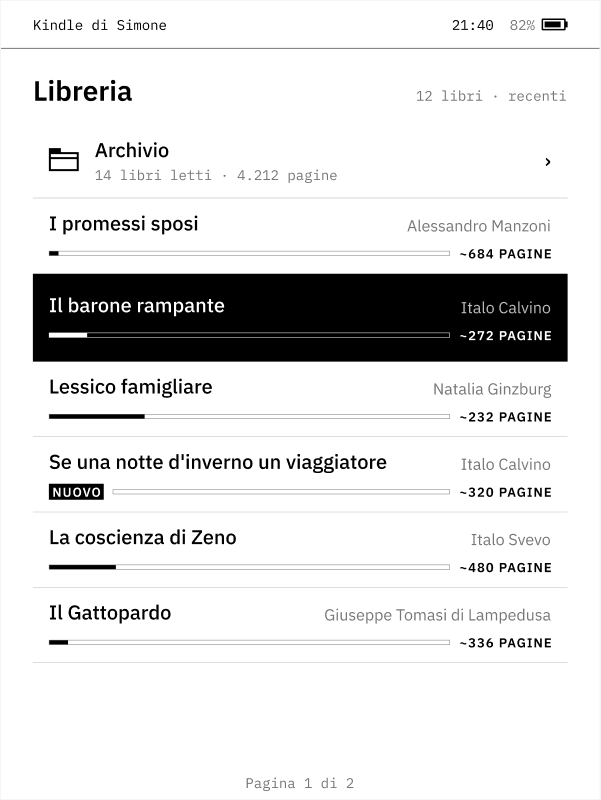
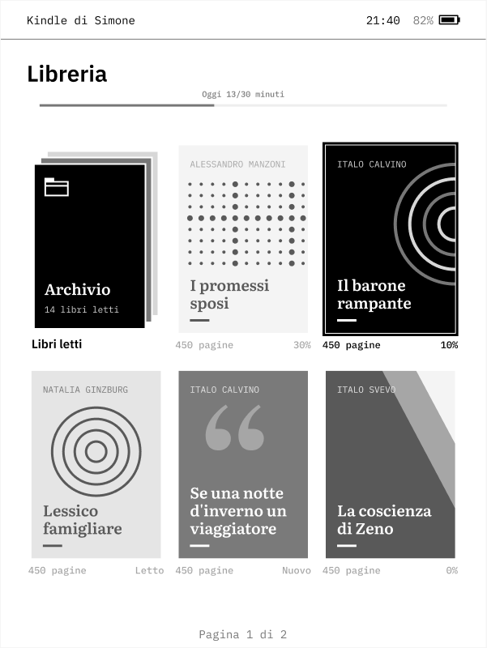
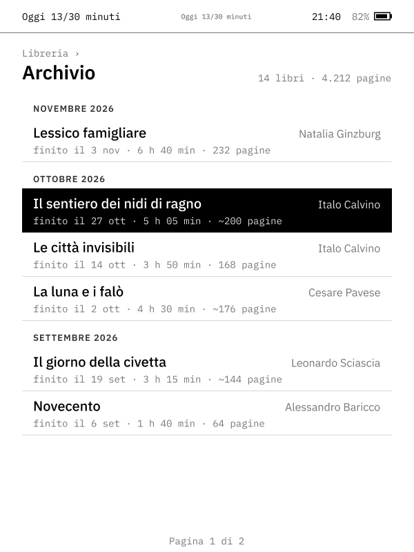
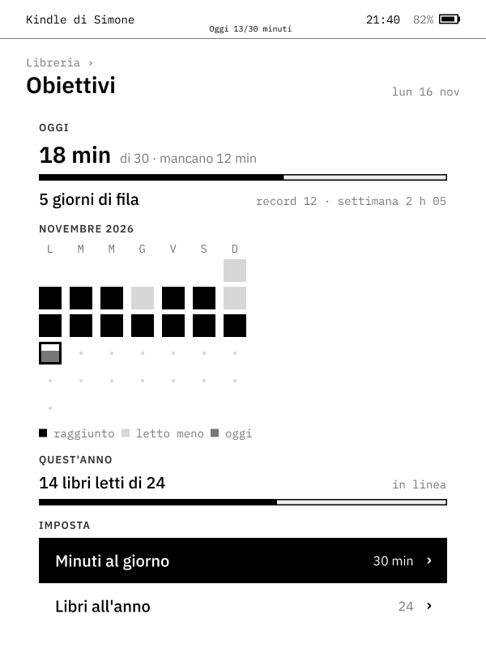
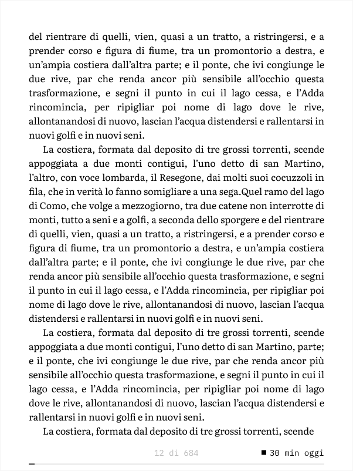
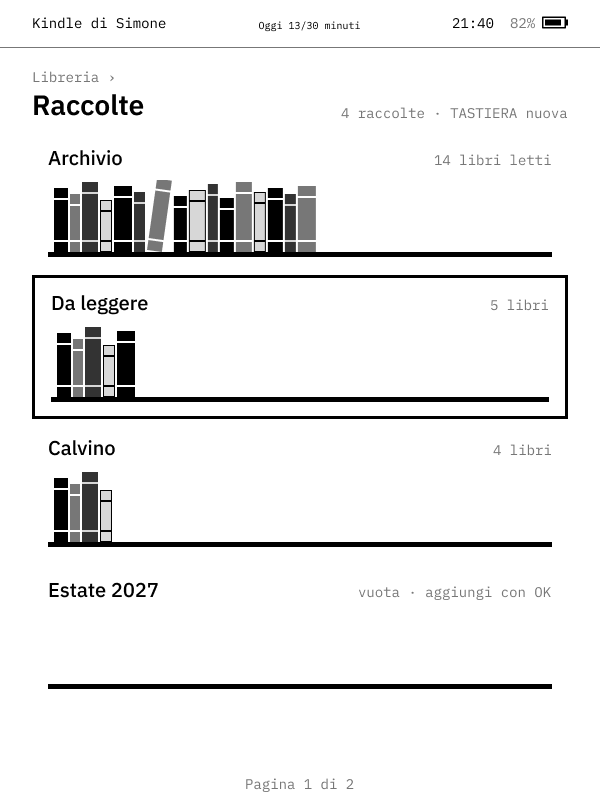
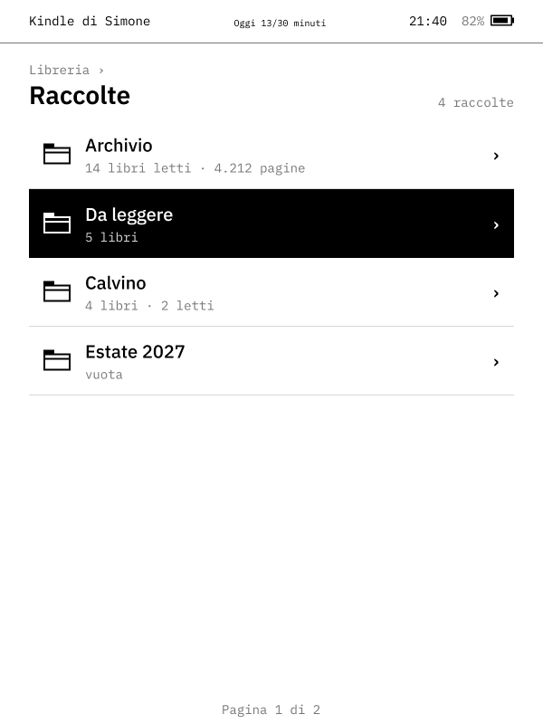

# 2026-11-16 · Archivio, raccolte e obiettivi di lettura

**Durata:** circa 12 minuti (12:31–12:43 UTC).
**Risultato:** cinque schermate nuove e una modificata nel file Figma
[Carbonella](https://www.figma.com/design/TD5USYE5DwkvWALoR821lL), costruite nello stile aggiornato da
Simone (barra "Kindle di Simone", righe più leggere, copertine non selezionate attenuate).

## Richieste di Simone

1. Tracciare il tempo passato a leggere per fissare degli obiettivi, e una pagina dedicata.
2. Un **Archivio** dei libri già letti, come prima cartella della libreria.
3. **Raccolte** di libri create a mano: scaffali che si riempiono o cartelle?

## Archivio

- Nella libreria a elenco la prima riga è ora la cartella **Archivio** ("14 libri letti · 4.212 pagine").
- Nella vista a copertine la prima cella è una pila di copertine con l'icona della cartella. Per farle
  posto, *Il Gattopardo* scivola alla pagina 2.
- La schermata **05 · Archivio** elenca i libri finiti divisi per mese, con data di fine, tempo totale
  di lettura e pagine cartacee.

| Elenco | Copertine | Archivio |
|---|---|---|
|  |  |  |

## Obiettivi

Come si misura il tempo: conta solo quando la pagina di lettura è aperta, e si ferma se il Kindle va
in standby o se non si gira pagina per qualche minuto. Così il tempo è "vero".

Dove stanno le informazioni:

- **Libreria:** la riga sottile "Oggi 13/30 minuti" in alto (l'ha già messa Simone).
- **06 · Obiettivi** (dal menu della libreria): minuti di oggi con barra, giorni di fila e record,
  calendario del mese (quadrato nero = obiettivo raggiunto, grigio = letto meno, oggi riempito a metà),
  libri dell'anno e le due impostazioni (minuti al giorno, libri all'anno).
- **Lettura:** nel piede compare "■ 30 min oggi" solo quando l'obiettivo è raggiunto, poi niente altro:
  durante la lettura non deve distrarre.

| Obiettivi | Lettura con obiettivo raggiunto |
|---|---|
|  |  |

## Raccolte: scaffali o cartelle

Ho disegnato entrambe le versioni per confrontarle.

- **07 · Raccolte (scaffali)**, quella che consiglio: ogni raccolta è una mensola, e ogni libro
  aggiunto è un dorso in più. Si capisce subito quanto è piena, rende bene in scala di grigi e lo
  scaffale vuoto invita a riempirlo. L'Archivio è il primo scaffale. La selezione è una cornice nera.
- **07b · Raccolte (cartelle)**: la stessa lista con le cartelle, più compatta ma meno espressiva.

| Scaffali | Cartelle |
|---|---|
|  |  |

## Componenti nuovi

- `Cartella` e `Cartella griglia` (Stato Normale/Focus)
- `Riga archivio` (Stato Normale/Focus; Titolo, Autore, Dettagli)
- `Dorso` (Tono Nero/Grafite/Cenere/Chiaro), ridimensionabile
- `Scaffale` (Stato Normale/Focus; Nome, Conteggio): contiene 16 dorsi, si nascondono quelli in più

## Intoppi

- La barra di stato della libreria non è più un'istanza (Simone l'ha staccata): nelle nuove schermate
  ho usato una copia della sua versione.
- Il segno ✓ non esiste in IBM Plex Mono e veniva sostituito da un √: nel piede di lettura ho usato un
  quadratino nero.
- Le voci di menu nella pagina Obiettivi mostravano di nuovo la doppia freccia: ho spento
  "Mostra Icona" su quelle istanze.

## Cose ancora aperte

- Scegliere tra scaffali e cartelle; se vincono gli scaffali, la riga "Archivio" della libreria può
  diventare "Raccolte".
- Nel lettore in C: salvare le sessioni di lettura (inizio, fine, libro) in un piccolo file sul Kindle.
