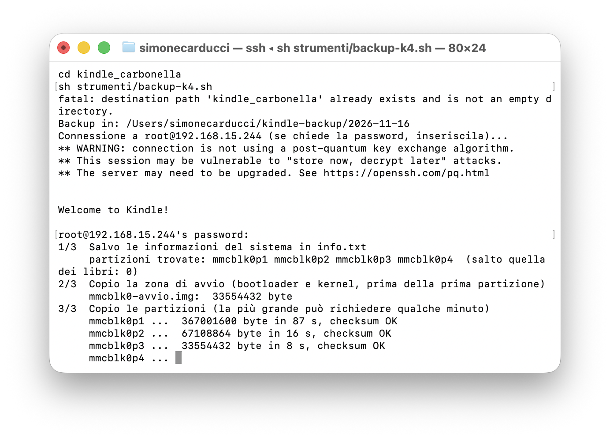
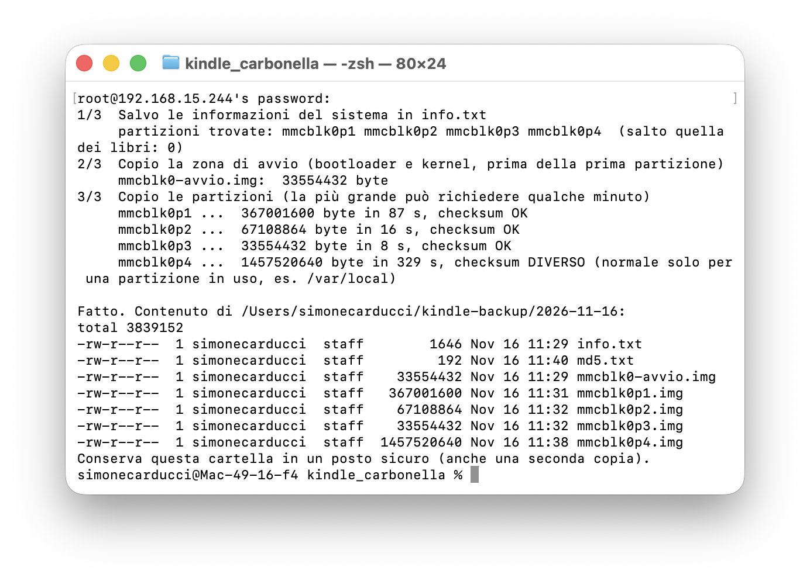

# 2026-11-16 · Backup delle partizioni del Kindle

**Stato:** ✅ completato alle 10:40 UTC. Backup completo del chip (circa 1,9 GB) in `~/kindle-backup/2026-11-16/` sul Mac di Simone.

## Perché

Ora che abbiamo il root via SSH, prima di far girare qualsiasi codice nostro salviamo un'immagine
del sistema. Se un giorno Carbonella rompesse qualcosa, questa è la copia da cui ripartire
(il recupero vero si fa con Kubrick, vedi `docs/jailbreak.md` §8).

## Cosa abbiamo preparato (10:08–10:20 UTC, circa 12 minuti)

- `strumenti/backup-k4.sh`: script per il Mac che, via SSH, copia:
  - la **zona di avvio** del chip di memoria (`/dev/mmcblk0` fino all'inizio della prima partizione:
    bootloader e kernel);
  - ogni **partizione di sistema** `mmcblk0pN`, saltando quella dei libri (`/mnt/base-us`);
  - `info.txt` con `uname`, `/proc/partitions`, `mount` e `df`;
  - `md5.txt` con i checksum, confrontati con quelli calcolati sul Kindle.
- Scelte:
  - lo script **legge soltanto** (`dd if=...`): sul Kindle non scrive niente;
  - una sola connessione SSH condivisa (`ControlMaster`), così la password si chiede una volta;
  - `bs=1048576` invece di `bs=1M`: la `busybox` del Kindle è vecchia e potrebbe non capire i suffissi;
  - le partizioni in uso in scrittura (es. `/var/local`) possono dare un checksum diverso: è normale.
- `docs/jailbreak.md` §7 aggiornato per usare lo script.

## Passi per Simone

1. Attiva USBNetwork sul Kindle (`;debugOn`, `~usbNetwork`, `;debugOff`) e verifica `ping 192.168.15.244`.
2. Nel Terminale del Mac, dalla cartella del repository: `sh strumenti/backup-k4.sh`
3. Inserisci la password di root quando la chiede.
4. Aspetta la fine (la partizione di sistema è qualche centinaio di MB: alcuni minuti).
5. Fai uno screenshot del Terminale e copia un'altra volta la cartella `~/kindle-backup/` (disco esterno o cloud).

## Risultato (10:29–10:40 UTC, circa 11 minuti)

Simone ha lanciato lo script dal Mac. Il `fatal: destination path 'kindle_carbonella' already exists`
in cima è solo il `git clone` ripetuto: il repository c'era già, nessun problema.

| Cosa | Dimensione | Tempo | Checksum |
|------|-----------:|------:|----------|
| zona di avvio (`mmcblk0-avvio.img`) | 32 MB (33 554 432 byte) | – | – |
| `mmcblk0p1` (sistema) | 350 MB (367 001 600 byte) | 87 s | OK |
| `mmcblk0p2` (`/var/local`) | 64 MB (67 108 864 byte) | 16 s | OK |
| `mmcblk0p3` | 32 MB (33 554 432 byte) | 8 s | OK |
| `mmcblk0p4` (libri) | 1,36 GB (1 457 520 640 byte) | 329 s | diverso (normale: partizione in uso) |

Velocità: circa **4 MB/s** via USB+SSH.

Cartella finale: `info.txt`, `md5.txt`, `mmcblk0-avvio.img`, `mmcblk0p1.img` … `mmcblk0p4.img`.
In pratica è un'immagine dell'intero chip da 2 GB, pezzo per pezzo. Gli orari nello screenshot sono
quelli del Mac (ora italiana, UTC+1).

### Sorpresa: la partizione dei libri non è stata saltata

Lo script cercava in `mount` la partizione montata su `/mnt/base-us`, ma sul K4 è montata (quasi certamente) tramite un
dispositivo *loop* (`/dev/loop/0`): lo script ha trovato "0" e ha copiato anche `mmcblk0p4`.
Non è un danno: è un backup più completo, ci mette solo qualche minuto in più, e il checksum di p4
può risultare diverso perché è in uso. Script corretto: se il nome non è `mmcblk0p*`, salta la
partizione più grande.

### Cose che restano

- Fare una seconda copia di `~/kindle-backup/2026-11-16/` (disco esterno o cloud).
- Confermare la causa della "sorpresa": in `info.txt`, la riga di `mount` con `/mnt/base-us`.
- Le immagini **non** vanno nel repository: sono grandi e contengono dati personali del Kindle.
