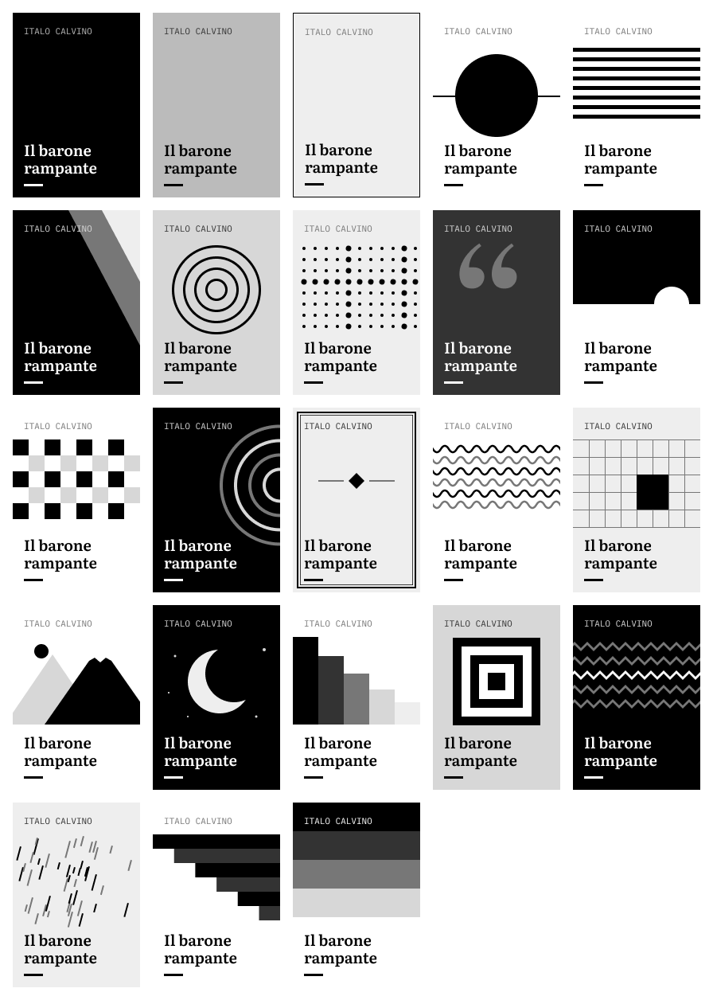

# 2026-11-16 · Altre dieci copertine

**Durata:** circa 3 minuti (11:54–11:57 UTC).
**Risultato:** il componente `Copertina` nel file Figma
[Carbonella](https://www.figma.com/design/TD5USYE5DwkvWALoR821lL) ha ora 23 stili (3 semplici e
20 grafici).

## I dieci stili nuovi

| Stile | Idea |
|---|---|
| Onde | linee ondulate alternate nere e grigie |
| Griglia | quadrettatura sottile con un quadrato nero pieno |
| Montagne | due montagne sovrapposte e un sole piccolo |
| Luna | falce di luna e qualche stella su fondo nero |
| Colonne | cinque colonne che scendono dal nero al grigio chiaro |
| Quadrati | quadrati concentrici bianchi e neri, effetto ipnotico |
| Zigzag | righe a zigzag, una bianca in mezzo |
| Pioggia | trattini inclinati sparsi (posizioni pseudo-casuali ma fisse) |
| Gradini | scala di blocchi neri e grafite |
| Fasce | quattro bande orizzontali dal nero al grigio chiaro |

Come prima, le forme stanno nel livello `Decoro` bloccato e i testi restano collegati alle proprietà
`Titolo` e `Autore` (questa volta li ho collegati subito, senza ripetere l'intoppo di prima).
Il set è ora una griglia di 5 colonne per 5 righe.

## Note

- Colonne e Fasce sono anche una prova pratica dei 16 grigi: sul Kindle vero si vedrà se le
  differenze tra Grafite, Cenere e Fumo restano distinguibili.
- Pioggia usa un generatore di numeri pseudo-casuali con un seme fisso: è lo stesso principio che
  useremo nel lettore per dare a ogni libro sempre la stessa copertina.
