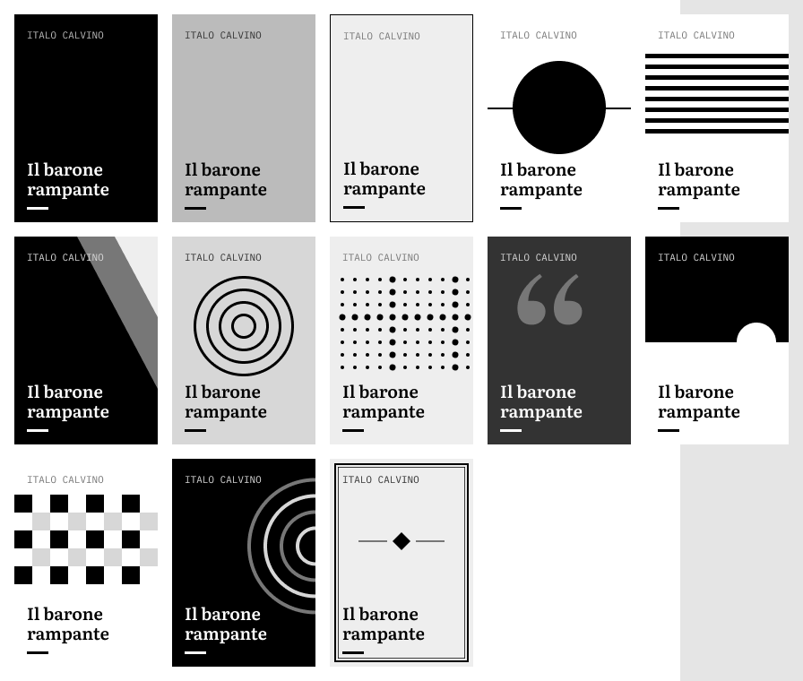
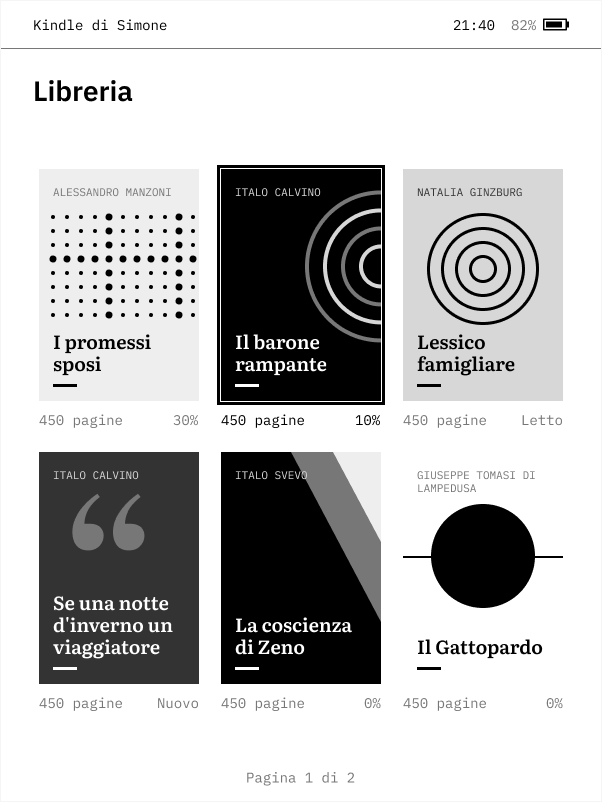

# 2026-11-16 · Dieci nuove copertine grafiche

**Durata:** circa 6 minuti (11:50–11:56 UTC).
**Risultato:** il componente `Copertina` nel file Figma
[Carbonella](https://www.figma.com/design/TD5USYE5DwkvWALoR821lL) ora ha 13 stili.

## Richiesta

Simone voleva altre dieci copertine, fatte con la palette di grigi del progetto, da assegnare a caso
ai libri.

## I dieci stili nuovi

Tutti usano solo i sei grigi del progetto e lasciano libera la parte bassa, dove stanno titolo e filetto.

| Stile | Idea |
|---|---|
| Sole | un disco nero sull'orizzonte |
| Righe | bande nere orizzontali, come una vecchia copertina tascabile |
| Diagonale | due triangoli grigi che tagliano l'angolo in alto a destra |
| Cerchi | cerchi concentrici neri su grigio |
| Punti | griglia di punti di grandezza variabile |
| Virgolette | una grande virgoletta in Literata |
| Metà | metà superiore nera con un semicerchio bianco |
| Scacchi | scacchiera nera e grigia |
| Archi | archi concentrici che entrano dal bordo destro |
| Cornice | doppia cornice con un rombo, stile classico |

## Come funziona

- La proprietà della variante si chiama ora **`Stile`** (prima era `Tono`): i vecchi Scuro, Medio e
  Chiaro restano.
- Ogni stile ha un livello `Decoro` bloccato sotto i testi, così modificando titolo o autore non si
  spostano le forme per sbaglio. Per ritoccare un decoro basta sbloccarlo.
- Nella schermata *01b · Libreria con copertine* ho assegnato gli stili a caso (estratti con un
  rimescolamento casuale): Punti, Archi, Cerchi, Virgolette, Diagonale, Sole.
- Nel lettore vero la scelta sarà "casuale ma stabile": lo stile si ricava da un numero calcolato dal
  titolo, così lo stesso libro ha sempre la stessa copertina.

## Intoppi

- Le varianti nuove sono copie della variante Chiaro, ma la copia ha perso il collegamento tra i testi e
  le proprietà `Titolo` e `Autore`: cambiando stile tutte le copertine tornavano a "Il barone rampante".
  Ho ricollegato i testi e rimesso titolo e autore dei sei libri.
- Nella prima versione di Diagonale e Archi le forme coprivano il nome dell'autore: le ho spostate.
