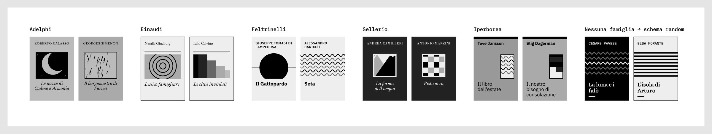

# 16 novembre 2026 · Copertine per famiglia editoriale

Tempo: circa 25 minuti (14:50–15:15).

## L'idea

Simone: "come facciamo ad assicurarci che le copertine non si ripetano? Non puoi stilizzare le varie copertine esistenti, tipo Adelphi, Feltrinelli eccetera, poi cercare l'edizione del libro e stilizzare la copertina?" E poi: "se non compare la famiglia usiamo uno schema libro random".

Con 23 schemi generici, già con 30-40 libri le copertine si ripetono. Le collane italiane invece hanno una "grammatica" riconoscibile: impaginazione, tipo di carattere, cornice, posizione dell'immagine. L'idea è riprendere quella grammatica in bianco e nero, **senza copiare loghi, marchi o illustrazioni**: le immagini restano i nostri motivi (Decoro del componente Copertina).

Prima di iniziare ho salvato tutte le 23 copertine e la card Raccolte in Evoluzione ("14:50 · Copertine prima delle famiglie editoriali").

## Le famiglie (sezione Figma "Copertine · famiglie editoriali")

| Famiglia | Fondo | Immagine | Autore | Titolo |
|---|---|---|---|---|
| Adelphi | tinta unita media (Velo, Fumo, Smog) | riquadro centrale con filo 1px | Libre Baskerville maiuscolo spaziato, centrato | Libre Baskerville corsivo, centrato |
| Einaudi | Carta con bordo 1px | sotto un filo nero, larghezza piena | EB Garamond, a sinistra | EB Garamond corsivo grande |
| Feltrinelli | immagine a pieno formato | tutta la copertina | Plex Sans SemiBold maiuscolo su fascia Carta | Plex Sans Bold su fascia Carta |
| Sellerio | Grafite (al posto del blu scuro) | quadrato piccolo con passe-partout Carta | Libre Bodoni maiuscolo spaziato, centrato | Libre Bodoni corsivo, centrato |
| Iperborea | tinta unita (Smog, Fumo) con barra nera in alto | striscia verticale a destra | Plex Sans Bold | Plex Sans Regular grande |
| Nessuna famiglia | uno dei 23 schemi Copertina, scelto a caso | – | – | – |

**Le posizioni restano fisse anche tra le famiglie.** L'autore sta sempre nella fascia alta (da 16px, i primi 56px sono riservati) e il titolo parte sempre da 161px. Le famiglie cambiano carattere, allineamento, fondo e immagine, mai il punto in cui si trovano autore e titolo.

## Regole per il Kindle (da implementare)

1. **Editore:** si legge `dc:publisher` dall'OPF dell'EPUB. Se manca, si usa il prefisso editore dell'ISBN (`dc:identifier`): per esempio 978-88-459 → Adelphi, 978-88-06 → Einaudi, 978-88-07 → Feltrinelli, 978-88-389 → Sellerio, 978-88-7091 → Iperborea. La tabella dei prefissi va verificata e salvata in un file di configurazione.
2. Se non si trova l'editore si fa una ricerca dell'ISBN (Open Library), **una volta sola e solo dal computer**, durante il trasferimento dei libri. Il Kindle non va in rete.
3. **Famiglia:** l'editore viene associato a una famiglia. Se non c'è una famiglia → schema random tra i 23 della Copertina (regola di Simone).
4. **Niente ripetizioni:** i dettagli vengono da un hash (per esempio FNV-1a) di ISBN + titolo:
   - bit 0-4 → motivo dell'immagine (23 Decoro)
   - bit 5-6 → tono di fondo, scelto fra quelli ammessi dalla famiglia
   - bit 7-9 → piccolo spostamento o ritaglio del motivo dentro il riquadro
   È "random" ma stabile: lo stesso libro ha sempre la stessa copertina. Due libri vicini nella griglia con lo stesso motivo? Si passa al motivo successivo.
5. Le copertine scure o medie non hanno bordo. Quelle su Carta hanno sempre il bordo da 1px.

## Font

Libre Baskerville, EB Garamond e Libre Bodoni sono OFL, quindi si possono mettere sul Kindle insieme a Literata e IBM Plex. Bisogna verificare quanto pesano e come rende il carattere sottile del Bodoni sull'e-ink.

