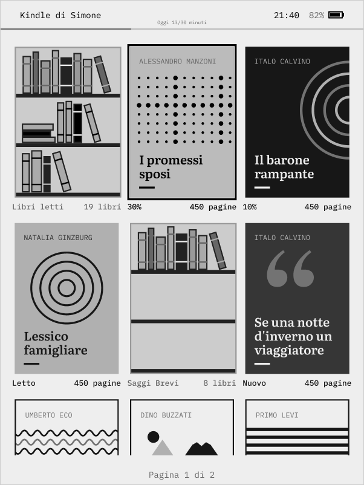
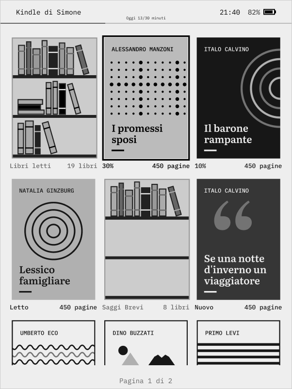
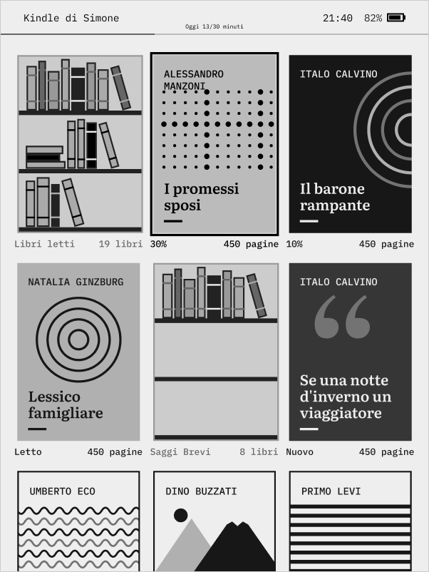
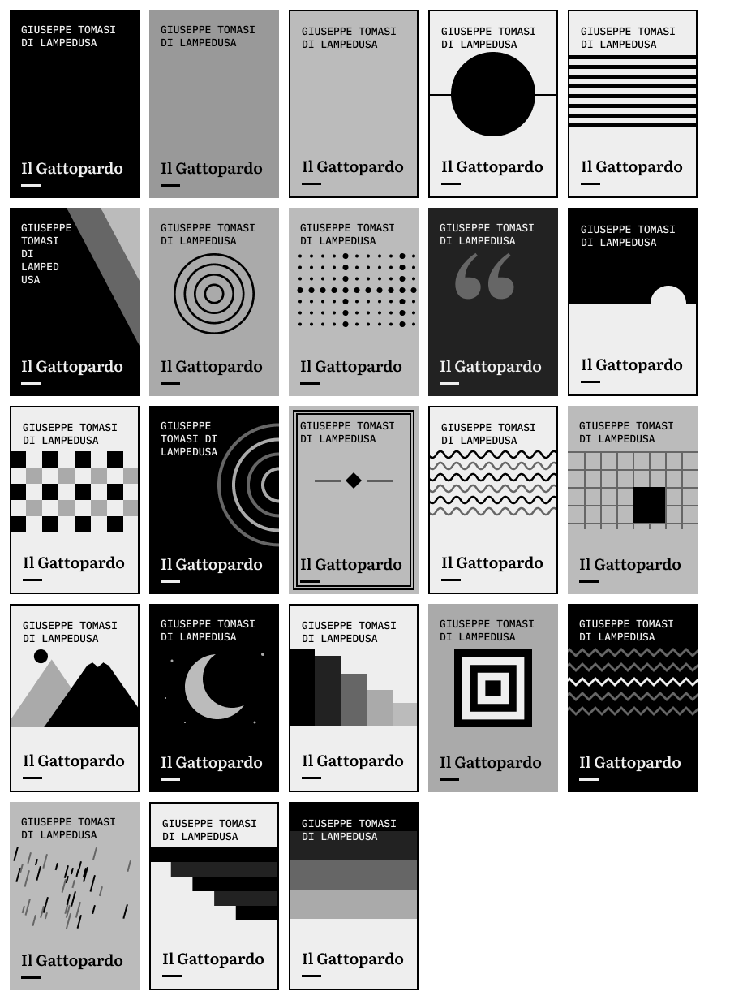
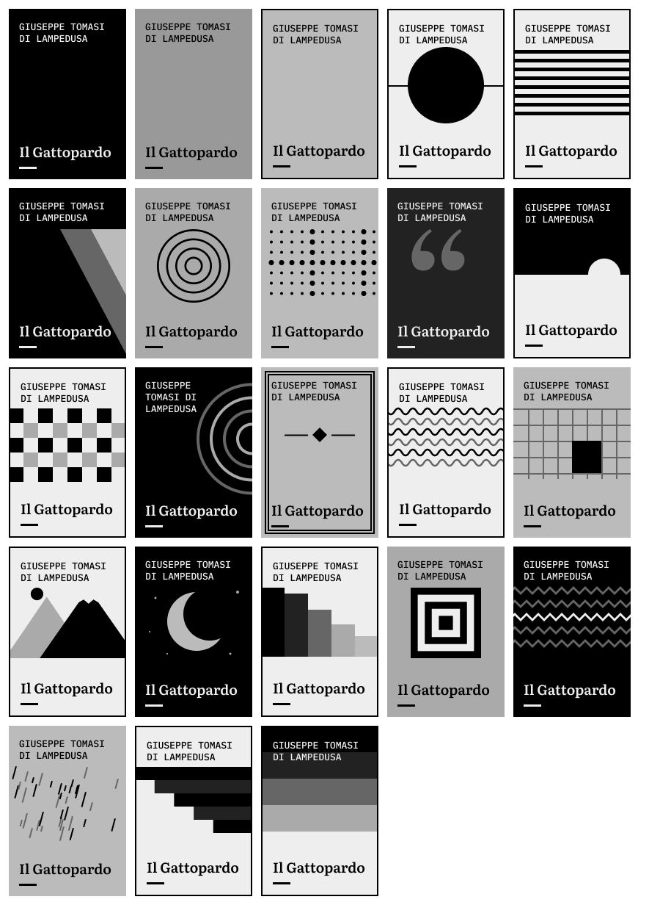

# 2026-11-16 · Correzioni dopo la prima prova sul Kindle

**Durata:** circa 10 minuti (13:56–14:05 UTC).
**Risultato:** palette più scura, linee a 2 px e home con 12 card invece di 6 nel file Figma
[Carbonella](https://www.figma.com/design/TD5USYE5DwkvWALoR821lL). La prova sul dispositivo è
documentata nel diario dell'altro filone di lavoro (`2026-11-16-prova-design-kindle.md`).

## Cosa ha detto Simone guardando il Kindle

- "I grigi chiari spariscono", "#FFFFFF non esiste, spostiamo tutto a toni leggermente più scuri".
- "Le linee da un px si vedono ma preferirei ingrandirle".
- "Il testo è abbastanza nitido".
- "6 libri sono pochi, c'è tanto spazio da poter usare ancora".
- Testo di lettura: da 16 a 18 px.

## Cosa ho cambiato

**Palette (stili colore):** ogni grigio scende di uno o più gradini della scala a 16 livelli, e il bianco
puro sparisce.

| Stile | Prima | Dopo |
|---|---|---|
| Inchiostro | G0 `#000` | G0 `#000` |
| Grafite | G3 `#333` | G2 `#222` |
| Cenere | G7 `#777` | G6 `#666` |
| Smog | G11 `#BBB` | G9 `#999` |
| Fumo | G13 `#D7D7D7` | G10 `#AAA` |
| Velo | G14 `#EEE` | G11 `#BBB` |
| Leggero | G15 `#F5F5F5` | G12 `#CCC` |
| Carta | G16 `#FFF` | G14 `#EEE` |

**Card non selezionate:** erano al 65–75% di opacità, che di fatto schiariva ogni grigio (le didascalie
"450 pagine" e "Libri letti" diventavano quasi bianche). Ora sono al 100%; la selezione resta la cornice nera.

**Linee:** tutti i bordi sotto i 2 px (copertine chiare, dorsi, icona batteria, scaffali) e le righe da 1 px
(barra sotto l'intestazione, motivi delle copertine Righe e Griglia) sono ora di 2 px.

**Home 4×3:** la griglia passa da 3×2 a 4 colonne × 3 righe, card da 131×201 (scala 0,78). Il nome
dell'autore sulle copertine è a 9 px e le righe sotto le card a 11 px. Ho aggiunto sei libri d'esempio
per riempirla. La vecchia versione è salvata accanto come *00 · Home 3×2 (prima del test su Kindle)*.

**Lettura:** l'unica schermata con il testo a 16 px è passata a 18 come le altre.

## Intoppi

- La foto del Kindle era in HEIC e qui non si riesce a convertirla, quindi ho lavorato sulle note di Simone.
- Per sbaglio ho portato lo stile `Lettura/Corpo` da 20 a 18; me ne sono accorto subito (il 16 era un
  testo nella schermata, non lo stile) e l'ho rimesso a 20.
- Mentre finivo, Simone ha cominciato a scurire le schermate a mano: mi sono fermato per non
  sovrapporre le modifiche.

## Cose ancora aperte

- Rifare la prova sul Kindle con la nuova palette e la home 4×3.
- Verificare se le copertine con fondo "Carta" (ora `#EEE`, come la pagina) hanno bisogno di un bordo.

## Bordo sulle copertine color carta (14:12 UTC, circa 3 minuti)

Regola di Simone: "se lo sfondo diventa carta, tutti i libri con sfondo carta devono avere almeno 1 px di
bordo". Le nove varianti di `Copertina` con fondo Carta (Sole, Righe, Metà, Scacchi, Onde, Montagne,
Colonne, Gradini, Fasce) hanno ora un bordo interno di 2 px in Inchiostro, come la variante Chiaro.
Essendo nel componente, vale in tutte le schermate, compresa la nuova *00 · Home 3 colonne (scorrimento)*
di Simone. Nessuna istanza aveva il fondo sovrascritto a Carta, quindi non c'era altro da correggere.

## Autore più leggibile (14:13 UTC, circa 4 minuti)

Simone sul Kindle: "non si legge molto bene l'autore, più contrasto". L'autore era in grigio medio
(Cenere, Fumo o Smog) e con peso Regular.

- Lo stile `Copertina/Autore` passa da IBM Plex Mono Regular a **Medium**.
- In tutte le 23 varianti di `Copertina` l'autore è ora **nero** sulle copertine chiare e **color carta**
  su quelle scure (Scuro, Diagonale, Virgolette, Archi, Luna, Zigzag, e la parte alta nera di Metà e Fasce).
- Nella home 4×3, dove l'autore era a 9 px, l'ho portato a 10 px.

Intoppo: con la prima regola (colore in base al fondo della copertina) in Metà e Fasce l'autore era nero
sulla fascia nera in alto; li ho corretti a mano.

## Autore più grande (14:16 UTC, circa 3 minuti)

Simone: "nomi degli autori più grandi". Lo stile `Copertina/Autore` passa da 11 a **13 px** (interlinea 120%).
Nella home 4×3, dove le copertine sono più piccole (125 px), l'autore è a 11 px.

Nota: i nomi lunghi ora vanno su due righe ("ALESSANDRO / MANZONI") e su alcune copertine, come Punti,
la seconda riga tocca il disegno.

## Regola: l'autore può andare a capo e non deve mai toccare il disegno (14:18 UTC, circa 8 minuti)

Simone: "alcuni nomi autori vanno a capo, ricorda questa cosa nei design, fai in modo che non vadano sopra".

**Regola di design (vale per tutte le copertine, anche quelle future):** i primi **56 px** in alto della
copertina sono riservati all'autore, che deve poter stare su due righe (13 px, interlinea 120%). Lì
possono esserci solo fondi pieni (Metà, Fasce, Cornice), mai il disegno. Il disegno sta tra 56 e
circa 152 px, sopra il titolo.

Cosa ho cambiato nelle 23 varianti di `Copertina`:

- **Spostati in basso:** Righe, Punti, Scacchi, Onde, Griglia, Luna, Zigzag, Gradini, Virgolette e le
  fasce della Diagonale. Dove il motivo finiva sul titolo ho nascosto l'ultima fila o accorciato le linee.
- **Rimpiccioliti** per stare nello spazio: Cerchi (89%), Quadrati (87%), Montagne (95%).
- **Colonne:** la colonna più alta parte da 56 px. **Pioggia:** tolte le gocce nella zona dell'autore.
- **Archi:** l'autore è stretto a 72 px, così va a capo prima degli archi sul lato destro.
- Sole, Metà, Fasce, Cornice e le tinte piatte non avevano bisogno di modifiche.

Per controllare ho messo tutte le varianti con "GIUSEPPE TOMASI DI LAMPEDUSA" in un foglio di prova
(poi cancellato). Nella prima prova anche la Diagonale aveva l'autore stretto, ma spezzava le parole
("LAMPED / USA"): ho spostato le fasce invece di stringere il testo.

| Prima prova | Versione finale |
|---|---|
|  |  |
