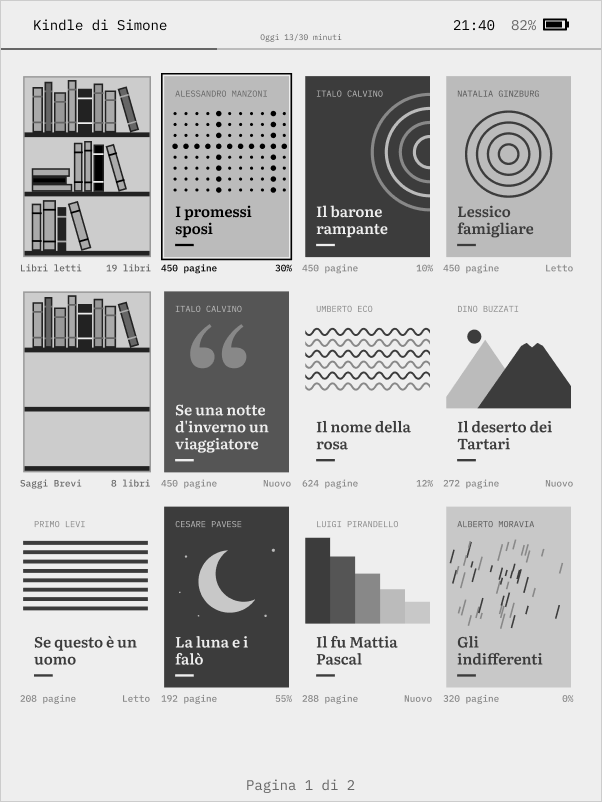

# 2026-11-16 · Correzioni dopo la prima prova sul Kindle

**Durata:** circa 10 minuti (13:56–14:05 UTC).
**Risultato:** palette più scura, linee a 2 px e home con 12 card invece di 6 nel file Figma
[Carbonella](https://www.figma.com/design/TD5USYE5DwkvWALoR821lL). La prova sul dispositivo è
documentata nel diario dell'altro filone di lavoro (`2026-11-16-prova-design-kindle.md`).

## Cosa ha detto Simone guardando il Kindle

- "I grigi chiari spariscono", "#FFFFFF non esiste, spostiamo tutto a toni leggermente più scuri".
- "Le linee da un px si vedono ma preferirei ingrandirle".
- "Il testo è abbastanza nitido".
- "6 libri sono pochi, c'è tanto spazio da poter usare ancora".
- Testo di lettura: da 16 a 18 px.

## Cosa ho cambiato

**Palette (stili colore):** ogni grigio scende di uno o più gradini della scala a 16 livelli, e il bianco
puro sparisce.

| Stile | Prima | Dopo |
|---|---|---|
| Inchiostro | G0 `#000` | G0 `#000` |
| Grafite | G3 `#333` | G2 `#222` |
| Cenere | G7 `#777` | G6 `#666` |
| Smog | G11 `#BBB` | G9 `#999` |
| Fumo | G13 `#D7D7D7` | G10 `#AAA` |
| Velo | G14 `#EEE` | G11 `#BBB` |
| Leggero | G15 `#F5F5F5` | G12 `#CCC` |
| Carta | G16 `#FFF` | G14 `#EEE` |

**Card non selezionate:** erano al 65–75% di opacità, che di fatto schiariva ogni grigio (le didascalie
"450 pagine" e "Libri letti" diventavano quasi bianche). Ora sono al 100%; la selezione resta la cornice nera.

**Linee:** tutti i bordi sotto i 2 px (copertine chiare, dorsi, icona batteria, scaffali) e le righe da 1 px
(barra sotto l'intestazione, motivi delle copertine Righe e Griglia) sono ora di 2 px.

**Home 4×3:** la griglia passa da 3×2 a 4 colonne × 3 righe, card da 131×201 (scala 0,78). Il nome
dell'autore sulle copertine è a 9 px e le righe sotto le card a 11 px. Ho aggiunto sei libri d'esempio
per riempirla. La vecchia versione è salvata accanto come *00 · Home 3×2 (prima del test su Kindle)*.

**Lettura:** l'unica schermata con il testo a 16 px è passata a 18 come le altre.

## Intoppi

- La foto del Kindle era in HEIC e qui non si riesce a convertirla, quindi ho lavorato sulle note di Simone.
- Per sbaglio ho portato lo stile `Lettura/Corpo` da 20 a 18; me ne sono accorto subito (il 16 era un
  testo nella schermata, non lo stile) e l'ho rimesso a 20.
- Mentre finivo, Simone ha cominciato a scurire le schermate a mano: mi sono fermato per non
  sovrapporre le modifiche.

## Cose ancora aperte

- Rifare la prova sul Kindle con la nuova palette e la home 4×3.
- Verificare se le copertine con fondo "Carta" (ora `#EEE`, come la pagina) hanno bisogno di un bordo.
