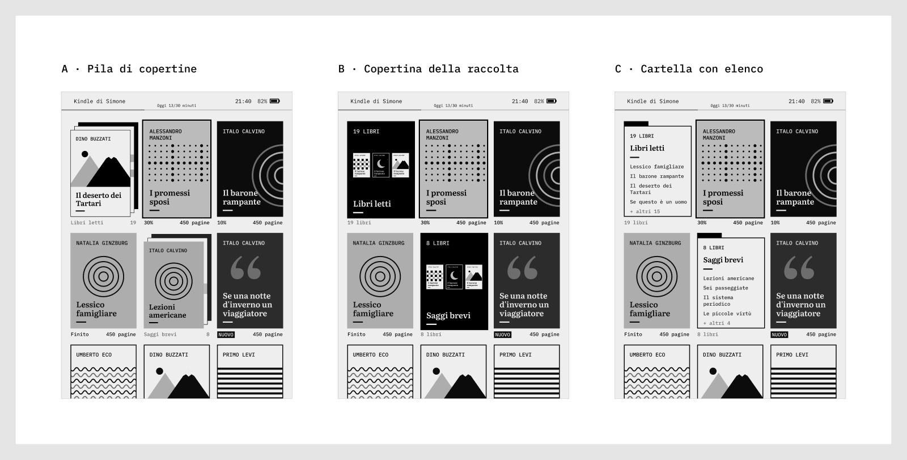

# 16 novembre 2026 · Evoluzione del design, copertine allineate, Obiettivi normalizzata

Tempo: circa 1 ora e 15 minuti (pomeriggio).

## Pagina "Evoluzione" su Figma

Simone ha chiesto di poter versionare tutto e recuperare i modelli cancellati, per avere la storia del design dentro Figma.

- Nuova pagina **Evoluzione** nel file Carbonella, con un unico frame verticale in ordine cronologico.
- In cima c'è il blocco **"Da recuperare · Versioni cancellate (cronologia di Figma)"**: quattro riquadri grigi vuoti. Le versioni vecchie non si possono ripristinare via API, quindi vanno riprese a mano dalla cronologia delle versioni di Figma (File → Mostra cronologia versioni → copia → incolla nel riquadro).
- Sotto, 11 passaggi datati (dalle 02:06 alle 14:20) con le 41 immagini già presenti in `diario/img/`, così la storia è visibile anche senza aprire il repo.
- **Regola nuova:** prima di ogni modifica importante si copia lo stato attuale delle schermate coinvolte in Evoluzione (copie "staccate" dai componenti, così non cambiano più). Il primo snapshot è "14:25 · Stato prima di normalizzare Obiettivi".

## Bordo delle copertine chiare: 1px

Simone: "intorno ai libri chiari metti solo 1px basta e avanza". Le copertine con fondo Carta o Chiaro hanno ora un bordo Inchiostro da **1px**. È l'unica eccezione alla regola delle linee da almeno 2px: il bordo serve solo a staccare la copertina dallo sfondo, e 1px nero su Carta si vede.

## Autore e titolo sempre nello stesso punto

Simone: "in ogni copertina autore nello stesso punto e titolo libro nello stesso punto".

- Il bordo spingeva il contenuto di 1-2px nelle varianti chiare: in tutte le varianti del componente `Copertina` il bordo non occupa più spazio nel layout (`strokesIncludedInLayout = false`).
- Risultato: autore sempre a 14,16 (larghezza 132), titolo sempre allo stesso punto in basso, su tutte le 23 varianti.
- La variante **Archi** aveva l'autore stretto per non toccare gli archi: riportato a larghezza piena e archi spostati in basso di circa 35px, dentro la fascia riservata all'illustrazione (56–152).

## 06 · Obiettivi normalizzata

Simone: "la pagina degli obiettivi va normalizzata in base ai design precedenti". Riferimento: la schermata Impostazioni.

- **Intestazione** uguale a Impostazioni: titolo a 32px dal bordo, stesso spazio sopra e sotto. Nascosto il percorso "Libreria ›" (le altre schermate non ce l'hanno; si può riattivare).
- **Margini** a 32px come nelle altre schermate (prima 48).
- **Sezioni** riorganizzate in gruppi come in Impostazioni (Oggi, Calendario, Quest'anno, Imposta): etichetta di sezione rientrata di 20px, contenuto allineato al testo delle voci menu.
- **Grigi chiari eliminati:** la parte vuota delle barre era Velo (sparisce sul Kindle) → ora Carta con bordo nero 2px; i giorni "letto meno" del calendario da Fumo a Cenere; nella legenda "oggi" è un quadrato vuoto con bordo, come nel calendario.
- **Calendario** con quadrati da 24px (prima 28) per far stare tutto in una pagina.
- **Footer** con la legenda tasti, come Impostazioni pagina 1.
- Le voci "Imposta" ora occupano tutta la larghezza come le voci menu delle altre schermate.

## Cosa resta da disegnare

- Indice del libro e lista dei segnalibri
- Vai a pagina (tastierino col pad a 5 vie)
- Cerca, con tastiera a schermo
- Dentro una raccolta o uno scaffale
- Dettaglio libro (copertina grande, info, azioni)
- Schermo di sospensione / spegnimento, batteria scarica
- Trasferimento libri (USB / Wi‑Fi)
- 05 · Archivio da riallineare al nuovo stile, come appena fatto con Obiettivi

## Raccolte: tre proposte (14:45)

Simone: "rimane aperta la questione raccolte, non mi fanno impazzire". Lo scaffale attuale in Home resta salvato in Evoluzione (snapshot 14:25, e le vecchie 07/07b come immagini). Nuova sezione Figma **"Raccolte · proposte"**, accanto alle schermate: la stessa Home con le due raccolte (Libri letti 19, Saggi brevi 8) disegnate in tre modi.

- **A · Pila di copertine:** le prime tre copertine della raccolta impilate, sfalsate di 10px. Si capisce subito cosa c'è dentro; nome e numero restano nella riga sotto.
- **B · Copertina della raccolta:** una copertina scura del sistema Copertina, con "19 LIBRI" al posto dell'autore, il nome al posto del titolo e tre miniature nella fascia illustrazione. Autore e titolo restano nella stessa posizione delle altre copertine.
- **C · Cartella con elenco:** cartella con linguetta, numero, nome in Literata e i primi titoli in elenco con "+ altri N". È la più leggibile su e-ink, ma è anche la più diversa dalle copertine.

