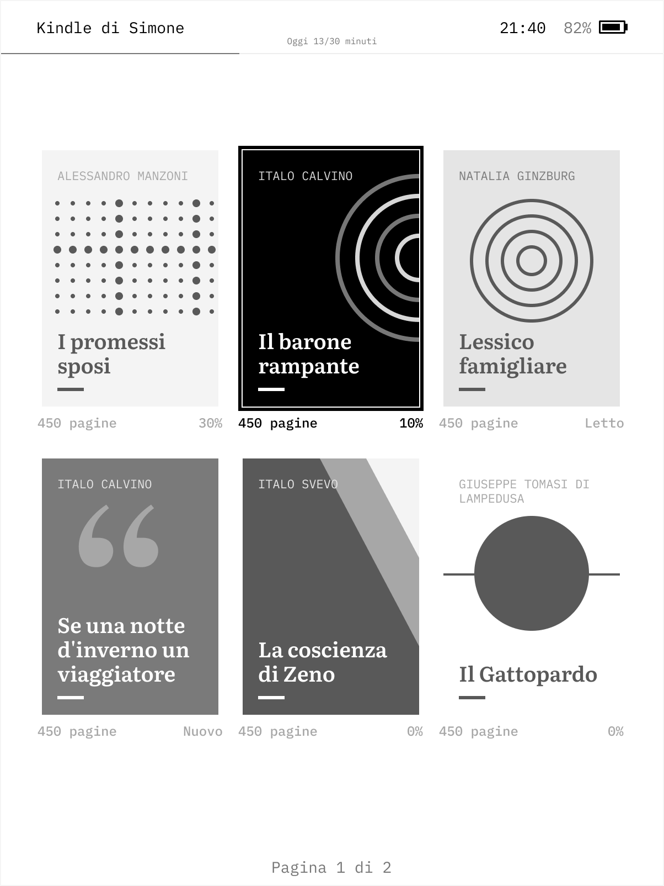
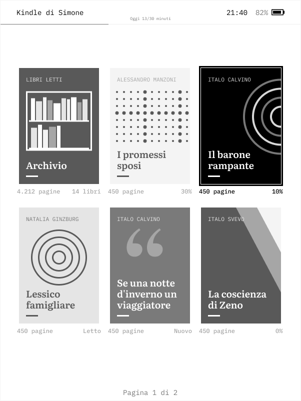
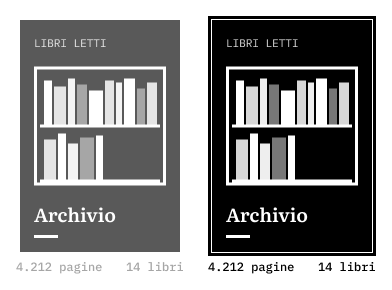
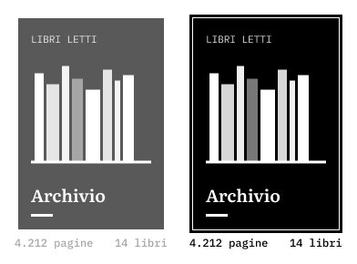
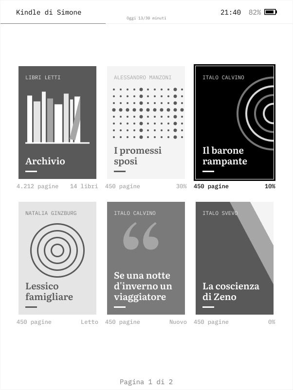

# 2026-11-16 · Home di partenza e Archivio grande come un libro

**Durata:** circa 12 minuti (12:44–12:52 UTC, più 4 minuti alle 12:50 per lo scaffale).
**Risultato:** la libreria a copertine di Simone diventa la schermata di partenza
(*00 · Home (landing)* nel file Figma [Carbonella](https://www.figma.com/design/TD5USYE5DwkvWALoR821lL)),
con l'Archivio come prima card della griglia.

## Richieste di Simone

1. "Non mi fa impazzire come ci sta, forse lo vorrei della stessa dimensione delle card dei libri così
   me lo metto lì": la vecchia cella dell'Archivio (pila di copertine con icona cartella) non convinceva.
2. "Usiamo questa come landing base", con lo screenshot della sua libreria a copertine con la riga
   "Oggi 13/30 minuti" in alto.

## Cosa ho fatto

- Ho rifatto il componente `Cartella griglia` con **la stessa struttura di `Libro griglia`**: 168×258,
  cornice con 4 px di margine, "copertina" da 160×232 e sotto la riga di informazioni nello stesso
  carattere (IBM Plex Mono 12). Le card non selezionate sono attenuate come i libri; la selezione è la
  stessa cornice nera di 3 px.
- La copertina dell'Archivio è nera, con in alto "LIBRI LETTI", al centro un piccolo scaffale con
  **due mensole** (quella in alto piena, quella in basso a metà, che si riempie man mano) e in basso il
  titolo *Archivio* con il filetto, come le copertine dei libri. Sotto:
  `4.212 pagine` a sinistra e `14 libri` a destra.
- Proprietà del componente: `Nome`, `Pagine`, `Dettagli`, `Stato`. Si può riusare per qualunque
  raccolta (basta cambiare il nome).
- La schermata *01b · Libreria con copertine 01* è stata rinominata **00 · Home (landing)** ed è la base.
  L'Archivio è la prima card; *Il Gattopardo* è nascosto (non cancellato) e passa a pagina 2.

| Home | Componente (normale / selezionato) |
|---|---|
|  |  |

## Seconda versione: due mensole

Simone: "non mi piace, fallo come fossero due mensole di uno scaffale". La prima versione aveva una sola
mensola con i dorsi alti, sembrava più un grafico a barre che una libreria. Ora c'è il mobile intero:
bordo bianco, due ripiani, dieci libri sopra e cinque sotto.

## Intoppi

- Nella prima versione c'era un nono dorso inclinato appoggiato agli altri: con la rotazione si
  sovrapponeva al libro accanto e sembrava un errore. L'ho tolto.

## Cose ancora aperte

- Se le raccolte diventano scaffali, le altre raccolte possono usare la stessa card dopo l'Archivio.
- Nel lettore in C la home a copertine è la schermata che si apre all'accensione.
