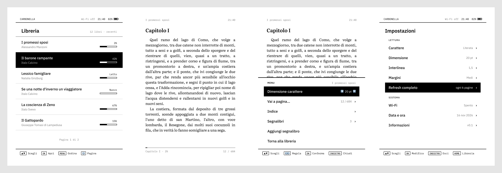
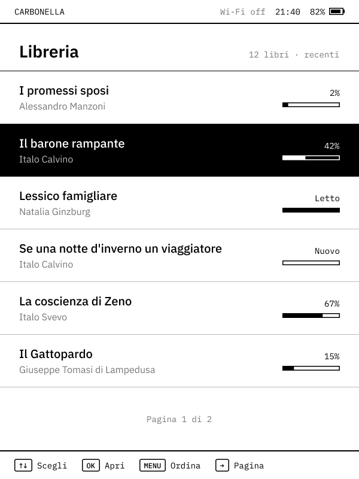
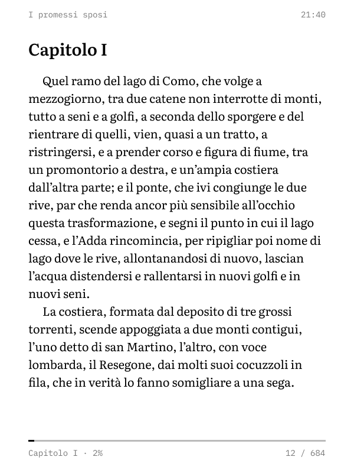
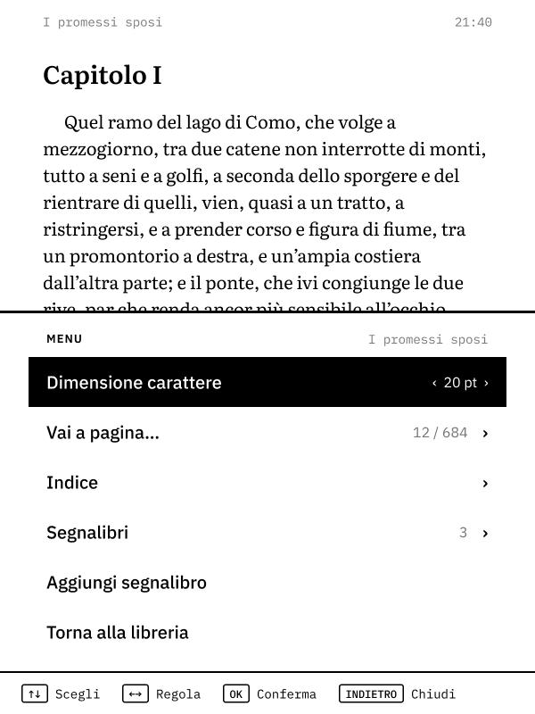
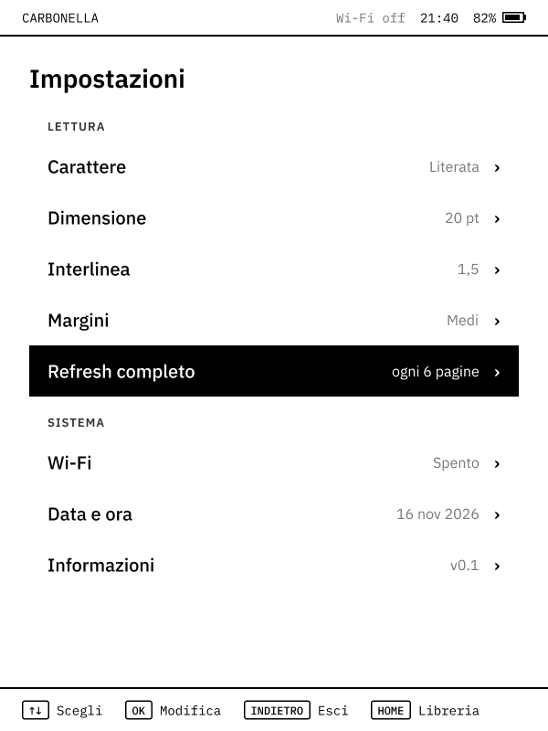
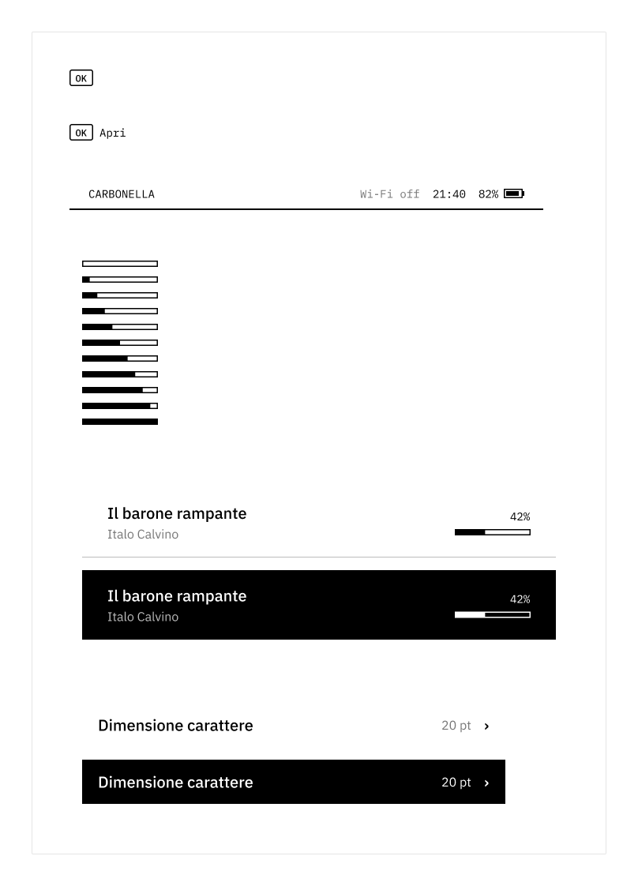

# 2026-11-16 · Prima interfaccia di Carbonella in Figma

**Durata:** circa 10 minuti di lavoro effettivo. Iniziato alle 00:29 UTC, poi la sessione si è interrotta
per un errore tecnico ed è ripartita alle 02:01 UTC; schermate finite alle 02:06 UTC.
**Risultato:** file Figma [Carbonella](https://www.figma.com/design/TD5USYE5DwkvWALoR821lL), con
componenti modificabili e quattro schermate a 600×800.

## Punto di partenza

Simone voleva un file Figma su cui giocare per decidere l'aspetto di Carbonella prima di scrivere il
codice. Vincoli del Kindle 4: schermo e-ink 600×800, 16 livelli di grigio, nessun touch (pad a 5
direzioni, Home, Menu, Indietro, Tastiera, tasti pagina laterali).

## Scelte di design

- **Formato:** frame da 600×800, cioè un pixel di Figma per ogni pixel dello schermo. Gli export a 1×
  mostrano esattamente quello che vedremo sul Kindle (a parte la resa della carta).
- **Colori:** sei stili di colore presi dalla scala a 16 grigi del Kindle (passo `#11`):
  Inchiostro G0 `#000`, Grafite G3 `#333`, Cenere G7 `#777`, Fumo G11 `#BBB`, Velo G14 `#EEE`,
  Carta G15 `#FFF`. Niente sfumature e niente trasparenze, che sull'e-ink diventano retinature sporche.
- **Selezione (focus):** riga invertita, nero pieno con testo bianco. Sul Kindle originale la selezione
  è una sottolineatura sottile, che si vede poco; il nero pieno si legge da lontano e si ridisegna bene
  con un refresh parziale.
- **Caratteri:**
  - *Literata* per il testo dei libri: è stato disegnato da Google proprio per la lettura su schermo e
    regge bene le dimensioni piccole.
  - *IBM Plex Sans* per menu e titoli dell'interfaccia.
  - *IBM Plex Mono* per barra di stato, numeri di pagina e tasti, così le cifre non "ballano".
  - Tutti e tre sono open source (licenza OFL), quindi li possiamo includere nel lettore.
- **Legenda dei tasti:** in fondo a ogni schermata c'è una barra con i tasti fisici e cosa fanno lì
  (ad esempio `OK Apri`, `MENU Ordina`). Senza touch è il modo più semplice per non perdersi.
- **Lettura:** pagina quasi vuota di interfaccia. In alto titolo e ora in grigio, in basso capitolo,
  pagina e una linea di avanzamento. Margini di 48 px, corpo 20 pt, interlinea 1,5.
  Prima avevo giustificato il testo, ma senza sillabazione lasciava buchi grandi tra le parole: per ora
  è allineato a sinistra. Quando avremo la sillabazione nel motore di impaginazione si può riprovare.
- **Menu nel libro:** pannello che sale dal basso con bordo nero spesso, senza oscurare la pagina
  (l'oscuramento sarebbe un grigio che costa un refresh completo). La dimensione del carattere si
  regola con ← → direttamente sulla voce selezionata.
- **Impostazioni:** c'è già la voce *Refresh completo ogni N pagine*, perché sull'e-ink i refresh
  parziali lasciano "fantasmi" e ogni tanto serve il lampeggio nero.

## Le schermate

| Libreria | Lettura |
|---|---|
|  |  |

| Menu nel libro | Impostazioni |
|---|---|
|  |  |

## Come è organizzato il file Figma

- Sezione **Componenti**:
  - `Tasto`: il tasto fisico, con il testo come proprietà.
  - `Suggerimento tasto`: tasto più azione, per la legenda.
  - `Barra di stato`: nome, rete, ora e batteria, tutti modificabili dal pannello a destra.
  - `Avanzamento`: barra con la variante `Valore` da 0 a 100 a scatti del 10%.
  - `Riga libro`: varianti `Stato = Normale / Focus`, con titolo, autore e percentuale come proprietà.
  - `Voce menu`: varianti `Stato = Normale / Focus`, con etichetta, valore e interruttori per mostrare
    il valore e la freccia.
- Sezione **Schermate**: le quattro schermate, costruite con istanze dei componenti. Cambiando un
  componente cambiano tutte le schermate.
- Stili di testo: `Lettura/Corpo`, `Lettura/Corsivo`, `Lettura/Titolo capitolo`, `UI/Titolo schermata`,
  `UI/Voce`, `UI/Voce secondaria`, `UI/Etichetta sezione`, `UI/Stato`, `UI/Tasto`.

## Intoppi

- IBM Plex Mono non ha i triangoli ▲▼◀▶: Figma li sostituiva con simboli colorati. Ho usato le frecce
  ↑↓←→, che il carattere ha. Da ricordare anche per il lettore in C: i glifi vanno controllati nel font
  che includiamo.
- In Figma non si può cambiare la larghezza di un rettangolo dentro un'istanza annidata (la riga libro
  contiene la barra di avanzamento). Per questo la barra è diventata un componente a varianti.
- Gli screenshot sono stati esportati direttamente da Figma tramite il connettore.

## Cose ancora aperte

- Decidere la lingua dell'interfaccia (per ora tutto in italiano).
- Schermate mancanti: segnalibri, indice, "Vai a pagina" con il tastierino, avvio e spegnimento,
  batteria scarica.
- Provare le schermate sul Kindle vero: esportare i PNG a 600×800 in scala di grigi e mostrarli con
  `eips -g` dopo il jailbreak, per vedere contrasto e leggibilità reali.
