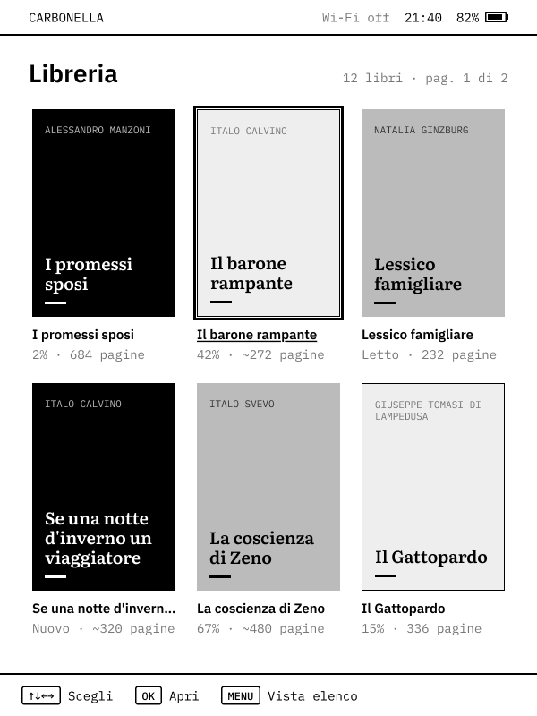
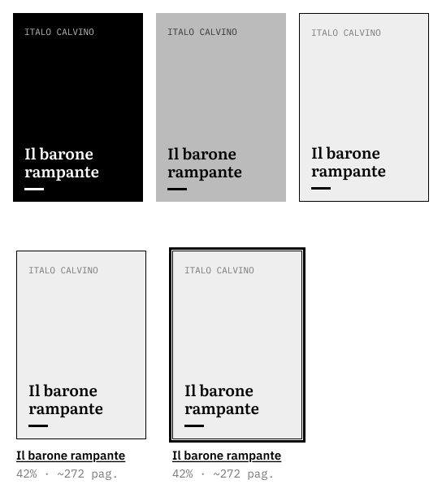
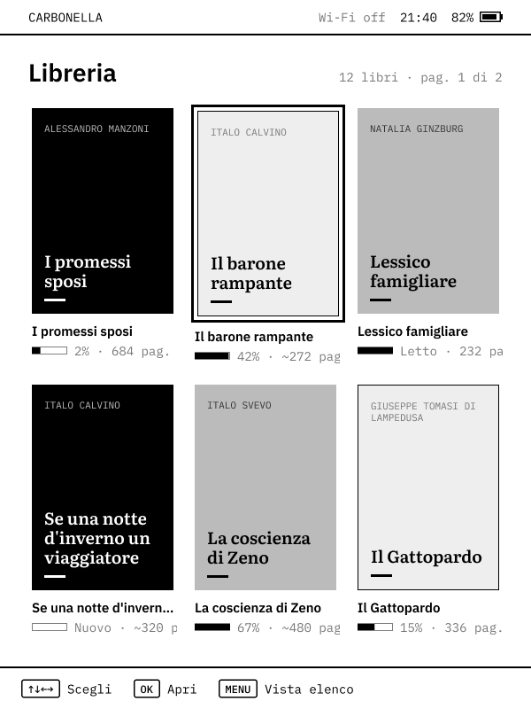

# 2026-11-16 · Libreria con le copertine

**Durata:** circa 5 minuti (09:36–09:41 UTC).
**Risultato:** nuova schermata *01b · Libreria con copertine* nel file Figma
[Carbonella](https://www.figma.com/design/TD5USYE5DwkvWALoR821lL), accanto alla libreria a elenco.

## Richiesta

Simone voleva una versione della libreria in cui si vedono le copertine dei libri.

## Scelte

- **Griglia 3×2:** sei copertine da 160×232 px (proporzione 2:3, quella dei libri). Tre colonne sono il
  massimo che sta in 600 px lasciando i titoli leggibili. Sotto ogni copertina ci sono titolo,
  percentuale letta e pagine cartacee, come nella vista a elenco.
- **Selezione:** cornice nera di 3 px attorno alla copertina, con un filo bianco in mezzo, e titolo
  sottolineato. Invertire i colori come nell'elenco non funziona qui, perché nasconderebbe la
  copertina. La cornice ha lo stesso ingombro in tutti e due gli stati, così la griglia non si sposta
  quando si muove la selezione col pad (sull'e-ink ogni spostamento costa un ridisegno).
- **Navigazione:** il pad muove la selezione in quattro direzioni (↑↓←→). Il tasto MENU passa dalla
  vista a copertine a quella a elenco e viceversa.
- **Copertine di ripiego:** molti EPUB non hanno una copertina, o ne hanno una illeggibile in 16 grigi.
  Per quei libri Carbonella disegna una copertina tipografica con autore in alto e titolo in Literata
  in basso, in tre toni (scuro, medio, chiaro). Nel mockup sono tutte di questo tipo, perché non
  possiamo usare le copertine vere degli editori nei file di progetto.

## Componenti nuovi

- `Copertina`: varianti `Tono = Scuro / Medio / Chiaro`, con titolo e autore come proprietà. Per
  provare una copertina vera basta selezionarla e, nel pannello Fill, scegliere Image e caricare la
  foto.
- `Libro griglia`: varianti `Stato = Normale / Focus`, con le proprietà `Titolo` e `Dettagli`.
  La copertina dentro è modificabile direttamente dall'istanza.
- Nuovi stili di testo: `Copertina/Titolo`, `Copertina/Autore`, `UI/Titolo griglia`.

## Intoppi

- Nella prima bozza la cornice del focus allungava la cella di 6 px e la riga di copertine non era più
  allineata. Ho escluso il bordo dal calcolo dell'impaginazione.
- La mini barra di avanzamento sotto la copertina tagliava il testo delle pagine: l'ho tolta e ho
  lasciato solo la percentuale.

## Cose ancora aperte

- Nel lettore in C le copertine vanno convertite a 16 grigi con dithering e salvate già ridotte a
  160×232, per non rallentare la libreria.
- Da decidere quale vista mostrare all'avvio (forse l'ultima usata).
