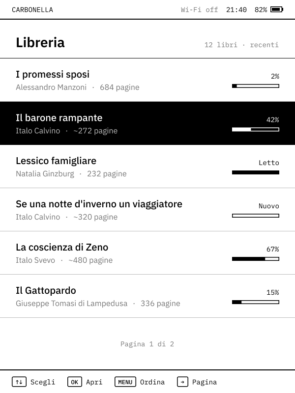
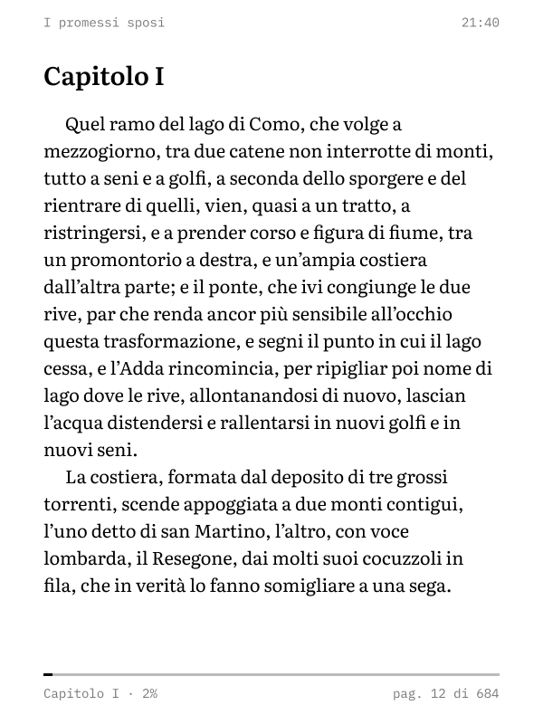
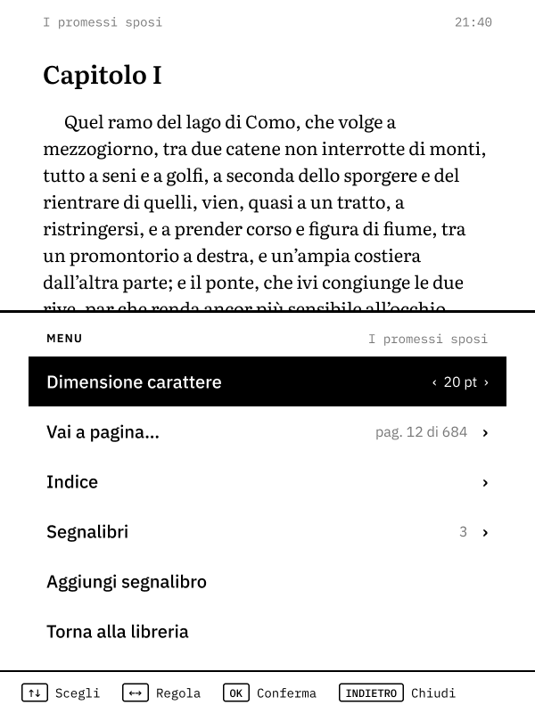
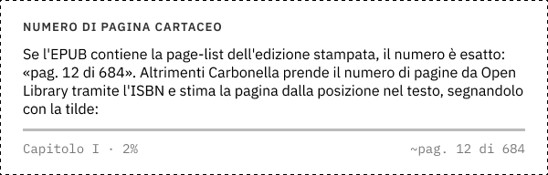

# 2026-11-16 · Numero di pagina dell'edizione cartacea

**Durata:** circa 5 minuti (09:16–09:21 UTC).
**Risultato:** schermate aggiornate nel file Figma
[Carbonella](https://www.figma.com/design/TD5USYE5DwkvWALoR821lL).

## Richiesta

Simone vuole vedere il numero di pagina "vero", quello del libro stampato, per farsi un'idea di dove si
trova e di quanto è lungo un libro. Le percentuali e le "posizioni" degli e-reader non danno questa
sensazione.

## Da dove arriva il numero

1. **Esatto:** molti EPUB (soprattutto EPUB 3 e quelli fatti dagli editori) contengono una *page-list*
   nel file di navigazione, o un `page-map.xml` negli EPUB 2. Sono segnaposto che dicono "qui inizia
   la pagina 142 dell'edizione stampata". Se ci sono, il numero è quello reale.
2. **Stimato:** se mancano, Carbonella cerca il numero di pagine dell'edizione cartacea su
   [Open Library](https://openlibrary.org) usando l'ISBN scritto nei metadati dell'EPUB, e calcola la
   pagina in proporzione alla posizione nel testo. In questo caso il numero è preceduto da una tilde:
   `~pag. 142 di 384`.

La ricerca su Open Library va fatta una volta sola, quando il libro entra in libreria (serve il Wi-Fi),
e il risultato va salvato insieme al libro.

## Cosa è cambiato nelle schermate

- **Lettura:** in basso a destra ora c'è `pag. 12 di 684` al posto di `12 / 684`.
- **Menu nel libro:** la voce *Vai a pagina…* mostra la pagina cartacea.
- **Libreria:** sotto ogni titolo c'è autore e lunghezza, ad esempio `Italo Calvino · ~272 pagine`.
  Nel componente `Riga libro` è una nuova proprietà, `Pagine`, modificabile dal pannello.
- Sotto la schermata di lettura c'è una nota che spiega la differenza tra numero esatto e stimato, con
  l'esempio del piede di pagina con la tilde.

I numeri di pagina nelle schermate sono di esempio, non presi da edizioni reali.

| Libreria | Lettura | Menu |
|---|---|---|
|  |  |  |

## Cose ancora aperte

- Edizioni diverse hanno numeri di pagina diversi: Open Library può restituire più edizioni per lo
  stesso titolo. Conviene preferire quella con lo stesso ISBN dell'EPUB e, se manca, la più comune.
- Gli EPUB senza ISBN restano senza numero cartaceo: in quel caso mostriamo solo la percentuale.
- Da verificare quanti EPUB della libreria di Simone hanno davvero la page-list.
