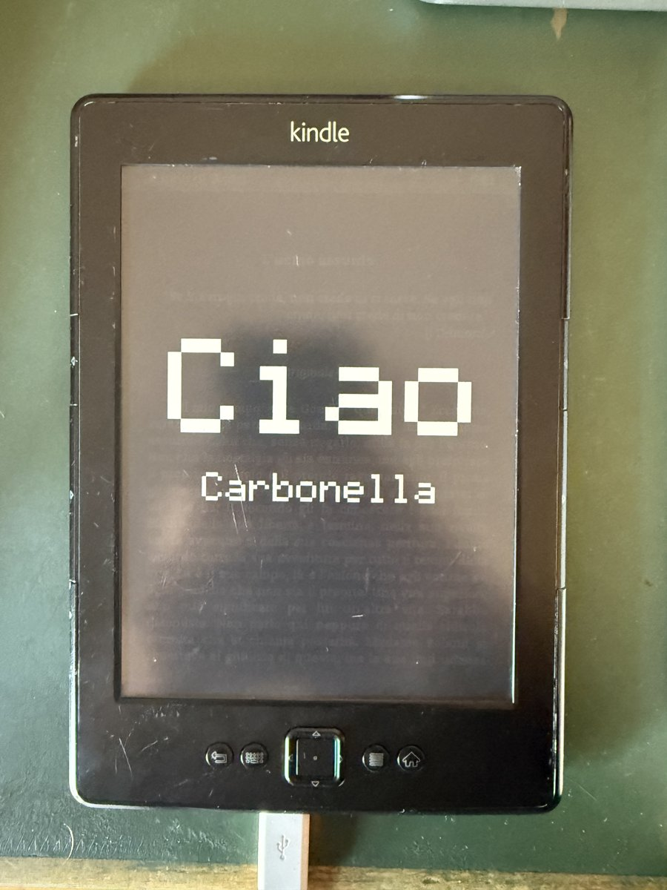

# 2026-11-16 · Il primo "Ciao" di Carbonella

**Stato:** ✅ funziona sul Kindle (11:23 UTC). Da sistemare: i colori sono invertiti.

## Obiettivo

Il primo codice nostro che gira sul Kindle: un programma C che disegna "Ciao" sullo schermo e-ink.
Serve a verificare tutta la catena: scrivo sul Mac → compilo per ARM → copio via `scp` → avvio via SSH.

## Cosa abbiamo fatto (10:08–10:25 UTC, circa 17 minuti)

- Codice in `esperimenti/01-ciao/` (`ciao.c`, `Makefile`, `README.md` con tutti i comandi).
- **Disegno:** il programma apre `/dev/fb0`, lo mappa in memoria, lo riempie di bianco e disegna le
  lettere con un mini font 5×7 scritto a mano, ingrandito 20 volte ("Ciao") e 6 volte ("Carbonella").
  Funziona con 4, 8, 16 e 32 bit per pixel, perché non sappiamo ancora con certezza il formato del K4.
- **Aggiornamento dello schermo:** l'e-ink non si ridisegna da solo. Usiamo l'ioctl
  `FBIO_EINK_UPDATE_DISPLAY` del vecchio driver "einkfb" (Kindle 2/3/4), con un piano B su
  `/proc/eink_fb/update_display`. Il programma stampa quale ha funzionato.
- **Toolchain:** [Zig](https://ziglang.org) come cross-compilatore (`zig cc -target arm-linux-musleabi
  -mcpu=cortex_a8 -static`). Il K4 ha un processore i.MX508 (Cortex-A8) e librerie del 2011: un
  binario statico con `musl` evita ogni problema di versioni. Su Mac basta `brew install zig`.
- **Verifica fatta qui:** compila senza warning; il risultato è un `ELF 32-bit ARM, statically linked`
  di circa 31 KB. Il codice di disegno, compilato per il computer, produce questa anteprima:


- **Non ancora verificato:** che il refresh e-ink funzioni sul K4 reale e che i colori non siano
  invertiti (c'è l'opzione `-i`). Lo scopriamo alla prima prova.

## Passi per Simone

Seguire `esperimenti/01-ciao/README.md`. In breve, dal Mac:

```sh
brew install zig
cd esperimenti/01-ciao
make
ssh root@192.168.15.244 "mkdir -p /mnt/us/carbonella"
scp -O build/ciao root@192.168.15.244:/mnt/us/carbonella/ciao
ssh root@192.168.15.244 "chmod +x /mnt/us/carbonella/ciao; /mnt/us/carbonella/ciao"
```

## Risultato (11:02–11:23 UTC)

1. Primo `make run`: compilazione OK sul Mac, ma il Kindle ha chiuso la connessione SSH subito dopo
   la richiesta della password (`Connection closed by 192.168.15.244 port 22`). Probabile password
   scritta troppo tardi o Kindle in salvaschermo. Corretto il `Makefile` per riusare una sola
   connessione (la password si chiede una volta).
2. Secondo tentativo: **"Ciao" e "Carbonella" compaiono sullo schermo e-ink.** 🎉



Cosa ci dice la foto:

- **Il refresh funziona**: il disegno arriva sullo schermo senza toccare altro.
- **I colori sono al contrario**: scritte bianche su fondo scuro. Sul K4 nel framebuffer 0 = bianco
  e 255 = nero, l'opposto di quello che avevamo supposto. Con `ciao -i` dovrebbe uscire nero su bianco.
- **Si vede in trasparenza la pagina di prima** (ghosting): l'aggiornamento non ha fatto il
  "lampeggio" completo che pulisce l'e-ink. Da capire se serve un altro tipo di refresh.

Output di `ciao -i` (11:58 UTC):

```
framebuffer: id=eink_fb 600x800 (virtual 600x800) bpp=8 line_length=600 grayscale=1
refresh: ioctl FBIO_EINK_UPDATE_DISPLAY ok
```

Quindi il K4 ha il driver **einkfb** (`eink_fb`), 8 bit per pixel, una riga = 600 byte esatti, e il
refresh via ioctl funziona. `grayscale=1` insieme ai colori invertiti conferma: qui 0 = bianco.

## Prossimi passi

- Rendere nero su bianco il comportamento normale sul K4 (invertire di default) e ridurre il ghosting.
- Usare FBInk per scrivere testo con font veri.
- Leggere i tasti da `/dev/input/event*`.
- Fermare l'interfaccia di Amazon mentre Carbonella è in esecuzione, così non ridisegna sopra.
