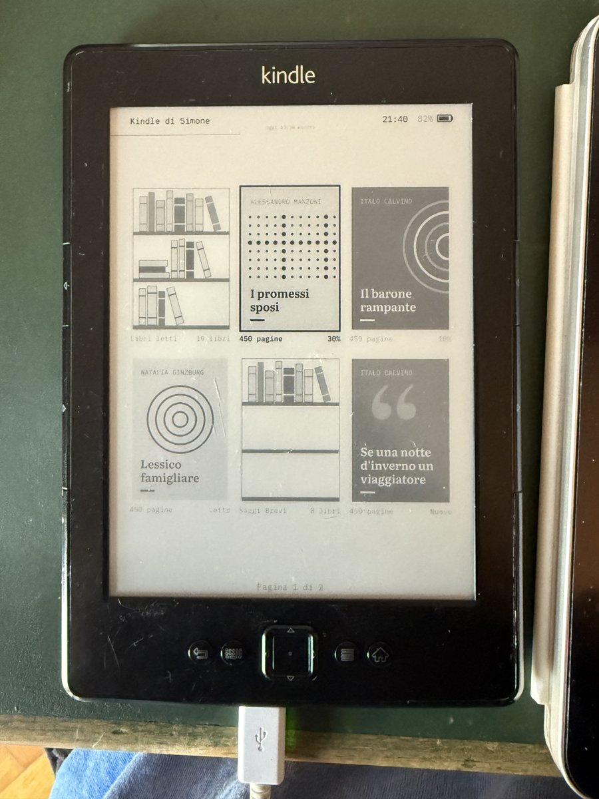

# 2026-11-16 · Prova del design Figma sul Kindle vero

**Stato:** 🟡 primo giro fatto (4 schermate su 6); Simone sta scurendo la palette in Figma, poi secondo giro.

## Come

- Esportate da Figma (file Carbonella, sezione "Schermate") 6 schermate 600×800: 00 Home, 01 Libreria,
  02 Lettura, 02 Lettura con menu, 04 Impostazioni, 06 Obiettivi. (05 Archivio e 07 Raccolte non sono
  ancora nella sezione "Schermate".)
- Sul Mac: portate a 600×800 in scala di grigi. Alcune uscivano larghe 601 px: tagliata l'ultima colonna
  invece di ridimensionare, per non sfocare le linee da 1 px.
- Copiate in `/mnt/us/carbonella/design` e mostrate con `/usr/sbin/eips -c; /usr/sbin/eips -f -g <file>.png`
  (via SSH serve il percorso completo di `eips`). Salvaschermo bloccato durante la prova
  (`lipc-set-prop com.lab126.powerd preventScreenSaver 1`, poi `0`).
- Durata: 14:52–15:02 ora italiana, circa 10 minuti.

## Cosa ha notato Simone

| Schermata | Note |
|-----------|------|
| 00 Home | I **grigi chiari spariscono** (didascalie "Libri letti", "450 pagine", riga sotto "Kindle di Simone"). Linee da 1 px visibili ma meglio **più spesse**. Testo abbastanza nitido. **6 libri sono pochi**: resta molto spazio vuoto in basso. |
| 01 Libreria | Il nero si legge bene. Indicazione generale: **scurire tutta la palette**, il bianco puro non esiste sul pannello e i toni chiari diventano illeggibili. |
| 02 Lettura | Testo standard da **16 a 18**: 16 è piccolo. |
| 02 Lettura con menu | Piace così. |
| 04 Impostazioni | Interrotta: Simone ha preferito rifare le schermate più scure. |
| 06 Obiettivi | Non mostrata. |

## Decisioni

- Palette spostata verso toni più scuri (in corso in Figma, da Simone).
- Linee sottili: almeno 2 px.
- Testo di lettura: 18.
- Home: griglia più fitta per usare lo spazio.

## Prossimo passo

Riesportare le schermate scurite e ripetere la prova.
