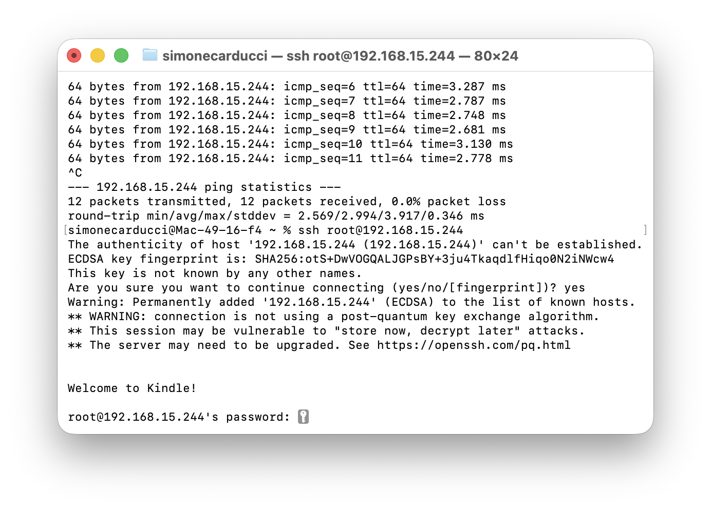
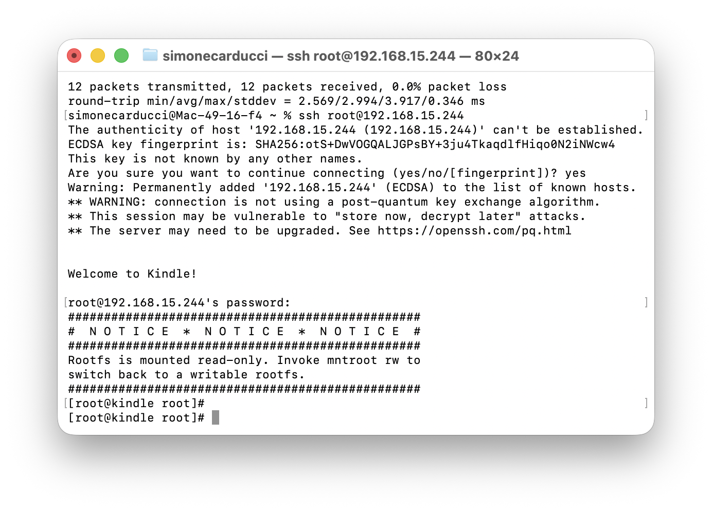

# 2026-11-16 · USBNetwork: la rete via USB non parte

**Stato:** ✅ risolto. Accesso SSH come root riuscito alle 10:07 UTC.

## Problema

Simone è bloccato al passo "Attivare la rete via USB" della guida (`docs/jailbreak.md`, §6).

## Ipotesi

1. **Comando sbagliato per il K4.** La guida diceva `;un`, ma quella scorciatoia è dei Kindle Touch e
   successivi. Sul K4 la sequenza è `;debugOn`, `~usbNetwork`, `;debugOff`. Guida corretta.
2. **USBNetwork non installato.** Se dopo "Aggiorna il tuo Kindle" sul disco non c'è la cartella
   `usbnet/`, il pacchetto non è entrato.
3. **Interfaccia sul computer.** Dopo aver attivato USBNetwork bisogna scollegare e ricollegare il cavo.
   Su Windows serve il driver RNDIS; su Mac e Linux di solito no.

## Domande aperte a Simone

- Mac, Windows o Linux?
- Dopo il comando, il Kindle sparisce come disco USB?
- C'è la cartella `usbnet/`?
- Il computer vede una nuova interfaccia di rete? Cosa risponde `ping 192.168.15.244`?

## Soluzione (09:55–10:02 UTC, circa 7 minuti)

- La causa era la guida: `;un` non funziona sul K4. La sequenza giusta è `;debugOn`, `~usbNetwork`, `;debugOff`.
- Secondo intoppo: sul K4 la ricerca "non fa confermare", perché non c'è un tasto Invio. Si conferma
  scendendo con il pad a 5 direzioni sulla voce di ricerca e premendo il tasto centrale. Aggiunto alla guida.
- Risultato: dopo il comando il Kindle è sparito come disco USB, segno che USBNetwork è partito.

## Rete e SSH (10:02–10:06 UTC, circa 4 minuti)

- Computer: Mac. IP fisso impostato da Impostazioni di Sistema → Rete → interfaccia del Kindle →
  TCP/IP → Manualmente (`192.168.15.201`, maschera `255.255.255.0`).
- `ping 192.168.15.244`: 12 pacchetti su 12, 0% di perdita, circa 3 ms.
- `ssh root@192.168.15.244`: il Kindle risponde con "Welcome to Kindle!" e chiede la password.
  L'avviso "post-quantum key exchange" del Mac è normale: il server SSH del Kindle è vecchio, e su un
  cavo USB tra computer e Kindle non è un problema.

### Prossimo passo: la password di root

Da provare in ordine: password vuota, `mario`. Se non funzionano, la password del K4 si ricava dal
numero di serie (calcolatore citato dalla wiki MobileRead: <http://www.sven.de/kindle/>).
A lungo termine meglio una chiave SSH in `usbnet/etc/authorized_keys`, così non serve password.

## Accesso root riuscito (10:07 UTC)

Simone è entrato come `root` con una delle password di default (vuota o `mario`), senza bisogno del seriale.
Il Kindle mostra l'avviso "Rootfs is mounted read-only": è normale, si usa `mntroot rw` solo quando
serve scrivere nel sistema, e poi `mntroot ro`.

**Traguardo:** jailbreak + USBNetwork + SSH completati. Tempo totale del troubleshooting: circa 12 minuti
(09:55–10:07 UTC).

**Prossimo passo consigliato:** il backup delle partizioni (`docs/jailbreak.md`, §7), prima di iniziare a
sviluppare Carbonella.
