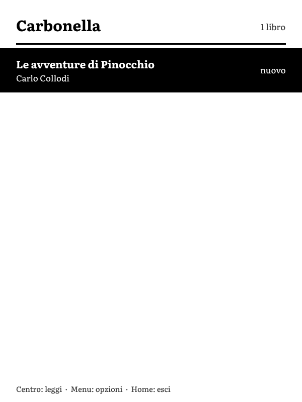
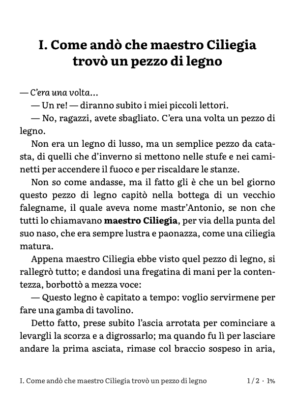
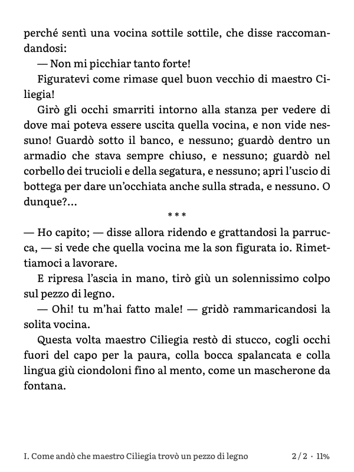
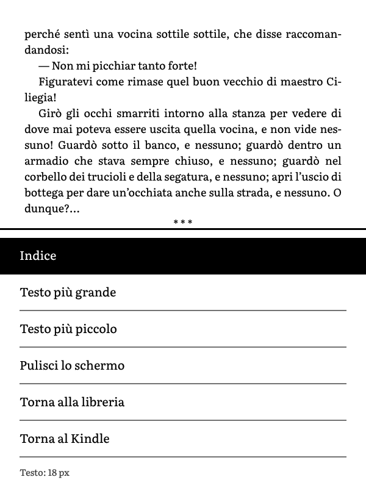
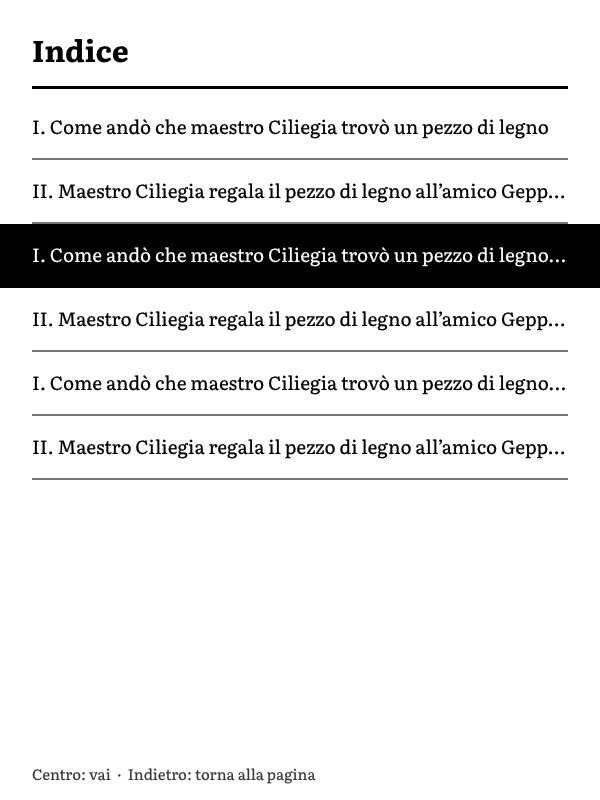

# 2026-11-16 · v0.1 "Prima brace": il primo Carbonella installabile

**Stato:** 🟡 pronta e provata nel simulatore e in emulazione ARM; manca la prova sul Kindle vero.

## Obiettivo

Arrivare a qualcosa da caricare sul Kindle e usare davvero per leggere, e che sia **replicabile**:
Simone regalerà altri Kindle 4 con Carbonella, quindi l'installazione deve essere un pacchetto unico,
uguale per tutti, e il programma deve essere leggero per il K4 (CPU ARM Cortex-A8 a 800 MHz, 256 MB di RAM).

## Tempo

16:12–16:40 UTC, circa 30 minuti (Claude, in un thread del progetto).

## Scelte

| Tema | Scelta | Perché |
|------|--------|--------|
| Motore di lettura | Scritto da noi in C (circa 3.700 righe con i commenti) | KOReader/MuPDF pesano decine di MB; a noi servono paragrafi, titoli, corsivi. Controllo totale sull'impaginazione. |
| ZIP | [miniz](https://github.com/richgel999/miniz) (1 file, MIT) | Solo lettura, niente zlib di sistema. |
| Font | [stb_truetype](https://github.com/nothings/stb) (1 file, pubblico dominio) invece di FreeType | Più leggero, nessuna dipendenza. Glifi in cache, una sola volta per dimensione. |
| Carattere | **Literata** (TypeTogether, SIL OFL), regolare/corsivo/grassetto | Disegnato per leggere sugli schermi. Ridotto ai caratteri latini con `pyftsubset`: 57 KB per stile invece di 320. |
| Contrasto | Curva che scurisce i grigi dei bordi delle lettere (gamma 0,7) | Regola dei test e-ink: i grigi chiari spariscono. |
| Disegno | Immagine in memoria 600×800 in "inchiostro" (0 = carta, 255 = nero) | È esattamente il formato del framebuffer del K4 scoperto con il Ciao: copia diretta, niente conversioni. |
| Aggiornamento e-ink | Parziale a ogni pagina, lampeggio completo ogni 6 (configurabile) | Velocità contro ghosting. Tre modi di lampeggio (`area`, `display`, `inverti`) da provare sul vero K4. |
| Tasti | `/dev/input/event*` con `EVIOCGRAB`, codici da KOReader | Il K4 ha codici diversi per i tasti pagina sinistri e destri. Struttura dell'evento scritta a mano perché musl usa tempi a 64 bit e il kernel del K4 (2.6.31) a 32. |
| Sillabazione | Regole italiane (vocale-consonante-vocale, doppie, s impura, l/m/n/r) senza dizionari | Con testo giustificato a 600 px senza sillabazione gli spazi diventano enormi. Massimo 2 righe di fila con il trattino; si spezza solo se la riga resterebbe troppo larga. |
| Avvio | KUAL → script che ferma il framework Amazon, avvia, e lo riavvia **comunque** all'uscita | Come fa KOReader sui Kindle vecchi. Niente avvio automatico all'accensione: un riavvio riporta sempre al Kindle originale. |
| Inattività | Dopo 20 minuti senza tasti, ritorno al Kindle | Con il framework fermo lo standby automatico non c'è: così la batteria non si scarica. |
| Pacchetto | Zip con due cartelle (`carbonella/`, `extensions/carbonella/`) | Si installa trascinando due cartelle sul disco del Kindle: va bene anche per gli amici. I dati (`carbonella/dati/`) non sono nello zip, quindi gli aggiornamenti non li toccano. |
| Versioni | `CHANGELOG.md`, versione in `src/carbonella.h`, GitHub Actions | Ogni tag `vX.Y.Z` compila e pubblica lo zip nelle Releases. |

## Cosa c'è nella v0.1

Vedi [CHANGELOG.md](../CHANGELOG.md). Schermate dal simulatore (stessa grafica che va sul Kindle):

| Libreria | Inizio capitolo | Pagina con sillabazione |
|----------|-----------------|-------------------------|
|  |  |  |

| Menu di lettura | Indice |
|-----------------|--------|
|  |  |

## Verifiche fatte qui

- **Compilazione ARM** con Zig 0.17.1 (`-mcpu=cortex_a8 -static -O2`): binario di **176 KB**, pacchetto zip
  completo **231 KB**.
- **Emulazione ARM** (qemu `cortex-a8`): il binario del Kindle gira e produce le stesse schermate.
- **Simulatore** (`make prova`): giro completo libreria → lettura → menu → testo più grande → indice → uscita.
- **Prestazioni** in emulazione: un capitolo da 200 KB (222 pagine) si legge in 26 ms e si impagina in 126 ms.
- **Robustezza**: AddressSanitizer + 26 file rovinati di proposito (zip troncati, vuoti, spazzatura,
  XHTML mutato a caso, TXT in Latin-1, una riga da 120.000 caratteri): nessun crash, nessun errore di memoria.

## Non ancora verificato (serve il Kindle)

1. Che `/etc/init.d/framework stop/start` funzioni lanciato da KUAL e che lo script sopravviva alla chiusura di KUAL.
2. I codici dei tasti (KUAL → Carbonella → **Prova dei tasti**).
3. Il lampeggio completo: nel Ciao era rimasta l'ombra della pagina precedente.
4. Cosa succede premendo il tasto di accensione mentre Carbonella è aperta.
5. La velocità vera di apertura e impaginazione (il registro scrive i millisecondi).

## Passi per Simone (prima prova)

Dal Mac, con il Kindle acceso e collegato (cavo inserito **dopo** l'avvio, come sempre):

```sh
cd ~/kindle/kindle_carbonella
git fetch origin
git checkout claude/project-thread-4maaqa
make installa      # compila, crea lo zip e lo copia sul Kindle
```

Poi copia un EPUB in `documents` (per esempio con `scp -O libro.epub kindle:/mnt/us/documents/`, oppure
`make build/libri/prova.epub` e copia quello) e avvia:

- dal Kindle: **KUAL → Carbonella → Apri Carbonella**, oppure
- dal Mac: `make avvia`.

Dopo la prova: `make log` mostra il registro. Foto dello schermo e registro vanno in questo diario.

## Prossimi passi

- Correggere quello che emerge dalla prova (v0.1.1).
- v0.2: Home a 3 colonne con copertine generate per famiglia editoriale (dal design Figma).

## Prima prova sul Kindle (16:38 UTC): non si apre

Simone ha installato la v0.1.0 (`make installa` ok: "Carbonella 0.1.0 installata"), ma da KUAL
**Carbonella non si apre**. La sessione sul Mac per leggere il registro si è fermata per il limite di
utilizzo, quindi non abbiamo ancora `carbonella.log`.

Ipotesi più probabile: fermando il framework Amazon si chiude anche KUAL, e con lui il nostro script
(`nohup` non basta se arriva un SIGTERM al gruppo di processi). Altre possibili: `nohup` assente
nel busybox del K4, permessi di esecuzione persi sul disco FAT, il lettore che non parte su quel kernel.

**v0.1.1** (19:00 UTC) copre tutte queste ipotesi: `setsid`/`nohup`/piano C, segnali ignorati nello
script, `chmod +x` del lettore, controllo `--versione` prima di fermare il framework, registro di avvio
`avvio.log` e `make diagnosi` per raccogliere tutto in un file. Provato con un finto framework che
manda SIGTERM allo script: lo script sopravvive e riavvia il framework.

### Causa trovata (19:05 UTC)

La diagnosi sul Kindle (via SSH dal Mac) dice: **il BusyBox del K4 è la versione 1.7.2 e non ha `nohup`**.
Il nostro `avvia.sh` della v0.1.0 lanciava `nohup ...`: falliva subito, prima ancora di creare il
registro (infatti `carbonella.log` non esiste). Il lettore invece funziona: `carbonella --help` gira sul K4
(kernel 2.6.31-rt11-lab126, Cortex-A8 con NEON/VFPv3, scheda MX50 "Yoshi").

Altre cose imparate: il `grep` di quel BusyBox non conosce `-E`; le altre estensioni KUAL scrivono
l'azione come `./bin/...`. La v0.1.1 usa `which` invece di `command -v`, l'azione `./bin/avvia.sh`, e
ha una via di avvio che funziona con la sola shell.
