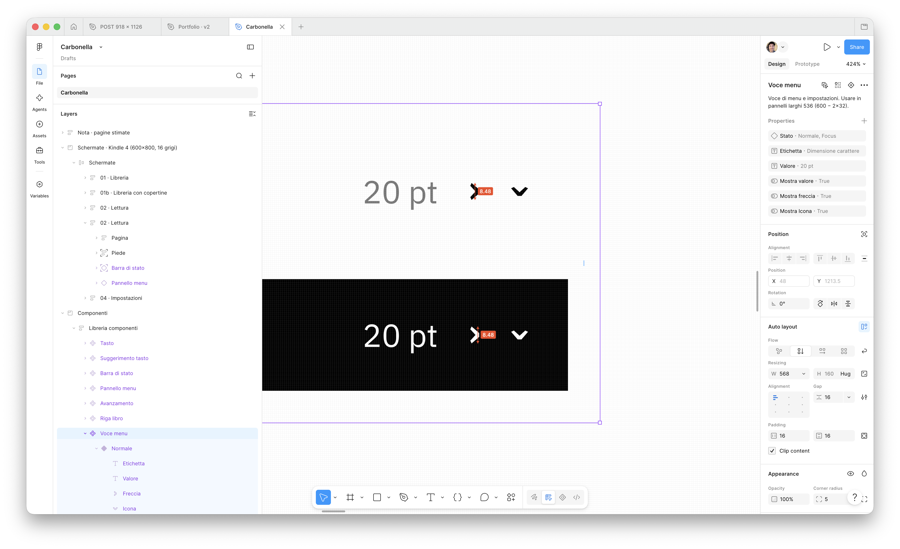
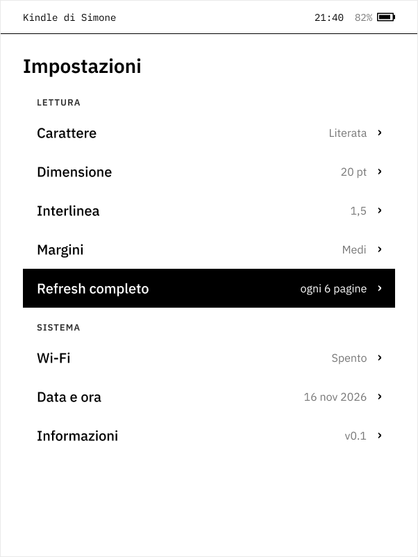

# 2026-11-16 · Componente "Voce menu" che sembrava bloccato

**Durata:** circa 3 minuti (11:22–11:25 UTC).

## Cosa ha visto Simone

Simone stava modificando il componente `Voce menu`: aveva sostituito la freccia di testo con un vettore
(`Freccia`) e aggiunto una seconda icona (`Icona`, una freccia verso il basso) con la proprietà
`Mostra Icona`. A 424% di zoom sono comparse delle etichette rosse con numeri (8.48) e il componente
sembrava bloccato.

## Cosa succedeva davvero

- Il componente non era rotto: larghezze, auto layout e padding erano corretti, e le varianti
  (536 px) stanno dentro al contenitore viola del set (568 px).
- Le etichette rosse sono le **misure di distanza** di Figma, che appaiono tenendo premuto Option (Alt).
  Se il tasto resta "incastrato", per esempio dopo aver cambiato finestra, le misure restano a schermo
  e sembra tutto bloccato. Basta premere e rilasciare Option una volta.
- Un problema vero c'era: `Mostra Icona` era attiva per default, quindi tutte le voci di menu e delle
  impostazioni mostravano due icone (› e ⌄).

## Correzione

Ho messo `Mostra Icona` spenta per default. Ora ogni voce mostra solo la freccia ›; l'icona ⌄ si
accende dal pannello a destra solo sulle voci che aprono una tendina.

