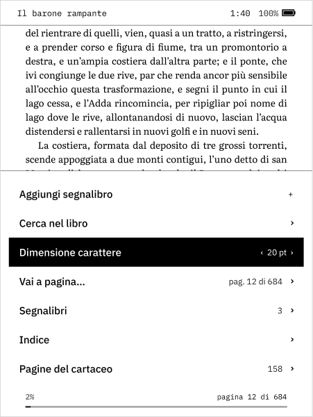
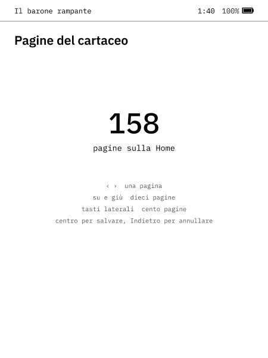

# 17 novembre 2026 · Figma: "Pagine del cartaceo" (verso la 1.2.0)

Tempo: circa 20 minuti (18:42–19:02).

Simone: "fallo su figma prepariamoci per la prossima versione". La voce per scrivere a mano le pagine del libro di carta (quelle che si vedono sulla Home) era già nel codice del front end (commit c40e0a9), ma non in Figma. Ho disegnato riga e schermata uguali a quello che fa il codice, così il front end può poi allinearsi a eventuali ritocchi di Simone.

- **Prima:** copia congelata del menu del libro in Evoluzione ("17 nov 18:45 · Menu del libro prima di "Pagine del cartaceo""). Le vecchie copie v0.3 e v0.4 del menu, che erano ancora collegate al componente, sono state staccate, così non cambiano più.
- **Menu del libro** (componente `Pannello menu`, variante Libro): nuova ultima riga **Pagine del cartaceo**, con il numero e la freccia ›.
- **Due schermate nuove** nella colonna 02 Lettura, in auto layout:
  - `02 · Lettura · Pagine del cartaceo`: numero grande (IBM Plex Mono Medium 64), sotto "pagine sulla Home".
  - `02 · Lettura · Pagine del cartaceo · non note`: "0" e "non note: sulla Home le pagine a schermo".
  - Sotto, i suggerimenti dei tasti come in "Vai a pagina…": "‹ ›  una pagina", "su e giù  dieci pagine", "tasti laterali  cento pagine", "centro per salvare, Indietro per annullare".
- Il numero si cambia con il pad, come in "Vai a pagina…", non con la tastiera a lettere: per scrivere solo cifre è più veloce.

Le altre novità della 1.2.0 erano già in Figma: la batteria "In carica" (componente `Batteria icona`), la nota "min oggi" a obiettivo raggiunto (`02 · Lettura · obiettivo raggiunto`), le copertine Feltrinelli e Mondadori. Standby spento durante la lettura e contatore che si ferma dopo 5 minuti non hanno una schermata.

