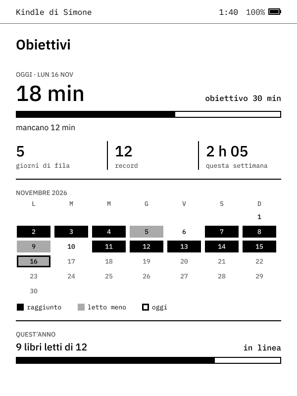

# 17 novembre 2026 · Obiettivi rifatta in auto layout

Tempo: circa 20 minuti (12:08–12:30).

Simone: "rifammelo in autolayout e ci lavoro", riferito alla proposta di riordino di **06 · Obiettivi** (pagina 1, 600×800), quella dentro "03 Impostazioni" in Schermate.

- **Prima:** copia congelata della schermata com'era (posizioni libere) in Evoluzione, passaggio "17 nov 12:08 · Obiettivi prima dell'auto layout".
- **Dopo:** stessa schermata, stesso contenuto, tutta in auto layout verticale:
  - `Header`, `Intestazione`, `Contenuto` (riempie lo spazio, margini 32, gruppi distanziati di 18), `Footer`.
  - `Oggi`: etichetta, riga "18 min / obiettivo 30 min" (allineata alla linea di base), barra, "mancano 12 min".
  - `Statistiche`: tre colonne con i separatori da 2px.
  - `Calendario`: mese, griglia (riga dei giorni + 6 settimane, celle 68×24 con il numero centrato; le celle vuote sono frame `Vuoto`), legenda.
  - `Quest'anno`: etichetta, riga libri/stato, barra.
  - Le barre sono frame con bordo 2px e dentro il rettangolo `Fatto` a larghezza fissa: per cambiare l'avanzamento basta cambiare la larghezza di `Fatto`.
- Testi e istanze sono copiati dall'originale, quindi font e colori sono identici. Le distanze verticali sono arrotondate a valori regolari: qualche elemento si sposta di 1–5px rispetto a prima.
- Il "Pagina 1 di 2" non c'è più perché Simone l'aveva già tolto nella sua copia.

