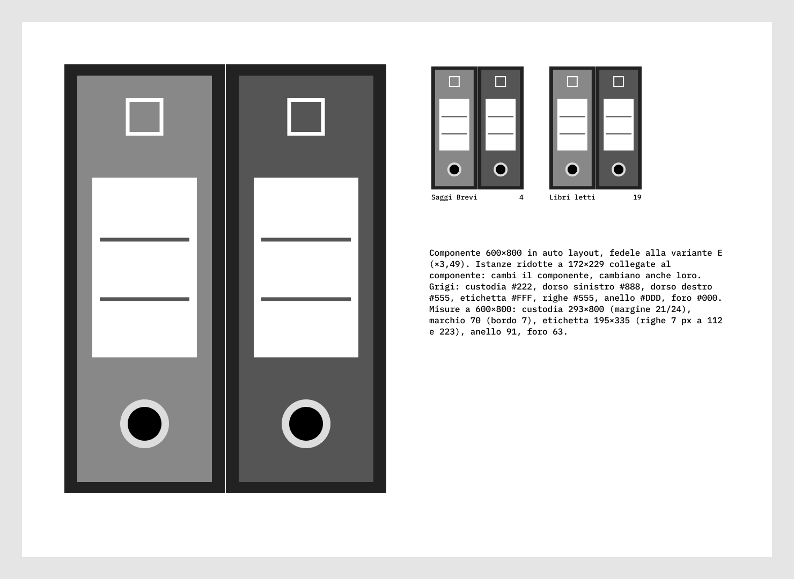

# 17 novembre 2026 · Raccolta "due faldoni" a 600×800

Tempo: circa 10 minuti (12:04–12:14 UTC). Thread: **design**.

Simone ha scelto la proposta **E · due faldoni** tra le raccolte "raccoglitore" ("da due mi piace") e ha chiesto di rifarla a 600×800 in auto layout ("ricrea in 600x800 in autolayout"), come i modelli delle copertine.

- Componente Figma **Raccolta 600×800 / Due faldoni** (99:1927) nella sezione "Raccolta 600×800 · due faldoni" (99:1944). È tutto in auto layout: due custodie affiancate, ogni dorso con marchio, etichetta e anello distribuiti in verticale.
- Le misure sono quelle della variante E moltiplicate per 3,49 (600/172). Sono gli stessi grigi della proposta: custodia #222, dorsi #888 e #555, etichetta #FFF, righe #555, anello #DDD, foro #000.
- Due istanze collegate ridotte a 172×229 con la riga sotto ("Saggi Brevi 4", "Libri letti 19"), come appariranno in Home.
- Misure passate al thread front end per il codice. La sezione delle proposte A–E non è stata toccata.

