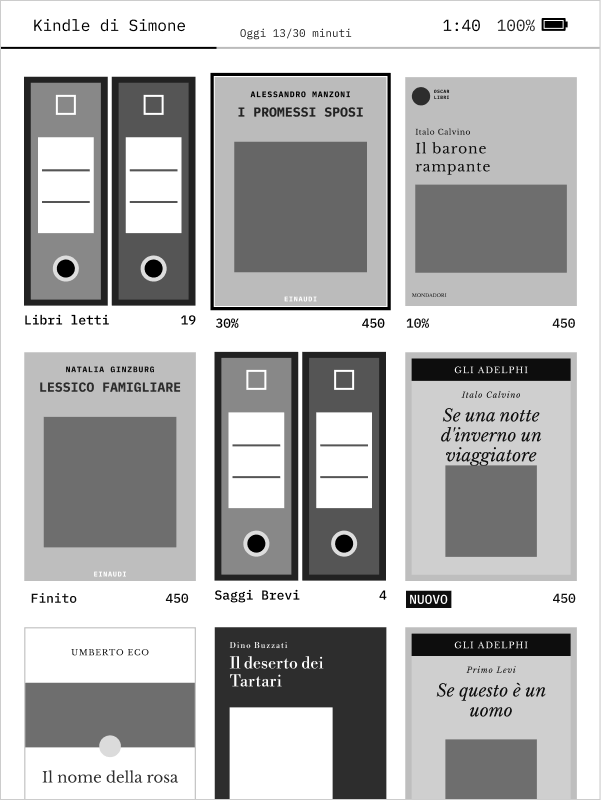

# 17 novembre 2026 · Riordino del file Figma

Tempo: circa 25 minuti (12:32–12:57).

Simone: "aggiorna anche il file di figma, spostando in evoluzione ciò che non ci serve più e aggiornando i vari design".

## Spostato in Evoluzione › Superati (non cancellato)

Nuovo gruppo "17 nov 12:35 · Riordino della pagina Carbonella" in fondo alla sezione Superati:

- Raccolte · proposte "raccoglitore" A–E (scelta fatta: due faldoni).
- 06 · Obiettivi · proposta · 1 di 2, l'originale (sostituita dalla copia di Simone in auto layout).
- Frame 10 con la vecchia 06 · Obiettivi.
- Sezione "v1.0.5 · sul Kindle" (le foto del Kindle sono già nel passaggio di Evoluzione 11:55).
- Copertine · famiglie editoriali 3:4 v1/v2 con le reference (sostituite dai modelli 600×800).

## Pagina Carbonella, ora

- Componenti, Schermate.
- Raccolta 600×800 · due faldoni, accanto alle Schermate.
- Obiettivi · pagina 2 · proposta da rifare in auto layout.
- Copertine 600×800 · modelli editori.

## Design aggiornati

- **Home** (componente 00 · Home): le due raccolte non sono più la pila di copertine ma i due faldoni (stesse card della sezione "due faldoni", collegate al componente). Si aggiornano da sole anche tutte le schermate di menu che usano la Home. Prima del cambio la Home è stata copiata in Evoluzione ("17 nov 12:40 · Home prima dei faldoni").
- **Obiettivi**: in Schermate c'è la versione in auto layout.
- Menu, Impostazioni con ARCHIVIO e conferma "Sei sicuro di voler archiviare?" erano già allineati al Kindle.
- I numeri di versione scritti nelle schermate ("Carbonella 0.2.0", "Informazioni v0.1") restano al thread versioni.

