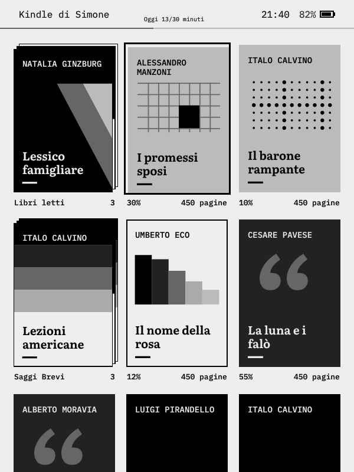
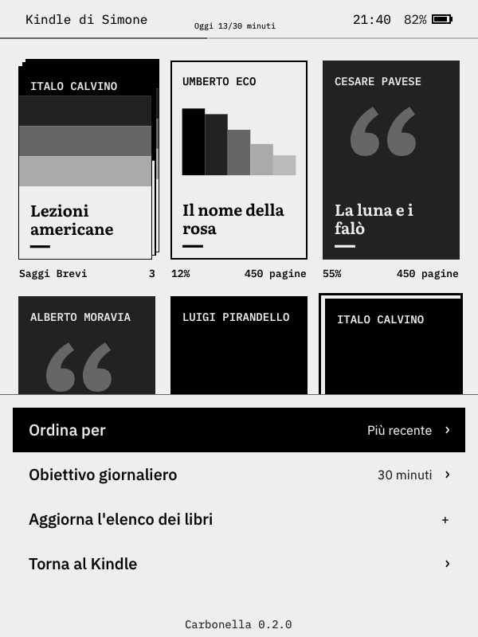
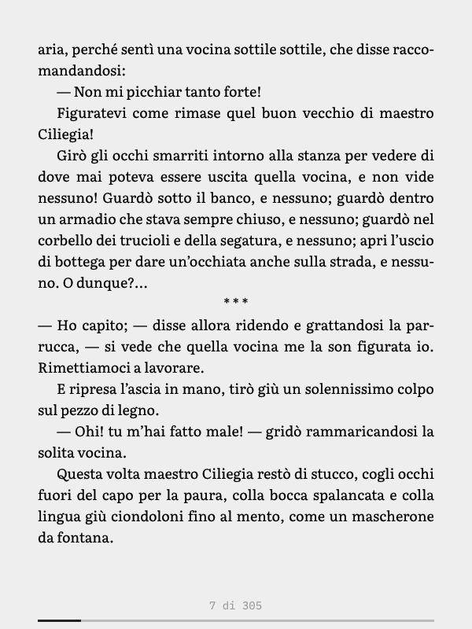
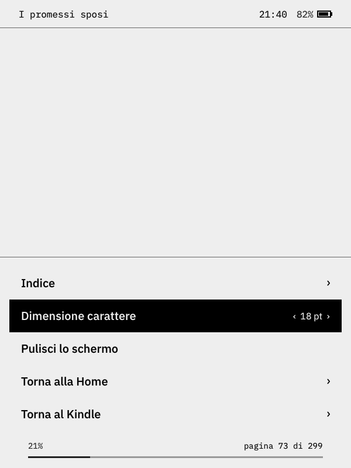
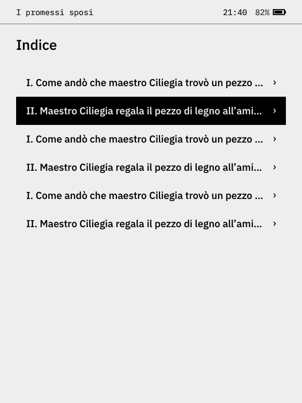
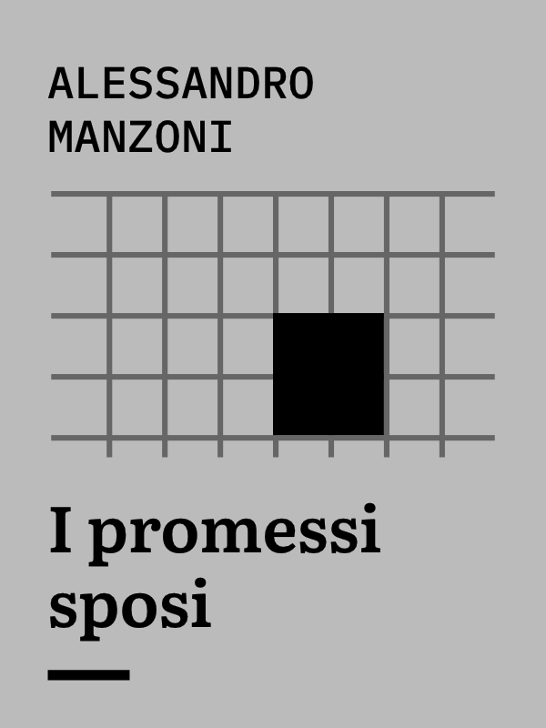
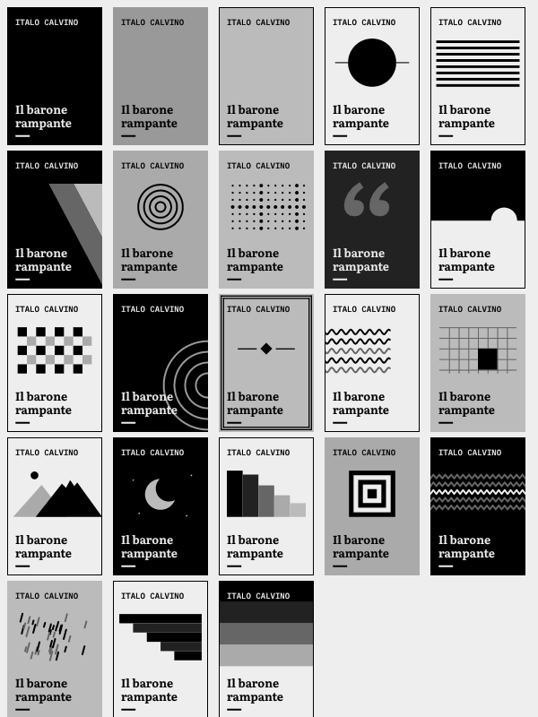

# 2026-11-17 · v0.2 "Come in Figma": le schermate rifatte dal design

**Stato:** 🟡 pronta e provata nel simulatore; installazione sul Kindle in corso dal Mac.

## Perché

La v0.1.1 funzionava sul Kindle, ma Simone l'ha guardata e ha detto: *"sì ma non è come in Figma"*.
Aveva ragione: la v0.1 aveva una libreria a elenco e font scelti da noi. La v0.2 rifà ogni schermata
partendo dai frame del [file Figma](https://www.figma.com/design/TD5USYE5DwkvWALoR821lL), con le misure,
i font e i grigi presi direttamente dal design.

## Tempo

00:01–00:30 UTC del 17/11 (circa 30 minuti, Claude), mentre Simone era collegato con il Kindle.

## Cosa abbiamo preso da Figma

| Elemento Figma | Come è fatto in Carbonella |
|----------------|----------------------------|
| Colori "E-ink" (Inchiostro #000, Grafite #222, Cenere #666, Smog #999, Fumo #AAA, Velo #BBB, Leggero #CCC, Carta #EEE) | Gli stessi grigi come valori di inchiostro; la carta è #EEE, mai bianco puro. |
| Font: IBM Plex Mono (stato), IBM Plex Sans Medium (menu), Literata SemiBold (titoli copertine), Literata (lettura) | Aggiunti i quattro font mancanti, ridotti ai caratteri latini (25–50 KB l'uno). Plex Sans Medium e Literata SemiBold ricavati dai font originali. |
| **00 · Home 3 colonne** | Griglia 3 colonne (celle 180,7 × 281,8, spazi 10/14), terza riga tagliata a metà, scorrimento per righe. Intestazione con nome, "Oggi 13/30 minuti", ora, batteria e barra dell'obiettivo. Sotto ogni copertina percentuale e pagine in Plex Mono Medium 13. |
| **Focus** ("cornice nera di 3 px, la griglia non si sposta") | La cornice compare attorno alla copertina; si ridisegnano solo le due celle che cambiano. |
| **Raccolte** (pila di copertine) | La prima cella è "Libri letti" (i libri finiti); ogni sottocartella di `documents` diventa una raccolta. |
| **Copertina** (23 stili, "uno a caso ma sempre lo stesso per ogni libro") | I 23 stili disegnati in vettoriale con le coordinate del componente (cerchi, punti, pioggia, montagne…). Lo stile dipende da titolo e autore. |
| **Pannello menu** e **Voce menu** | Pannello dal basso con righe da 56 px, focus nero, valore a destra e freccia "›". |
| **02 · Lettura** | Margini 48, Literata 18 con interlinea 1,5, rientro 24; in basso "12 di 684" e la barra di avanzamento del libro. |
| **02 · Lettura Menù** | Titolo del libro in alto, pagina vuota, pannello con Indice, Dimensione carattere ("‹ 18 pt ›", si cambia con sinistra/destra), Pulisci lo schermo, Home, Kindle; sotto "2%" e "pagina 12 di 684". |
| **04 · Impostazioni** | Stile usato per le schermate a elenco (Indice, "Tornare al Kindle?"). |

## Standby (nuovo, deciso con Simone)

Nel design non c'era. Simone: *"se sei su un libro e il Kindle va in standby, riproduci in grande a
schermo intero la copertina del libro"*. Così:

- `carbonella.sh` ascolta il servizio del Kindle che gestisce il tasto di accensione
  (`lipc-wait-event com.lab126.powerd goingToScreenSaver,outOfScreenSaver`) e lo dice al lettore
  con due segnali (SIGUSR1 = standby, SIGUSR2 = risveglio);
- Carbonella disegna la copertina del libro aperto a 600×800 (dalla Home: l'ultimo libro letto);
- al risveglio torna esattamente la schermata di prima, alla stessa pagina.

Da verificare sul Kindle vero: che il K4 mandi questi eventi anche con l'interfaccia Amazon ferma.

## Pagine

Il design mostra "12 di 684" per tutto il libro. Carbonella impagina un capitolo alla volta (per
essere veloce), quindi: le pagine del capitolo aperto sono esatte, quelle degli altri capitoli sono
stimate dalla quantità di testo, con una misura che si affina a ogni capitolo letto. Per i libri mai
aperti la stima viene dalla dimensione del testo nell'EPUB.

## Schermate dal simulatore

| Home | Menu Home | Pagina |
|------|-----------|--------|
|  |  |  |

| Menu di lettura | Indice | Standby |
|-----------------|--------|---------|
|  |  |  |

I 23 stili di copertina (`carbonella --copertine`), da confrontare con il componente "Copertina" di Figma:

## Verifiche fatte qui

- Simulatore: giro completo (Home, menu, raccolte, lettura, menu di lettura, dimensione, indice,
  standby e risveglio) con `make prova`, che ora crea una libreria finta con gli stessi libri del frame Figma.
- AddressSanitizer + UBSan sullo stesso giro e su uno più lungo: nessun errore.
- Compilazione ARM: binario di 234 KB, gira in emulazione cortex-a8.

## Prossimi passi

1. Installare sul Kindle e provare lo standby con il tasto di accensione.
2. Avvio automatico all'accensione, con le vie d'uscita (file per saltarlo, ritorno al Kindle se si blocca).
