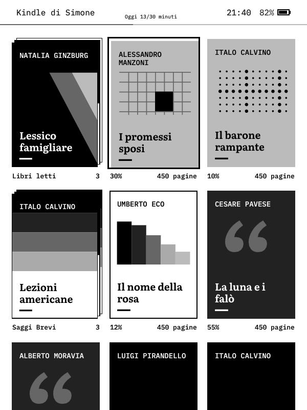
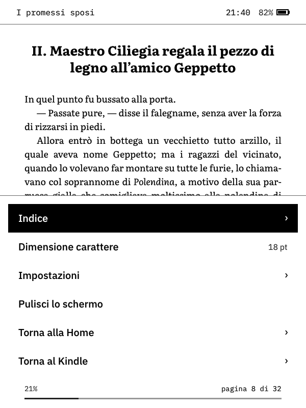
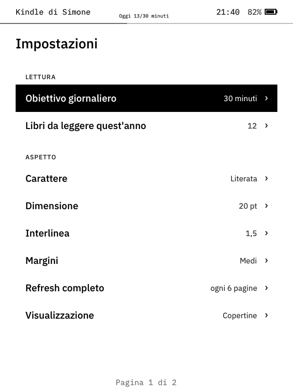
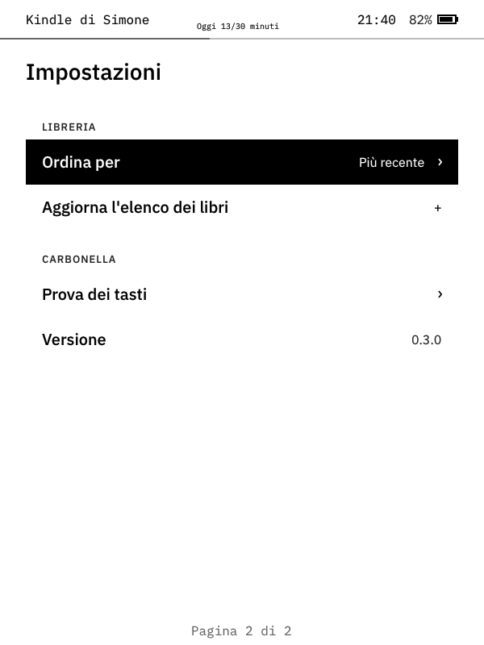

# 2026-11-17 · v0.3 "Appunti di Simone": sfondo bianco, menu sopra il testo, Impostazioni

**Stato:** 🟡 pronta e provata nel simulatore; installazione sul Kindle in corso.

## Perché

Simone ha provato la v0.2 sul Kindle e ha lasciato tre appunti (00:36 UTC):

> *"1 lo sfondo su figma deve essere comunque bianco anche se comparirà più grigino, ho bisogno del
> massimo contrasto 2 quando apro il menu dentro al testo il testo scompare 3 aggiungiamo anche la
> pagina delle impostazioni e mantieni tutto"*

E una regola nuova per le prossime versioni: *"quando versioni, crea anche le stesse pagine su Figma"*,
così le schermate si possono guardare e ritoccare anche lì.

## Tempo

00:36–00:50 UTC del 17/11 (circa 15 minuti, Claude).

## Cosa è cambiato

| Appunto | Come l'abbiamo risolto |
|---------|------------------------|
| 1. Sfondo bianco | Il grigio "Carta" (#EEE) ora è bianco puro (`G_CARTA 0` in `carbonella.h`): vale per Home, lettura, menu, Impostazioni e anche per le copertine chiare. La vecchia regola "mai bianco puro" non vale più. |
| 2. Il testo spariva aprendo il menu | Il menu ridisegna la pagina sotto al pannello invece di cancellarla; in alto resta il titolo del libro. Se cambi dimensione del carattere, la pagina sotto si aggiorna subito. |
| 3. Pagina Impostazioni | Nuova schermata come il frame "04 · Impostazioni": titolo, gruppi LETTURA e ASPETTO con le stesse 8 voci e le stesse posizioni (etichetta a 150, righe da 173 e da 337), "Pagina 1 di 2" in basso. La pagina 2 raccoglie Ordina per, Aggiorna l'elenco, Prova dei tasti e Versione. Si apre dal menu della Home e da quello di lettura. |

Note sulle voci:

- **Carattere** e **Visualizzazione** hanno per ora una sola scelta (Literata, Copertine): le voci ci
  sono, come nel design, e sono pronte per altre opzioni.
- **"Obbiettivo di giornaliero"** nel frame è diventato "Obiettivo giornaliero", come nel menu della Home.
- Le modifiche si salvano in `dati/preferenze.conf` (nuova chiave `libri_anno`) e restano dopo gli aggiornamenti.

## Schermate dal simulatore

| Home (sfondo bianco) | Menu sopra il testo |
|----------------------|---------------------|
|  |  |

| Impostazioni, pagina 1 | Impostazioni, pagina 2 |
|------------------------|------------------------|
|  |  |

## Verifiche fatte qui

- `make prova` con un giro nuovo: Home, menu, lettura, menu sopra il testo, dimensione, Impostazioni
  dalla lettura (dimensione e interlinea cambiate, pagina 2), indice, standby e risveglio, Impostazioni
  dalla Home.
- AddressSanitizer + UBSan sullo stesso giro: nessun errore (solo la memoria non liberata all'uscita, come prima).
- Compilazione ARM: binario di 238 KB.

## Prossimi passi

1. Installare sul Kindle e provare (anche lo standby col tasto di accensione).
2. Stesse schermate della v0.3 in Figma, accanto ai frame di Simone.
3. Avvio automatico all'accensione, con le vie d'uscita.
