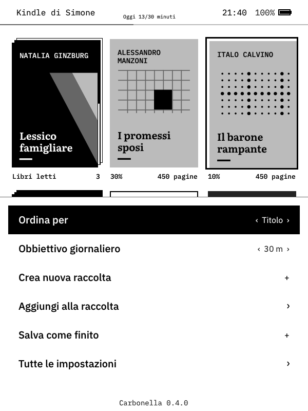
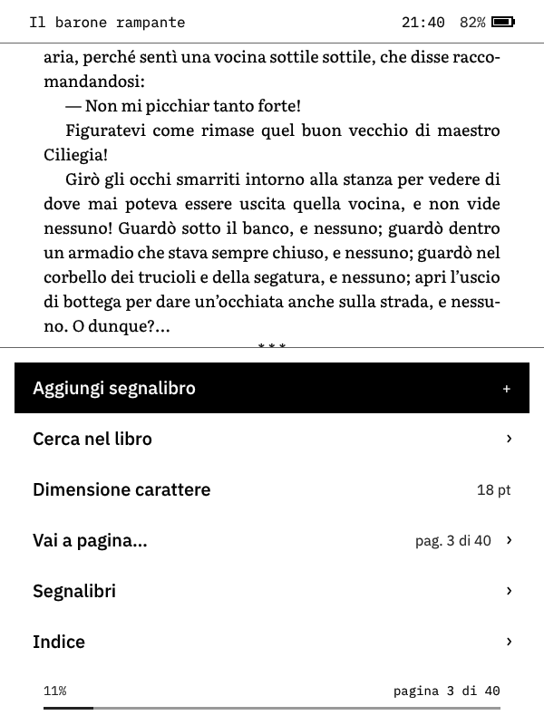
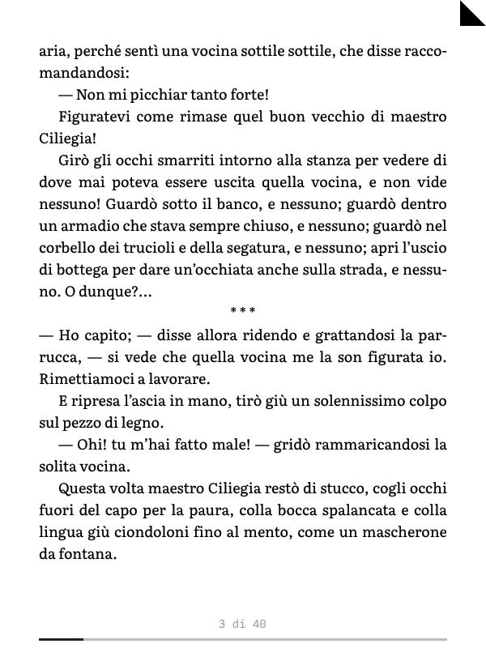
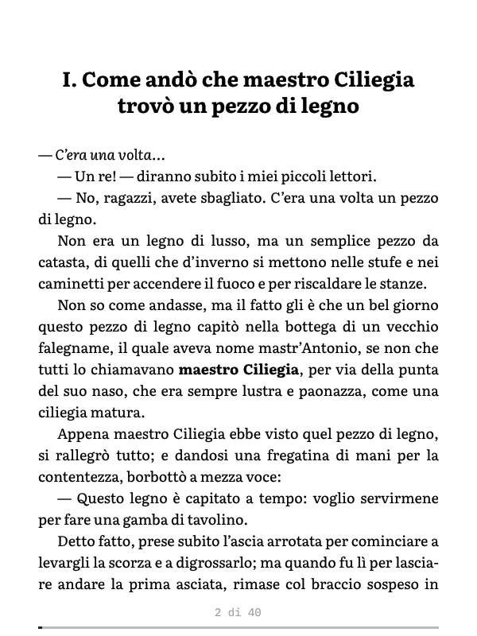
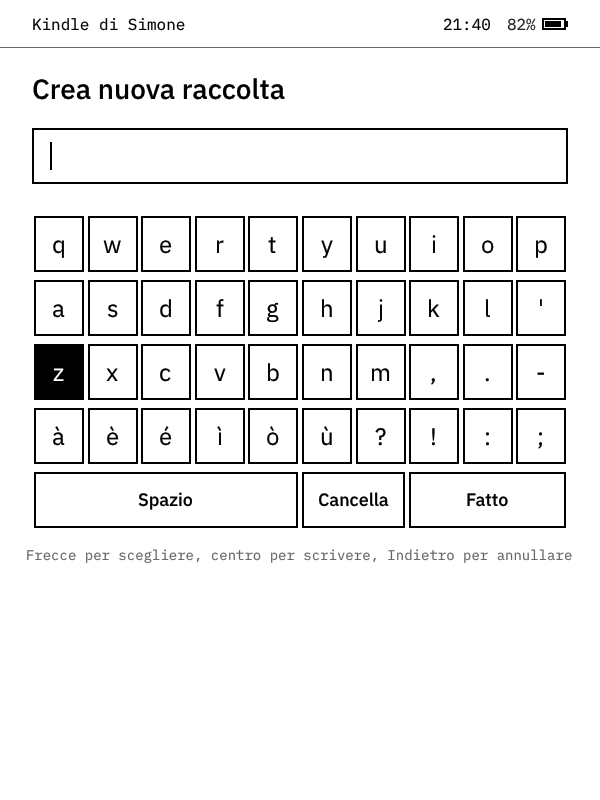
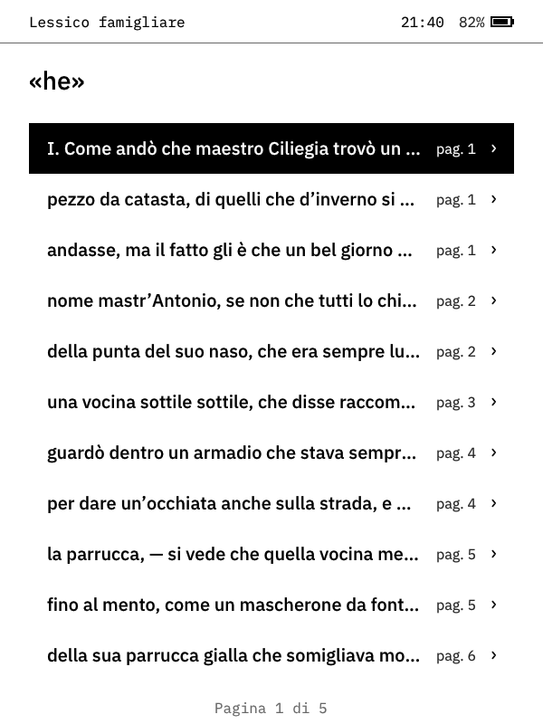
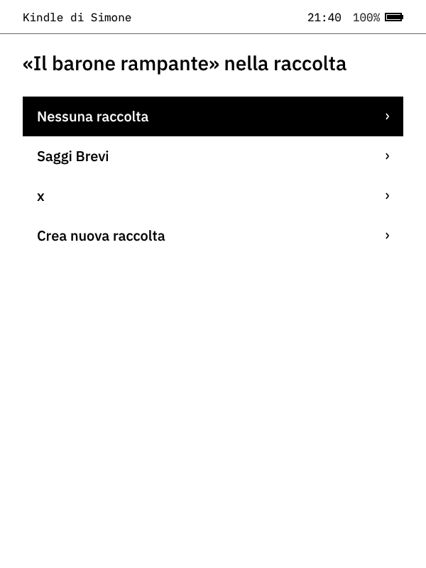

# 2026-11-17 · v0.4 "I menu di Figma": stesse voci, stesse parole

**Stato:** 🟡 pronta e provata nel simulatore; installazione sul Kindle in corso.

## Perché

Guardando la v0.3 Simone ha scritto: *"ma perché se in Figma il menù ha delle scritte tu le devi cambiare"*.

Era vero. Nei menu avevo messo solo le funzioni che Carbonella sapeva già fare (Pulisci lo schermo,
Torna alla Home, Torna al Kindle, Aggiorna l'elenco…) e avevo cambiato qualche parola. **Regola da ora:
testi e ordine delle voci sono quelli dei frame Figma, parola per parola; se una voce non funziona
ancora, la si fa funzionare, non la si cambia.** (Salvata anche nella memoria del progetto.)

## Tempo

01:02–01:25 UTC del 17/11 (circa 25 minuti, Claude), compresa la v0.4.1.

## Le voci, lette da Figma

Lette direttamente dalle proprietà delle "Voce menu" nei due pannelli (testo, valore, freccia o +):

| Pannello Home ("00 Home Menù") | | Pannello Libro ("02 · Lettura Menù") | |
|---|---|---|---|
| Ordina per | Più recente › | Aggiungi segnalibro | + |
| Obbiettivo giornaliero | 30 minuti › | Cerca nel libro | › |
| Crea nuova raccolta | + | Dimensione carattere | ‹ 20 pt › |
| Sposta libri | › | Vai a pagina… | pag. 12 di 684 › |
| Aggiungi libro da leggere | + | Segnalibri | 3 › |
| Impostazioni | + | Indice | › |

## Cosa fa ogni voce nuova

- **Crea nuova raccolta**: tastiera sullo schermo per il nome; crea la cartella in `documents` con un
  file `.carbonella-raccolta` (così le raccolte vuote si vedono nella Home, e le cartelle di sistema come
  `dictionaries` no).
- **Sposta libri**: elenco dei libri (con la raccolta attuale), poi la destinazione. Il file viene spostato
  e la posizione di lettura lo segue.
- **Aggiungi libro da leggere**: tra i libri mai aperti, segna quelli da leggere (`dati/da_leggere.tsv`);
  sotto la copertina compare "Da leggere". *Da confermare con Simone che sia questo il significato.*
- **Aggiungi segnalibro**: salva la pagina in `dati/segnalibri.tsv` e disegna l'angolo piegato 32×32 in
  alto a destra, come nel frame "02 · Lettura Segnalibro". Sulla stessa pagina lo toglie.
- **Segnalibri**: l'elenco con le prime parole della pagina e "pag. N".
- **Cerca nel libro**: tastiera, poi i punti trovati (fino a 100) con qualche parola e la pagina.
- **Vai a pagina…**: numero grande; ‹ › una pagina, su/giù dieci, tasti laterali cento.

## Schermate dal simulatore

| Menu Home | Menu di lettura | Segnalibro | Vai a pagina… |
|---|---|---|---|
|  |  |  |  |

| Tastiera | Cerca nel libro | Aggiungi alla raccolta | |
|---|---|---|---|
|  |  |  | |

## Verifiche fatte qui

- `make prova` con un giro nuovo che usa tutte le voci dei due menu.
- AddressSanitizer + UBSan su due giri lunghi: nessun errore.
- Compilazione ARM (256 KB) e prova in emulazione.

## v0.4.1: il menu Home cambiato da Simone

Mentre costruivo le schermate v0.4 in Figma ho visto che il pannello della Home era cambiato (Simone ci
stava lavorando): **Ordina per ‹ Più recente ›**, **Obbiettivo giornaliero ‹ 30 m ›**, Crea nuova raccolta +,
**Aggiungi alla raccolta ›**, **Salva come finito +**, **Tutte le impostazioni ›**. La v0.4.1 segue il frame
nuovo: le prime due voci si cambiano con sinistra/destra; "Aggiungi alla raccolta" e "Salva come finito"
valgono per il libro con il riquadro. "Aggiungi libro da leggere" non c'è più, quindi la domanda su cosa
dovesse fare è risolta. Lezione: rileggere Figma subito prima di ogni versione, non solo all'inizio.

## Da fare

- Il pannello in Figma dice "Pagina 1 di 2": la pagina 2 del menu non è disegnata. Se Simone la disegna,
  lì potranno tornare le voci tolte.
- Le schermate nuove (tastiera, Vai a pagina…, elenchi) non hanno un frame in Figma: le aggiungo nella
  sezione della versione, così Simone può ridisegnarle.
