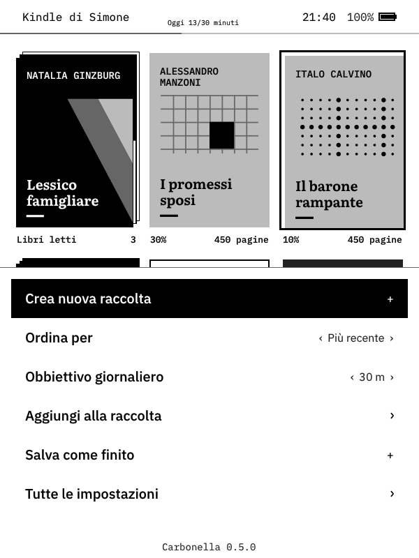
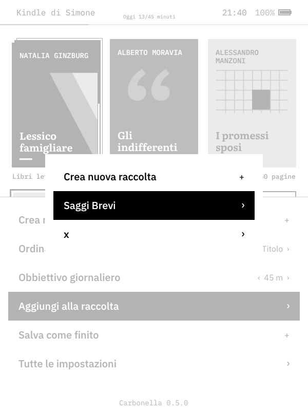
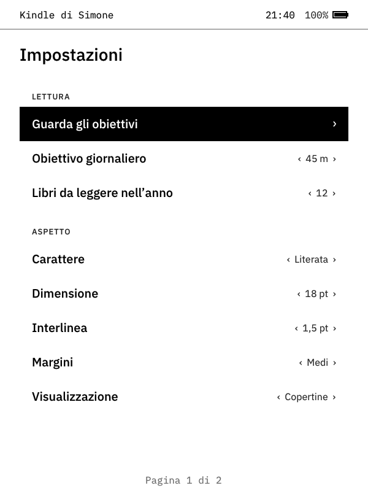
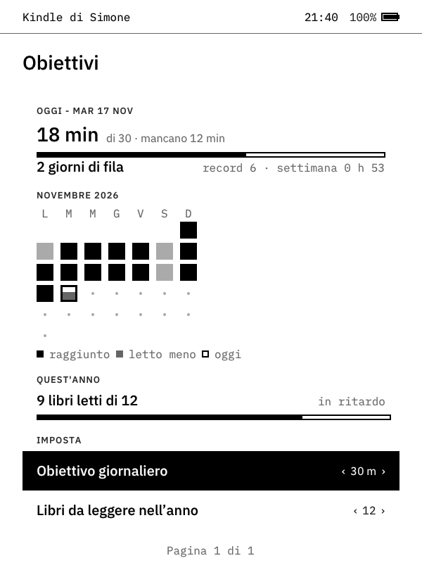
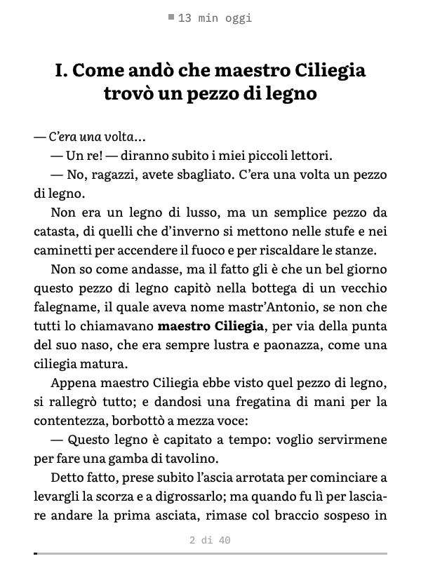

# 17 novembre 2026 · v0.5.0 "Obiettivi"

**Tempo:** circa 30 minuti (01:25–01:55 UTC), dal messaggio di Simone all'installazione sul Kindle.

## Cosa ha chiesto Simone

> "sto aggiornando il testo un attimo" … "ho migliorato tutto aggiorna ora"

Simone non ha detto quali frame aveva cambiato. Ho riletto tutto il file Figma e l'ho confrontato con
quello che c'era sul Kindle (v0.4.1).

## Cosa era cambiato in Figma

| Frame | Cosa è cambiato |
| --- | --- |
| 00 Home Menù | *Crea nuova raccolta* in cima; poi Ordina per, Obbiettivo giornaliero, Aggiungi alla raccolta, Salva come finito, Tutte le impostazioni |
| 00 Home Menù Raccolta (nuovo) | Pannello piccolo al centro (424 px), Home sbiadita al 30%: *Crea nuova raccolta* (+) e le raccolte (›) |
| 04 · Impostazioni, pagina 1 | Gruppo Lettura: *Guarda gli obiettivi*, *Obiettivo giornaliero*, *Libri da leggere nell'anno*. Aspetto parte a 370. Tolto *Refresh completo*. Valori tutti "‹ valore ›", interlinea "1,5 pt". Niente minuti nell'intestazione |
| 06 · Obiettivi (nuovo) | Oggi, giorni di fila, calendario del mese, quest'anno, Imposta |
| 02 · Lettura · obiettivo raggiunto (nuovo) | "■ 30 min oggi" in alto al centro |

Lettura, menu di lettura, segnalibro e pagina 2 delle impostazioni erano uguali a prima.

## Come l'ho fatto

- **Obiettivi**: i minuti per giorno li leggo da `dati/letture.tsv`, che Carbonella scrive già a ogni
  sessione di lettura.
  - Una sessione a cavallo della mezzanotte viene divisa tra i due giorni.
  - *Giorni di fila* conta i giorni consecutivi con l'obiettivo raggiunto. Oggi conta solo quando
    l'obiettivo è raggiunto, così la serie non si azzera la mattina.
  - Il *record* è la serie più lunga degli ultimi 800 giorni.
  - Nel calendario, il riquadro di oggi si riempie dal basso man mano che leggi, come nel frame.
  - I giorni passati senza lettura hanno un puntino, come i giorni futuri. Il frame non mostra questo
    caso, quindi è una mia scelta.
- **Libri letti quest'anno**: sono i libri al 100% (finiti, o *Salva come finito*) letti l'ultima volta
  quest'anno. Sono "in linea" se sono almeno quanti ne servono a questo punto dell'anno, altrimenti
  "in ritardo". *In ritardo* è l'unico testo non preso dal frame.
- **Avviso in lettura**: lo disegno insieme alla pagina, quindi non costa un aggiornamento in più dello
  schermo.
- **Pannello raccolte**: lo schermo sotto viene sbiadito moltiplicando ogni pixel per 0,3, poi viene
  disegnato il pannello.

## Prove

- Nuovo giro del simulatore (`make prova`) che passa da tutte le voci nuove: 128 schermate.
- ASan e UBSan sullo stesso giro: nessun errore.
- Sotto qemu (Cortex-A8, soft-float), Home, menu, Obiettivi e pannello raccolte in 1,5 s in tutto.

## v0.5.1: Archivia libro

Mentre la v0.5.0 si installava, ho ricontrollato Figma per creare la sezione di versione. Simone aveva
aggiunto **Archivia libro** al menu della Home e messo la freccia a *Salva come finito*. Ho fatto subito
la v0.5.1.

Il frame non dice cosa fa *Archivia libro*, quindi ho scelto la lettura più semplice e reversibile: il
libro va nella raccolta "Archivio". La Home lo mostra come una pila, e il libro si può spostare di nuovo
con *Aggiungi alla raccolta*.

Lezione, di nuovo: rileggere Figma subito prima di ogni installazione, perché Simone lavora sui frame in
diretta.

## v0.5.2: lo standby non funzionava

Simone: "rimetti modalità standby". Ho controllato sul Kindle, in sola lettura. In /var/log/messages c'è
`powerd: Prevent screen saver set. Ignoring power button` a ogni pressione del tasto.

La causa: dalla v0.1 `carbonella.sh` metteva `preventScreenSaver 1` per evitare lo standby automatico
mentre leggi. Ma così powerd ignora anche il tasto di accensione, e la copertina non è mai comparsa sul
Kindle vero (nel simulatore sì, perché lì lo standby è un tasto finto).

La correzione:
- `preventScreenSaver` resta a 0.
- Il lettore chiama `touchScreenSaverTimeout` al massimo una volta al minuto mentre si usano i tasti.
- Il watcher legge un evento alla volta.
- All'avvio vengono chiusi i watcher vecchi rimasti appesi.

## Da chiedere a Simone

- Nel frame Obiettivi il piè di pagina dice "Pagina 1 di 2", ma la pagina 2 non è disegnata. Per ora
  scrivo "Pagina 1 di 1".
- Senza "Nessuna raccolta" non si può più togliere un libro da una raccolta. Se serve, va aggiunta una
  voce in Figma.
- *Archivia libro*: va bene che sposti il libro nella raccolta "Archivio"?
- La Home dice ancora "Obbiettivo" con due b, mentre Impostazioni e Obiettivi dicono "Obiettivo". Ho
  lasciato tutto come nei frame.
