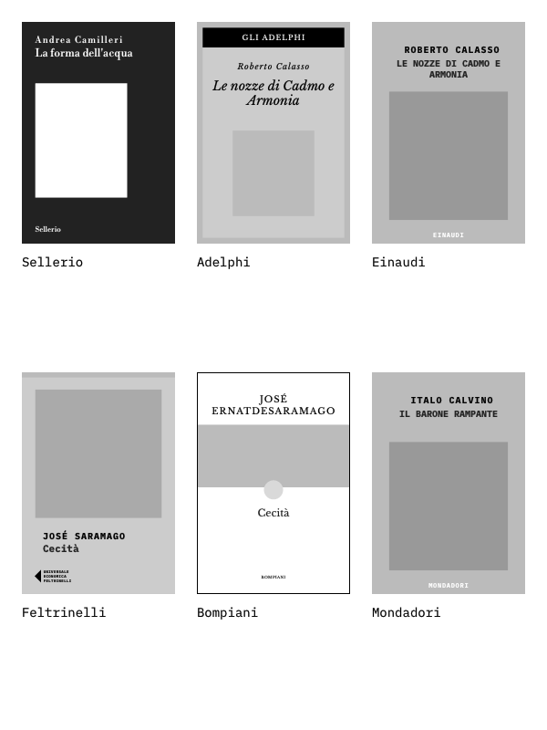
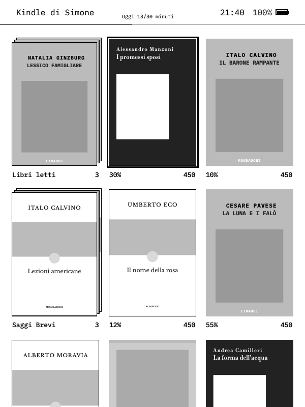
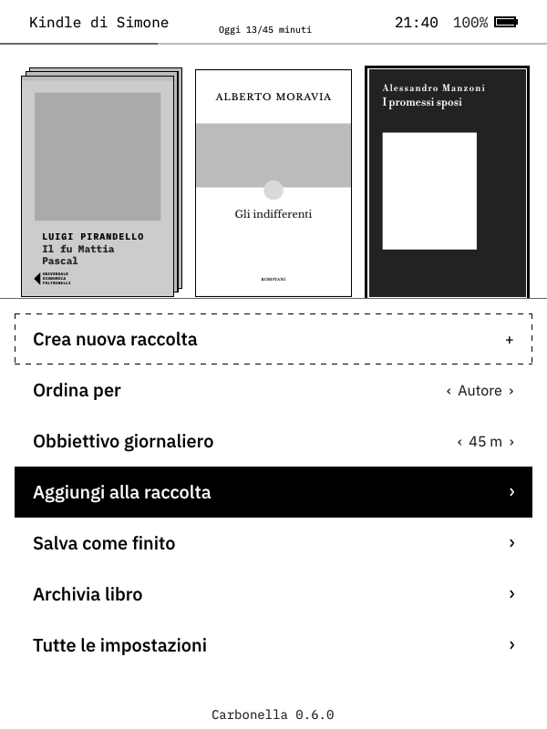
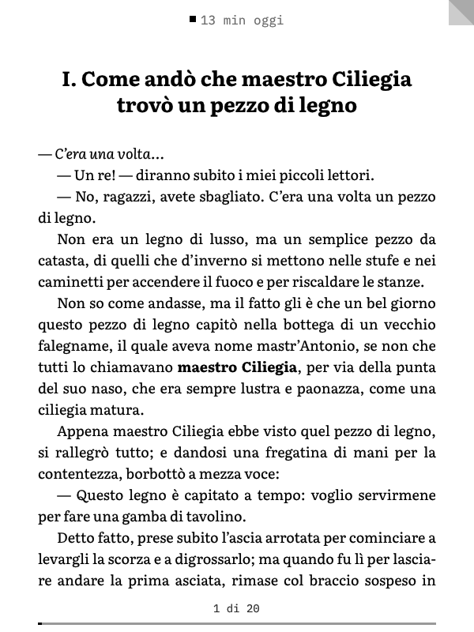
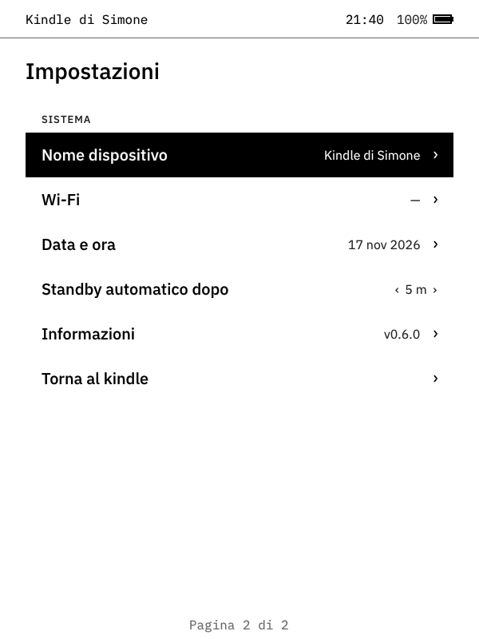

# 17 novembre 2026 · v0.6 "Copertine dagli editori"

**Tempo:** circa 25 minuti (09:55–10:20 UTC), dalle richieste di Simone all'installazione sul Kindle.

## Cosa ha chiesto Simone

> "implementa il tratteggiato in crea nuova raccolta, la nuova linguetta, la notifica dei 30 minuti, le
> nuove impostazioni, la selezione perfettamente quadrata del libro, n" … "etichetta nuovo e il togliere
> la dicitura pagine ma lasciare il numero"

Sulle copertine, prima ha scelto "Immagine vera dell'EPUB", poi ha cambiato idea:

> "No mi sono reso conto che dobbiamo usare i miei nuovi modelli usiamo sempre loro"

## Cosa ho letto in Figma

| Elemento | In Figma | Nel codice |
| --- | --- | --- |
| Crea nuova raccolta | bordo 1 px tratteggiato `[6, 6]`, interno | `dashed_frame` in `ui_menu_row` per la riga con "+" |
| Linguetta (13:344) | vettore 32×32: quadrato #AAA, triangolo in basso a sinistra #CCC | `draw_bookmark_corner` |
| ■ 30 min oggi | quadratino nero 8×8 a 241, testo a 255 | quadratino `G_NERO` |
| Impostazioni pag. 2 | *Standby automatico dopo* "‹  1 m ›" fra Data e ora e Informazioni | nuova voce, righe a 334/390/446 |
| Selezione (Home) | Cornice 181×258, bordo nero 3,2 px interno, copertina ferma a +4,3 | cornice quadrata, la copertina non si sposta più |
| NUOVO | riquadro nero 45×17, testo bianco a +4 | etichetta per ogni libro mai aperto |
| Pagine | "450" senza "pagine" | solo il numero |
| Barra di lettura | testo #222, traccia #999 | `G_GRAFITE`, `G_SMOG` |

Per trovarli ho confrontato i frame con la copia congelata delle 09:36 (pagina Evoluzione) e poi ho
letto direttamente i nodi nuovi, compresi tratteggi e regioni dei vettori.

## Le copertine dai modelli di Simone

I modelli sono in "Libreria componenti" > Frame 6: Sellerio, Adelphi, Einaudi, Feltrinelli e Bompiani,
tutti 240×347.

- **Quale modello**: se `dc:publisher` dell'EPUB contiene uno dei cinque nomi si usa quello. Altrimenti
  il modello si sceglie con un hash di titolo e autore, quindi è sempre lo stesso per lo stesso libro.
- **Il logo**: con il modello del suo editore il libro mostra il logo come in Figma ("GLI ADELPHI",
  "einaudi", il triangolo con "universale economica feltrinelli"…). Con un altro editore, al posto del
  logo c'è il nome del vero editore, vuoto se l'EPUB non lo dice. Così non scriviamo "Sellerio" su un
  libro Mondadori.
- **Titoli lunghi**: il riquadro grigio (o la cornice bianca di Sellerio) scende per fare posto alle
  righe in più. Nel Feltrinelli nome e titolo salgono, perché stanno sopra il logo.
- **Misure**: un modello è scalato in modo uniforme. Nello standby (600×800, più largo del modello) il
  modello è centrato e i lati prendono il colore di sfondo.
- **Caratteri nuovi** (SIL OFL, scaricati da google/fonts, fissati al peso 400 con `fonttools` e ridotti
  all'alfabeto latino con `pyftsubset`): Libre Bodoni, Libre Baskerville normale e corsivo, IBM Plex Mono
  Bold. Sono 185 KB in tutto.
- **Spaziatura delle lettere**: i modelli usano il 10–12%. `model_text` disegna lettera per lettera con
  la spaziatura, va a capo per parole e chiude l'ultima riga con "…".
- `dati/libreria.tsv` ha una colonna in più per l'editore, quindi al primo avvio della v0.6 i libri
  vengono riletti (sul Kindle: 4 libri in 14 ms).
- Le 23 copertine generate non ci sono più (restano nella storia di git).

## Standby automatico dopo

- Si sceglie fra 1, 2, 3, 5 e 10 minuti. Di partenza è 5: il frame mostra "1 m", ma un minuto senza
  tasti capita già leggendo una pagina.
- Il timer di powerd riparte a ogni tasto: Carbonella chiama `touchScreenSaverTimeout` al massimo una
  volta al minuto.
- Dopo il tempo scelto senza tasti, Carbonella chiede lo standby al Kindle. powerd manda
  `goingToScreenSaver` e compare la copertina, come con il tasto di accensione.
- **v0.6.0**: usava `lipc-set-prop com.lab126.powerd powerButton 1`. Il controllo sul Kindle
  (`lipc-probe -v com.lab126.powerd`) ha mostrato che sul K4 quella proprietà non esiste.
- **v0.6.1**: usa `powerd_test -p`, lo strumento di prova di powerd che simula il tasto. È ancora da
  provare sul Kindle vero.

## Prove

- Giro completo del simulatore (`make prova`) e foglio dei modelli (`--copertine`).
- ASan e UBSan sullo stesso giro e sul foglio dei modelli: nessun errore.
- Installazione sul Kindle (v0.6.0): "fonts loaded: 13", nessun errore nel log, `preventScreenSaver` a 0,
  un solo watcher.

## In Figma

- La sezione della v0.5.3 è stata spostata in *Superati*, sulla pagina Evoluzione.
- Nuova sezione **v0.6.1 · sul Kindle**, con le schermate vere del simulatore e una nota con le scelte.
- Nuovo passo nella colonna dell'Evoluzione: "17 nov 10:10 · Sul Kindle: v0.6".
- I frame della Home di Simone hanno ancora le copertine generate. Non li ho toccati: sono suoi.
