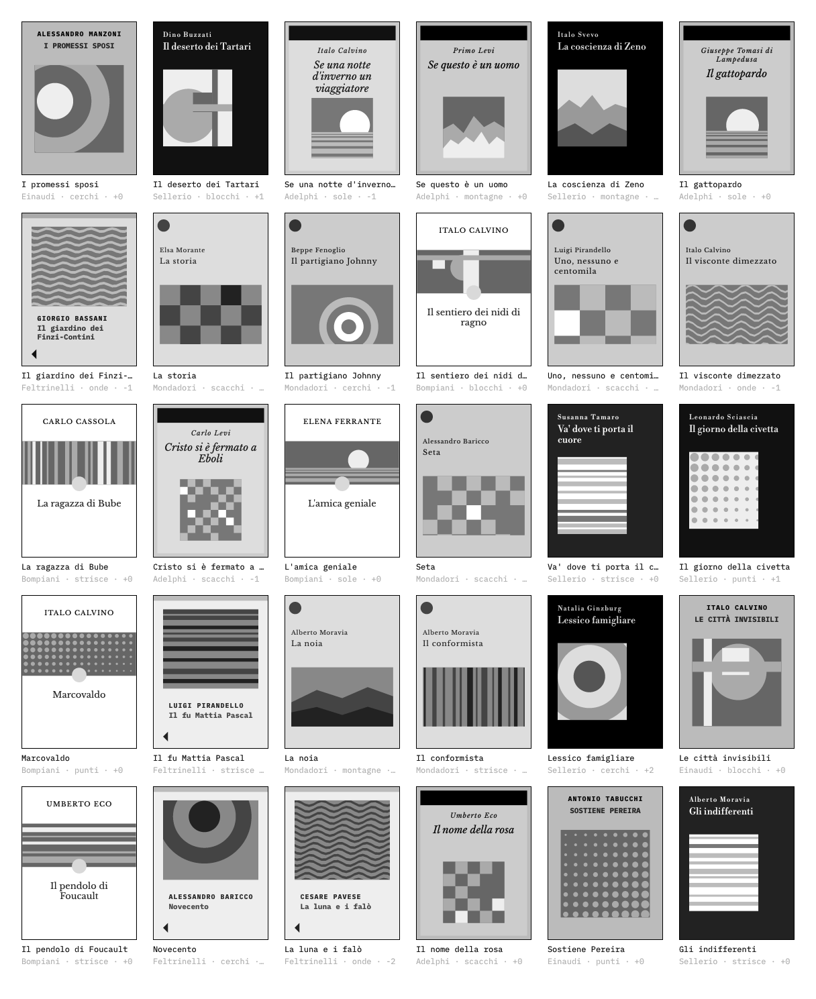
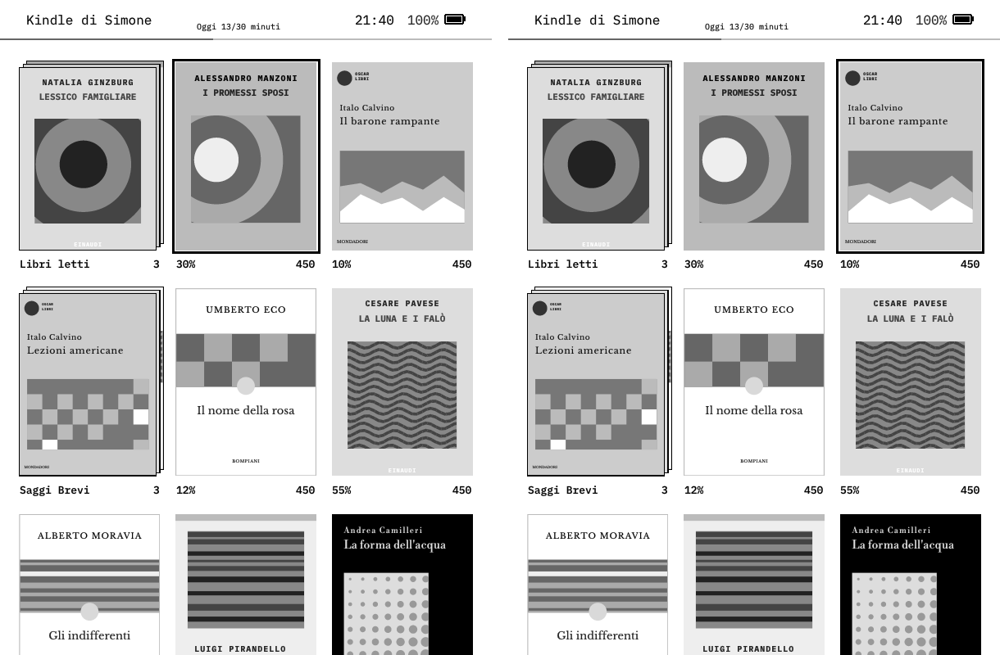
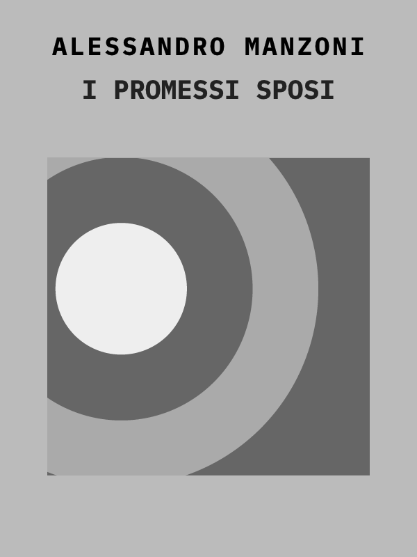

# v1.0.0 "Carbonella" · 17 novembre 2026

Ore (UTC): 10:40 → 11:00 circa, dalle richieste di Simone all'installazione.

## Cosa ha chiesto Simone

- 10:40: "ora cambiami qui l'estetica mettendo i nuovi formati di libri e cambiami anche il formato delle
  raccolte a questo punto" (la Home in Figma).
- "poi manda tutto a kindle con la nuova versione, forse la prima carbonella 1.0.0".
- 10:47: "se riuscissi a versionare anche il modo di avere delle illustrazioni e il cambio di colore
  randomico prima di versionare 1.0.0 sarebbe top".

## Figma

- Nuovo set di componenti **Copertina 3:4** (160×213, un'istanza ridotta dei componenti 600×800 per
  ogni modello). La Home (componente 13:7779) lo usa per tutti i libri: modello scelto dall'editore,
  o dallo stesso calcolo del codice quando l'editore non c'è.
- **Libro griglia**: cornice 168×221, card 168×243. **Raccolte**: pila di tre Copertina 3:4 a 156×208.

## Codice

- I sei modelli riscritti a 600×800 da `Copertine 600×800`: misure, font, spaziature e colori letti dai
  componenti di Simone. L'auto layout (space-between) è imitato: se il titolo prende più righe,
  l'illustrazione scende o si accorcia.
- Griglia della Home: copertina 172×229, cornice 181×238, cella alta 262. Pila 168×224.
- **Grigi a contrasto costante**: tutti i grigi di una copertina si spostano insieme di 0, 1 o 2
  gradini dell'e-ink (17 su 255). Siccome si spostano anche i testi, la differenza sfondo/testo non
  cambia. Il bianco e il nero puri non possono andare oltre, quindi Sellerio (testo bianco) scurisce,
  gli altri (testo nero) schiariscono, Bompiani resta bianco.
- **Illustrazioni generate** dentro "Illustrazione": il seme viene da titolo e autore, quindi un libro
  ha sempre lo stesso disegno, in Home e in standby. Otto motivi con parametri casuali (cerchi
  concentrici, strisce, griglia di punti, sole sull'orizzonte, due creste di montagne, onde, blocchi
  Bauhaus, scacchiera con buchi). Colore del disegno: grigio del rettangolo ±4 gradini, accento ±8.
- Tavola di prova: `carbonella-sim --base build/base --tavola tavola.pgm` salva 30 copertine con
  modello, motivo e gradino sotto ciascuna.

## Il problema della velocità

La prima prova sotto qemu (cortex-a8, soft float come sul Kindle) dava 2–4 s per una copertina a tutto
schermo: le onde e le montagne erano le peggiori. La causa: dischi e poligoni campionavano 16 punti per
ogni pixel del rettangolo che li contiene. Ora `fill_spans` calcola per ogni sotto-riga gli intervalli
dentro la forma e conta i campioni solo lì: stessi pixel, 0,2–0,6 s per copertina, 30 copertine in
1,3 s invece di 4,3. Anche le onde ora sono poligoni (una fascia per onda) invece di polilinee spesse.

## Prove

- `make prova`: giro completo, 139 schermate.
- ASan + UBSan sul giro e sulla tavola: nessun errore.
- Build ARM: `make ZIG="python3 -m ziglang"`.

## Domande aperte per Simone

- I motivi e i gradini sono una prima proposta. Se prepari in Figma le tavole "Combinazioni" (grigi
  approvati) e "Motivi", le seguo parola per parola.
- In Figma il rettangolo si chiama ancora "Illustrazione" (singolare); nel codice il nome non conta.
