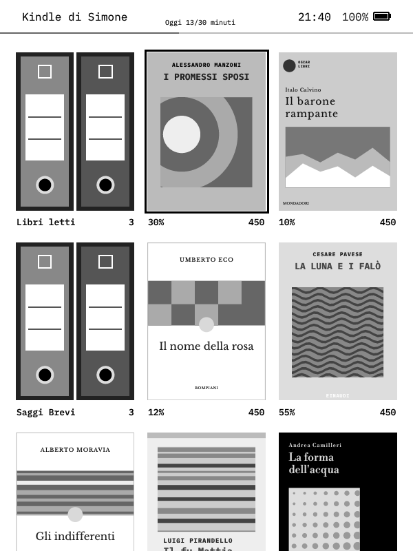
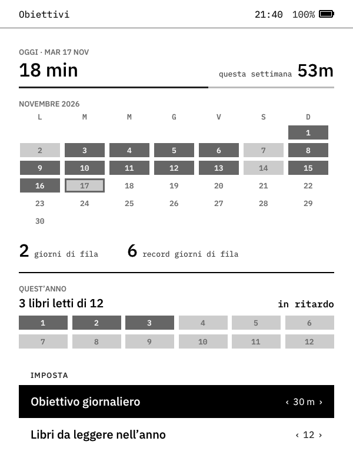

# v1.1.0 "Faldoni e Obiettivi" · 17 novembre 2026

## Cosa ha chiesto Simone

- Ha scelto in Figma il disegno delle raccolte: la proposta "Due faldoni" (componente "Raccolta 600×800 /
  Due faldoni", 99:1927), tra quelle preparate dal thread di design.
- 12:29 UTC, con lo screenshot del nuovo frame Obiettivi (102:2118): "nuovo poi prendi e versiona tutto".

## Come è stata fatta

Da questa versione il lavoro è diviso in thread, uno per ogni compito (regola di Simone, 12:02 UTC):
design, front end, back end, debug e rilasci. Il front end ha scritto il codice, il thread dei rilasci
ha fatto la versione.

| Ora (UTC) | Chi | Cosa |
| --- | --- | --- |
| 12:05–12:06 | front end | Raccolte disegnate come due faldoni, poi ritoccate sul componente di Figma (ea09511, 8aeb599) |
| 12:06–12:32 | front end | Schermata Obiettivi rifatta come il frame 102:2118 (bbaf79e) |
| 12:29–12:45 | rilasci | Numero 1.1.0, CHANGELOG, diario, EVOLUZIONE, zip, etichette git, Figma |

In tutto circa 40 minuti, contando le due parti del lavoro.

## Codice

- **Home**: una raccolta si disegna come due faldoni affiancati, con un quadratino, un'etichetta bianca
  con due righe e un foro tondo. Le etichette restano vuote; nome e numero dei libri sono nella riga sotto,
  come per i libri. Le copertine dei libri non compaiono più sulle raccolte.
- **Obiettivi**, dall'alto in basso come nel frame:
  - intestazione "Obiettivi" con ora e batteria;
  - OGGI · giorno e data, i minuti letti oggi, "questa settimana" con il totale e una barra sottile;
  - il mese in corso: lettere dei giorni (L M M G V S D) e una cella numerata per ogni giorno. Scura se
    quel giorno l'obiettivo è stato raggiunto, grigia se si è letto meno, con il bordo se è oggi;
  - "giorni di fila" e "record giorni di fila";
  - QUEST'ANNO: "N libri letti di M", lo stato ("in linea" o "in ritardo") e una casella numerata per
    ogni libro dell'obiettivo annuale;
  - IMPOSTA: Obiettivo giornaliero (‹ 30 m ›) e Libri da leggere nell'anno (‹ 12 ›);
  - niente piè di pagina.
- `make prova` funziona senza errori e la build ARM compila (verificato dal front end).

## Schermate (simulatore)

## Rilascio

- Pacchetto `carbonella-v1.1.0.zip` nella cartella *rilasci* del progetto, insieme a tutti i precedenti.
  Nello stesso giro: ricostruiti gli zip mai salvati di 0.6.1, 0.6.2, 0.6.3 e 1.0.2, aggiunte le righe
  1.0.1–1.0.6 in [EVOLUZIONE](EVOLUZIONE.md), nuovo passo in Figma.
- Figma, pagina Evoluzione: nuovi passi per v0.6.2/0.6.3, v1.0.6 e v1.1.0.
- **Sul Kindle (12:37 UTC)**: installata dal front end con `make installa` e riavviata. Il log dice "Carbonella
  1.1.0", framebuffer 600×800, tastiera e 5-way presi, 13 caratteri caricati, 9 libri dalla cache in 19 ms,
  refresh completo 54 ms, nessun errore. Non c'è una foto del Kindle: le schermate qui sopra sono del simulatore.
- Etichette git: preparate e verificate (ogni SHA ha in `carbonella.h` la sua versione), ma il push dei tag è
  bloccato dai container cloud. Vanno pubblicate dal Mac con il via libera di Simone.
