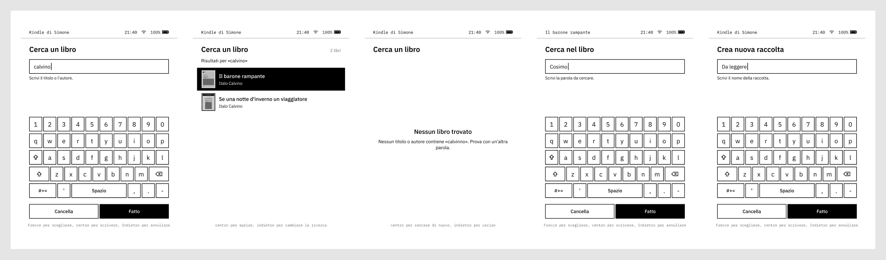
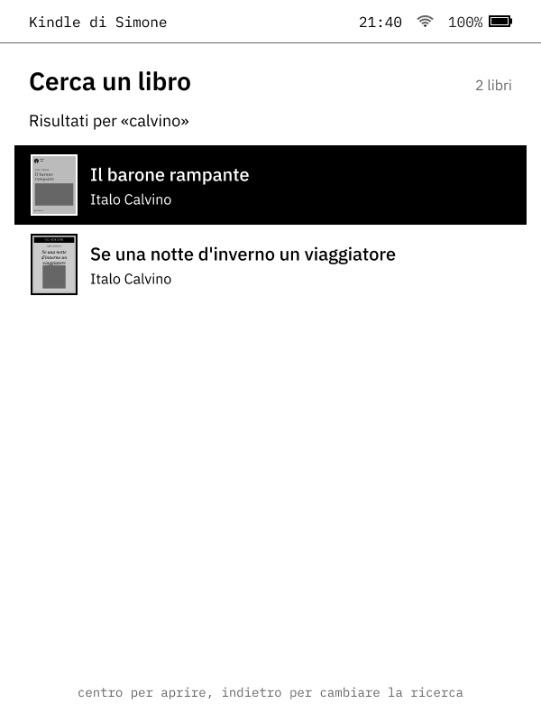

# 18 novembre 2026 · "Cerca un libro" e tastiera in basso (Figma)

Tempo: circa 25 minuti (thread design).

## Richiesta

Simone: "se premo la tastiera dalla home cerca un libro, attenzione che la tastiera me la devi spostare in basso".
Simone ha già spostato la tastiera in basso nella schermata password di Ricevi libri (Corpo "spazio tra":
campo e avviso in alto, tastiera da y 350 fino a y 742). Le nuove schermate partono da quella.

## Figma

Nuova sezione "Tastiera in basso (18 nov)" sotto Ricevi libri (node 142:2679). Header Standard, Wi-Fi Connesso.
Misure comuni: titolo a y 72, campo 536×56 a y 128, avviso 16 px a y 190, `Tastiera` a y 350, piede a y 758.

**Cerca un libro · 1 · scrivi** (142:2681), si apre col tasto Tastiera dalla Home
- Titolo `Cerca un libro` · avviso `Scrivi il titolo o l'autore.`
- Piede `Frecce per scegliere, centro per scrivere, Indietro per annullare`. `Fatto` avvia la ricerca.

**Cerca un libro · 2 · risultati** (142:2817)
- Titolo `Cerca un libro`, a destra `2 libri` (Cenere G6, 16 px; `1 libro` al singolare).
- Sotto il titolo `Risultati per «calvino»` (18 px).
- Righe a tutta larghezza (568, x 16): copertina 48×64 con bordo 2 px, titolo 20 px Medium, autore 16 px,
  padding 12/20, spazio 16. Riga col focus in negativo (bordo copertina bianco).
- Piede `centro per aprire, indietro per cambiare la ricerca`.

**Cerca un libro · 3 · nessun libro** (142:2987)
- `Nessun libro trovato` (24 Medium) · `Nessun titolo o autore contiene «calvinno». Prova con un'altra parola.`
- Piede `centro per cercare di nuovo, indietro per uscire`.

**Cerca nel libro · tastiera** (142:3123)
- Header a sinistra il titolo del libro · titolo `Cerca nel libro` · avviso `Scrivi la parola da cercare.`

**Crea nuova raccolta · tastiera** (142:3259)
- Titolo `Crea nuova raccolta` · avviso `Scrivi il nome della raccolta.`

