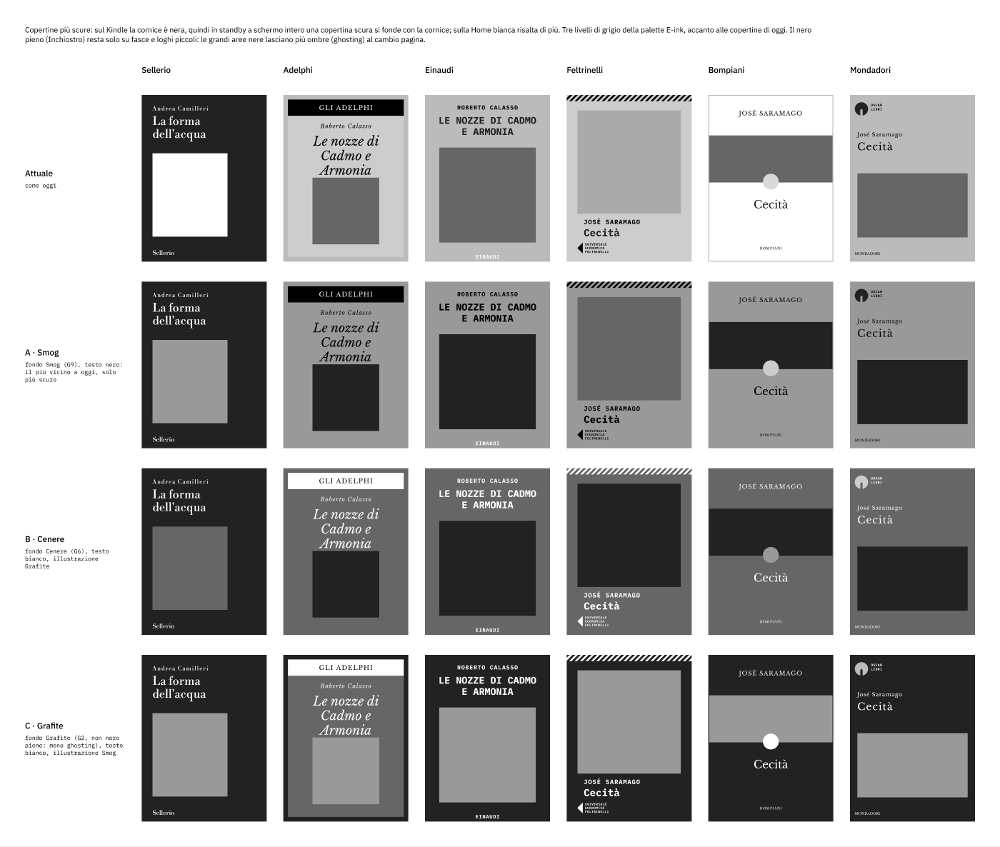
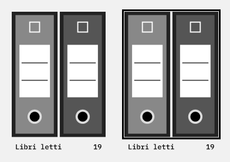

# 18 novembre 2026 · Copertine scure (proposte) e componenti aggiornati

Tempo: circa 35 minuti (14:36–15:10 UTC).

## Copertine scure · proposte colore

Simone: "preparali ma per ora non li impostare, prepara varie versioni colore". Il Kindle ha la cornice nera: in standby a schermo intero una copertina scura si fonde con la cornice, e sulla Home bianca risalta di più.

Nuova sezione Figma **"Copertine scure · proposte colore (18 nov)"**, sotto i modelli 600×800. Per ognuno dei sei editori, la copertina di oggi e tre versioni più scure, tutte istanze dei modelli (i modelli non sono cambiati, il codice nemmeno):

- **A · Smog**: fondo Smog (G9), testo nero. La più vicina a oggi.
- **B · Cenere**: fondo Cenere (G6), testo bianco, illustrazione Grafite.
- **C · Grafite**: fondo Grafite (G2), testo bianco, illustrazione Smog.

Il nero pieno resta solo su fasce e loghi piccoli: le grandi aree nere lasciano più ombre al cambio pagina. Sellerio è già scura: nelle proposte cambia solo l'illustrazione.

## Libreria componenti

Simone: "aggiorna tutto questo lato del figma" e "metti in evoluzione tutto quello che togli".

- Nuovo componente **Raccolta griglia** (Normale e Focus), costruito come `Libro griglia`: i due faldoni al posto della copertina, sotto nome e numero. La Home usa ora due istanze di questo componente al posto dei frame del 17 novembre.
- Spostati in Evoluzione › Superati: **Raccolte** (pila di copertine, nessuna istanza rimasta) e **Copertina** con i 23 stili generati (usato solo dalle copie in Evoluzione, che restano collegate).
- `Copertina 3:4`, `Libro griglia`, `Batteria icona` erano già allineati ai modelli attuali.
- `Cartella`, `Riga archivio` e `Riga libro` servono solo alla vista a elenco (`01 · Libreria Text`), che nel codice non c'è ancora: lasciati come sono.

