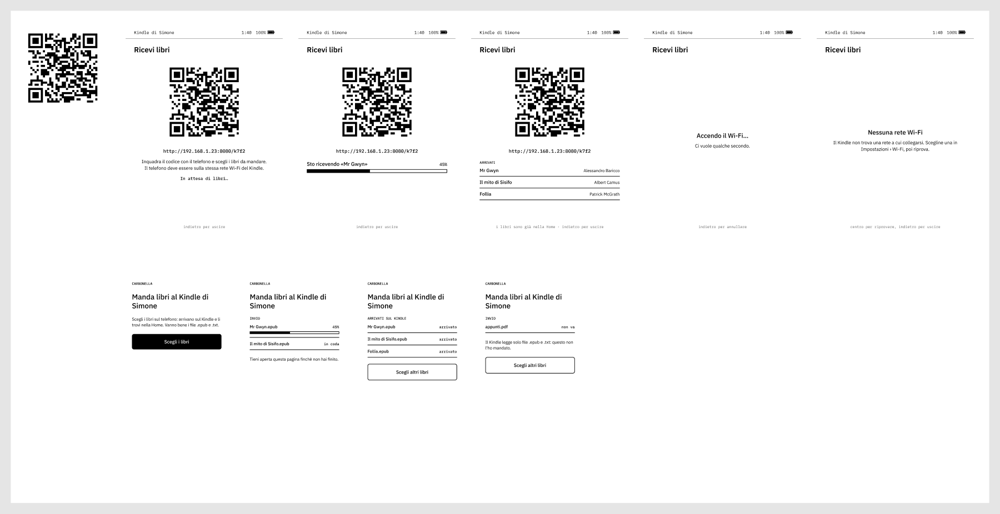

# 18 novembre 2026 · Figma: "Ricevi libri" (Kindle e telefono)

Tempo: circa 20 minuti (15:52–16:12 UTC).

Richiesta del back end per Simone: una schermata che accende un piccolo server sul Kindle e mostra un QR code; col telefono si apre una pagina web e si mandano gli EPUB, che finiscono nella Home. Deve essere facile anche per gli amici a cui Simone regala i Kindle.

Nuova sezione Figma **"Ricevi libri (18 nov)"**, sotto le proposte di copertine scure.

**Kindle (600×800), cinque stati:**
1. *in attesa*: QR 320×320 (bordo bianco compreso), sotto l'indirizzo in chiaro, "Inquadra il codice con il telefono e scegli i libri da mandare. / Il telefono deve essere sulla stessa rete Wi-Fi del Kindle.", "In attesa di libri…".
2. *sto ricevendo*: "Sto ricevendo «Mr Gwyn»", "45%", barra come in Obiettivi.
3. *ricevuti*: "ARRIVATI" e gli ultimi tre libri (titolo e autore); piede "i libri sono già nella Home · indietro per uscire".
4. *accendo il Wi-Fi*: "Accendo il Wi-Fi…", "Ci vuole qualche secondo.", piede "indietro per annullare".
5. *nessuna rete*: "Nessuna rete Wi-Fi", "Il Kindle non trova una rete a cui collegarsi. Scegline una in Impostazioni › Wi-Fi, poi riprova.", piede "centro per riprovare, indietro per uscire".

Il QR in Figma è un segnaposto (componente "QR"): quello vero lo genera il back end.

**Telefono (390×844), quattro stati:** "CARBONELLA", titolo "Manda libri al Kindle di Simone" (il nome viene da Impostazioni › Nome dispositivo), pulsante nero "Scegli i libri"; durante l'invio elenco dei file con percentuale o "in coda" e "Tieni aperta questa pagina finché non hai finito."; alla fine "ARRIVATI SUL KINDLE" e il pulsante "Scegli altri libri"; per un file non adatto "non va" e "Il Kindle legge solo file .epub e .txt: questo non l'ho mandato."

