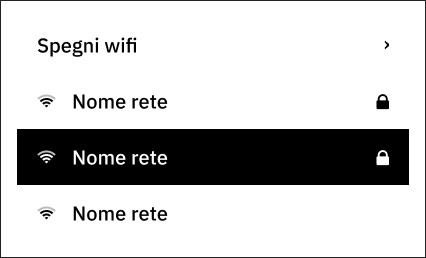
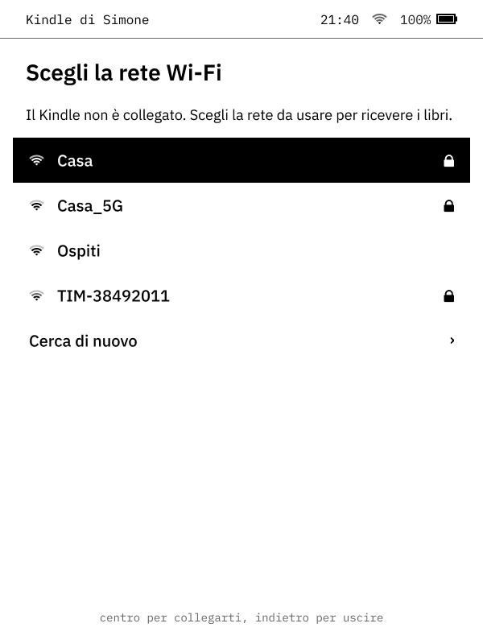
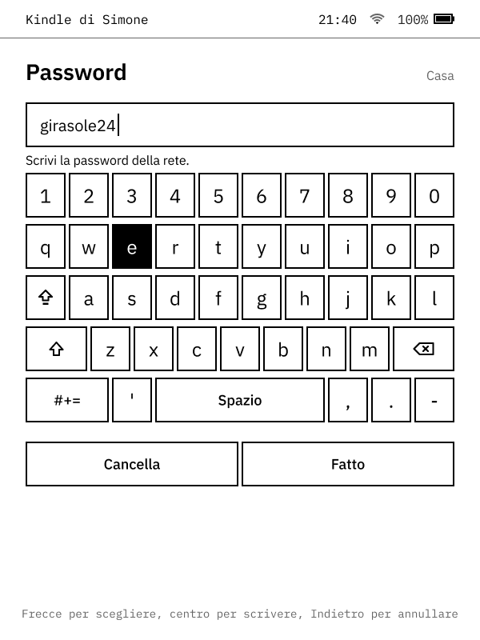
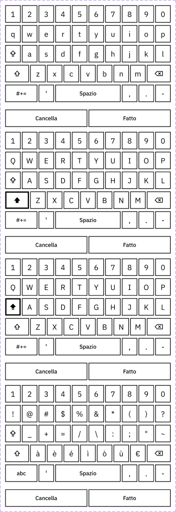

# 18 novembre 2026 · Scegliere il Wi-Fi dentro "Ricevi libri" (Figma)

Tempo: circa 60 minuti (thread design).

## Richiesta

Simone, guardando lo stato "Nessuna rete Wi-Fi" che rimandava a Impostazioni › Wi-Fi:
"non farmi tornare indietro, voglio selezionare qui il wifi".

## Cosa è cambiato in Figma

Il vecchio stato 5 è in Evoluzione › Superati (con nota del 18 nov). Nella sezione Ricevi libri, riga
Kindle, ora ci sono questi stati dopo "4 · accendo il Wi-Fi". Header con l'icona Wi-Fi `Senza rete`.

Testi da usare parola per parola:

**5 · scegli la rete**
- Titolo: `Scegli la rete Wi-Fi`
- Testo: `Il Kindle non è collegato. Scegli la rete da usare per ricevere i libri.`
- Righe: la riga Wi-Fi di Simone (`Voce menu`, Stato `Wifi` / `Wifi Focus`): icona del segnale a sinistra
  (`Segnale Wi-Fi`: Forte / Medio / Debole), nome della rete, lucchetto a destra se protetta.
  Esempi: Casa, Casa_5G, Ospiti, TIM-38492011.
- Ultima riga: `Cerca di nuovo` con `›`.
- Piede: `centro per collegarti, indietro per uscire`

**6 · nessuna rete trovata**
- Titolo: `Scegli la rete Wi-Fi` · `Nessuna rete trovata` · `Avvicina il Kindle al router e riprova.`
- Piede: `centro per cercare di nuovo, indietro per uscire`

**7 · password** (solo per reti con lucchetto)
- Titolo: `Password`, a destra il nome della rete in Cenere G6 (16 px).
- Campo 536×56 a y 128, sotto: `Scrivi la password della rete.`
- `Tastiera` da y 216 (vedi sotto).
- Piede: `Frecce per scegliere, centro per scrivere, Indietro per annullare` (uguale alla tastiera esistente).

**8 · mi collego**
- `Mi collego a «Casa»…` · `Ci vuole qualche secondo.` · piede `indietro per annullare`

**9 · password sbagliata**
- Come 7, il testo resta nel campo; sotto, in Medium: `Password sbagliata, riprova.` Il focus parte da `Cancella`.

Quando il collegamento riesce si torna da soli allo stato 1 (QR). Per le reti aperte si salta la password.

## Aggiornamento (16:05): menù Wi-Fi di Simone, lucchetto, tastiera vera

- Simone ha disegnato il menù Wi-Fi (`Pannello menu`, variante 5): `Spegni wifi ›` e le reti con icona
  Wi-Fi e nome, quella scelta in negativo. Ha chiesto il lucchetto per le reti con password: aggiunto
  alle righe `Wifi` e `Wifi Focus` di `Voce menu`, a destra, 12,5×16 px, con la proprietà `Protetta`
  (nella riga in negativo il lucchetto è bianco, Carta G14). L'elenco di Ricevi libri ora usa le sue righe;
  il mio componente `Rete Wi-Fi` è in Evoluzione › Superati.
- Tastiera: "rendila più tastiera con back space e tasto per maiuscolo e caps lock" e "cancella e fatto
  mettili sotto". Nuovo componente condiviso `Tastiera` (vale anche per Cerca nel libro e Crea raccolta),
  varianti `Minuscole`, `Maiuscola`, `Blocco maiuscole`, `Simboli`. La vecchia è in Superati.
  - Tasti 50×56, spazio 4, righe ogni 64 px da y 216:
    1. `1 2 3 4 5 6 7 8 9 0`
    2. `q w e r t y u i o p`
    3. `⇪` (blocco maiuscole, 50) `a s d f g h j k l`
    4. `⇧` (maiuscolo, 77) `z x c v b n m` `⌫` (cancella una lettera, 77)
    5. `#+=` (104) `'` `Spazio` (212) `,` `.` `-`
  - Sotto, a y 552 (24 px di stacco): `Cancella` e `Fatto`, 266×56 ciascuno.
    `Cancella` svuota tutto il campo (il `⌫` toglie una lettera alla volta); `Fatto` conferma.
  - `⇧` vale per una sola lettera, poi torna minuscolo; `⇪` resta finché non lo ripremi.
    Tasto attivo: bordo 4 px e freccia piena.
  - `Simboli` (`#+=`, poi il tasto diventa `abc`): riga 2 `! @ # $ % & * ( ) ?`,
    riga 3 `⇪ _ + = / \ : ; " ~`, riga 4 `⇧ à è é ì ò ù € ⌫`.
  - Icone `⇧ ⇪ ⌫` disegnate a vettore (componente `Tasto speciale`), tratto 2 px Inchiostro.

