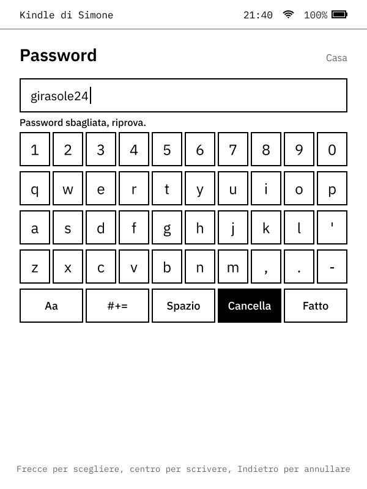
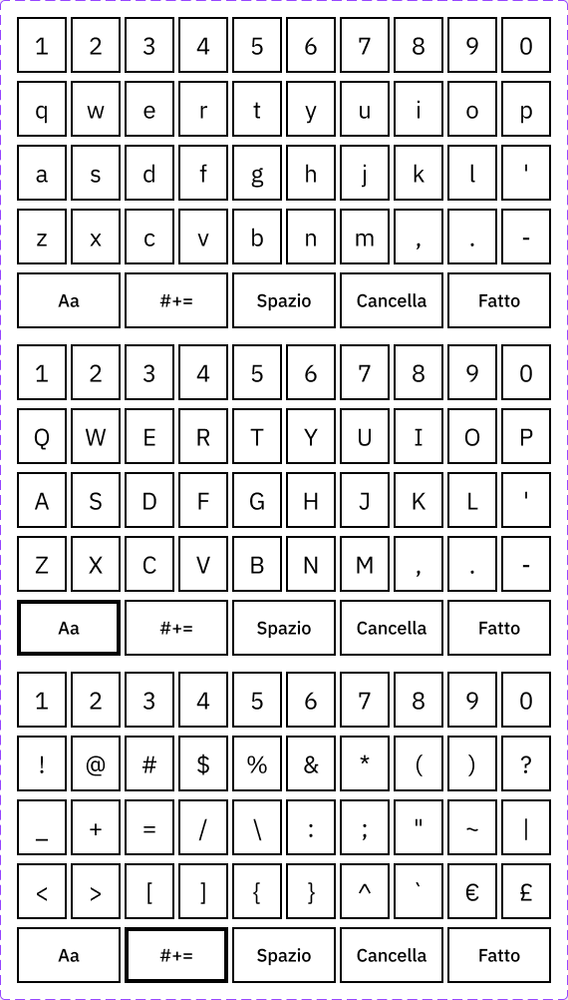

# 18 novembre 2026 · Scegliere il Wi-Fi dentro "Ricevi libri" (Figma)

Tempo: circa 35 minuti (thread design).

## Richiesta

Simone, guardando lo stato "Nessuna rete Wi-Fi" che rimandava a Impostazioni › Wi-Fi:
"non farmi tornare indietro, voglio selezionare qui il wifi".

## Cosa è cambiato in Figma

Il vecchio stato 5 è in Evoluzione › Superati (con nota del 18 nov). Nella sezione Ricevi libri, riga
Kindle, ora ci sono questi stati dopo "4 · accendo il Wi-Fi". Header con l'icona Wi-Fi `Senza rete`.

Testi da usare parola per parola:

**5 · scegli la rete**
- Titolo: `Scegli la rete Wi-Fi`
- Testo: `Il Kindle non è collegato. Scegli la rete da usare per ricevere i libri.`
- Righe (componente `Rete Wi-Fi`, Normale/Focus): nome della rete, lucchetto se protetta, segnale
  (`Segnale Wi-Fi`: Forte / Medio / Debole). Esempi: Casa, Casa_5G, Ospiti, TIM-38492011.
- Ultima riga: `Cerca di nuovo` con `›`.
- Piede: `centro per collegarti, indietro per uscire`

**6 · nessuna rete trovata**
- Titolo: `Scegli la rete Wi-Fi` · `Nessuna rete trovata` · `Avvicina il Kindle al router e riprova.`
- Piede: `centro per cercare di nuovo, indietro per uscire`

**7 · password** (solo per reti con lucchetto)
- Titolo: `Password`, a destra il nome della rete in Cenere G6 (16 px).
- Campo 536×56 a y 128 (come la tastiera già nel codice), sotto: `Scrivi la password della rete.`
- `Tastiera password` a y 216: tasti 50×56, spazio 4, righe ogni 64 px.
  Righe: `1234567890` / `qwertyuiop` / `asdfghjkl'` / `zxcvbnm,.-` / `Aa` `#+=` `Spazio` `Cancella` `Fatto` (104 px).
  `Aa` passa alle maiuscole, `#+=` ai simboli (`!@#$%&*()?`, `_+=/\:;"~|`, `<>[]{}^`€£`);
  il tasto attivo ha il bordo da 4 px.
- Piede: `Frecce per scegliere, centro per scrivere, Indietro per annullare` (uguale alla tastiera esistente).

**8 · mi collego**
- `Mi collego a «Casa»…` · `Ci vuole qualche secondo.` · piede `indietro per annullare`

**9 · password sbagliata**
- Come 7, il testo resta nel campo; sotto, in Medium: `Password sbagliata, riprova.`

Quando il collegamento riesce si torna da soli allo stato 1 (QR). Per le reti aperte si salta la password.

Nuovi componenti in Libreria: `Lucchetto`, `Segnale Wi-Fi`, `Rete Wi-Fi`, `Tasto` (Normale/Focus/Attivo),
`Tastiera password` (Minuscole/Maiuscole/Simboli).

