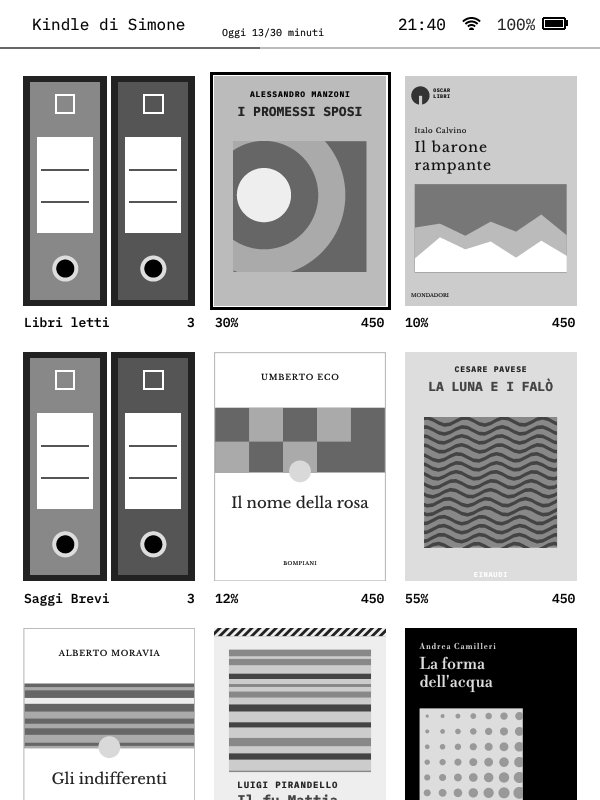
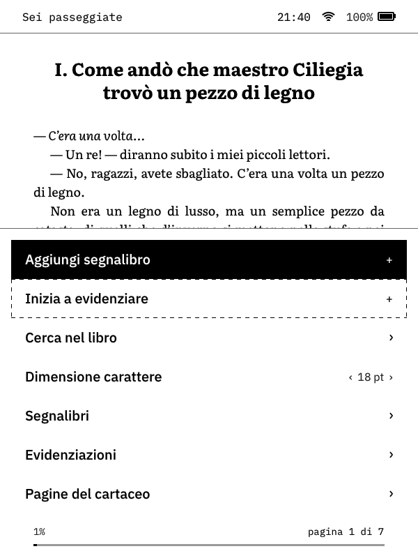
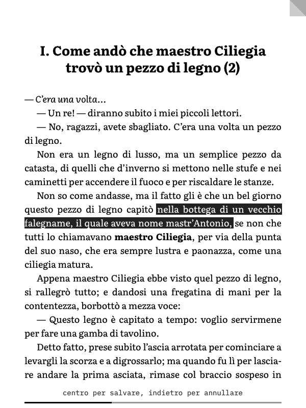
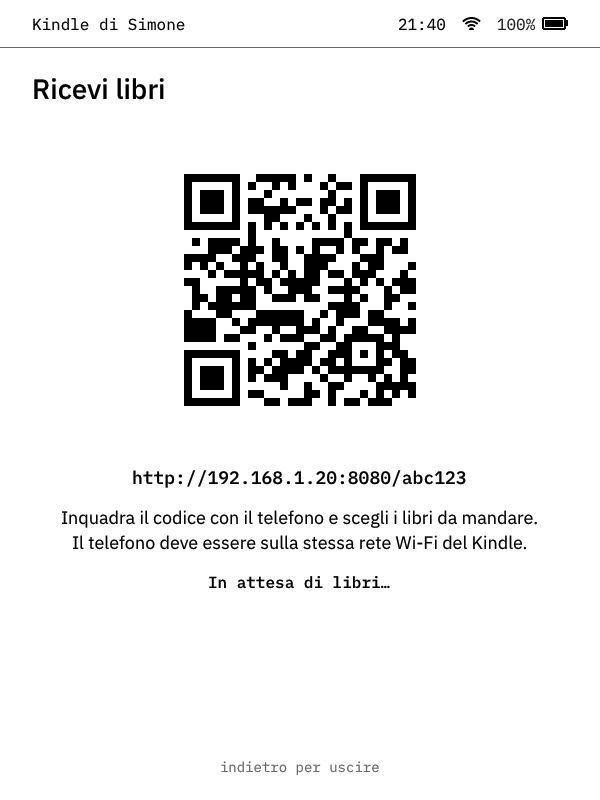
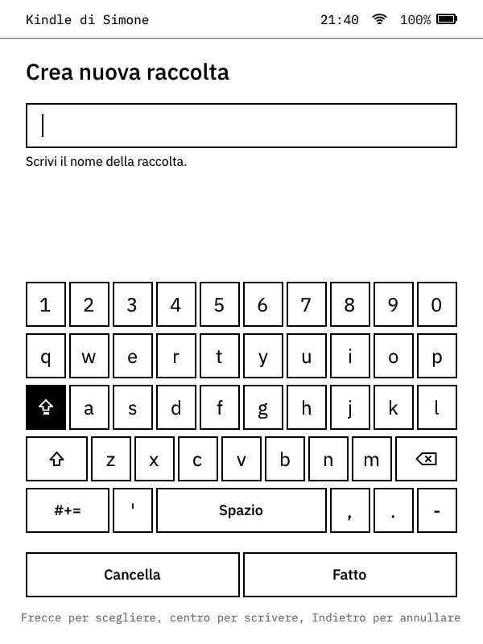

# v1.2.0 "Ricevi libri" · 18 novembre 2026

Simone, 18 nov 17:15 UTC: "aggiorna anche la versione, a che versione siamo?", poi "manda anche a github".

La 1.2.0 raccoglie tutto quello che è stato fatto dopo la 1.1.0, dal 17 nov alle 12:39 al 18 nov alle
17:10 UTC. In tutto sono 33 commit di codice, scritti dal front end e dal back end, più i diari del design e
del collaudo. Le novità sono elencate nel [CHANGELOG](../CHANGELOG.md#v120--2026-11-18--ricevi-libri).

## Chi ha fatto cosa

| Quando (UTC) | Thread | Cosa | Diario |
| --- | --- | --- | --- |
| 17 nov 12:39–12:53 | front end | Niente standby durante la lettura; il tempo di lettura si ferma dopo 5 min | — |
| 17 nov 14:05–18:44 | back end + front end | Pagine del cartaceo: lettura dall'EPUB, tabella, voce nel menu, Home | [pagine-cartacee](2026-11-17-pagine-cartacee.md), [figma-pagine-del-cartaceo](2026-11-17-figma-pagine-del-cartaceo.md) |
| 17 nov 16:26–18:44 | front end | Feltrinelli e Mondadori, batteria in carica, avviso di 5 s | — |
| 18 nov 14:40–14:56 | design + front end | Evidenziare, capitoli col pad, nuovo menu di lettura e Impostazioni | [evidenziazione-e-libreria](2026-11-18-evidenziazione-e-libreria.md) |
| 18 nov 15:50–16:56 | back end + front end + design | Ricevi libri con QR, server, Wi-Fi, reti salvate, tastiera nuova | [ricevi-libri-server](2026-11-18-ricevi-libri-server.md), [ricevi-libri](2026-11-18-ricevi-libri.md), [wifi-e-ricevi-libri](2026-11-18-wifi-e-ricevi-libri.md), [scegli-rete-wifi](2026-11-18-scegli-rete-wifi.md) |
| 18 nov 16:58–17:10 | front end | Obiettivi come il nuovo Figma, Cerca un libro dalla Home, tastiera in basso | [cerca-un-libro](2026-11-18-cerca-un-libro.md) |
| 18 nov | design | Copertine scure: solo proposte in Figma, non nel codice | [copertine-scure-e-componenti](2026-11-18-copertine-scure-e-componenti.md) |
| 18 nov 17:15–17:35 | rilasci | Numero, CHANGELOG, diario, zip, Figma, GitHub | questo file |

## Schermate (simulatore, `make prova`)

## Rilascio

- `make prova` funziona senza errori e la build ARM compila. Il pacchetto è `carbonella-v1.2.0.zip`, nella
  cartella *rilasci* del progetto.
- Sul Kindle è installata la d6d663e (Obiettivi). L'ultimo pezzo, Cerca un libro, aspetta che il Kindle sia
  di nuovo collegato: lo installa il front end.
- Nello stesso giro ho unito al ramo di rilascio i diari che stavano solo sui rami del design (37 commit) e
  del collaudo (2 commit). Così il diario completo è in un ramo solo.

## GitHub: com'era e cosa manca

Simone ha chiesto se ci eravamo dimenticati GitHub. Lo stato al 18 nov, 17:20 UTC:

- **Il codice c'era tutto**: ogni thread ha sempre fatto il push sul suo ramo `claude/project-thread-*`.
  Il repository sul Mac è allineato a GitHub, senza commit solo locali.
- **Mancava l'ordine**: `main` contiene ancora solo lo scheletro del 16 nov. Il lavoro sta in PR aperte,
  una sopra l'altra (#1 ← #4 ← #5), più la #2 (design) e la #3 (proposta delle pagine cartacee).
- **Mancano le etichette e i rilasci**: su GitHub non ci sono tag né release. I container cloud non possono
  fare il push dei tag (errore 403) e gli strumenti GitHub che abbiamo non creano release. I tag si possono
  fare dal Mac con il via libera di Simone; le release con gli zip si caricano dal sito di GitHub o con `gh`
  sul Mac.
