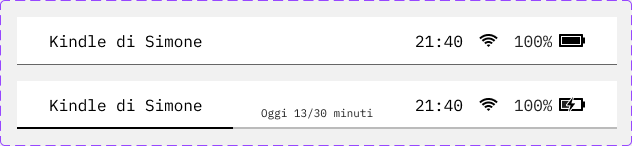
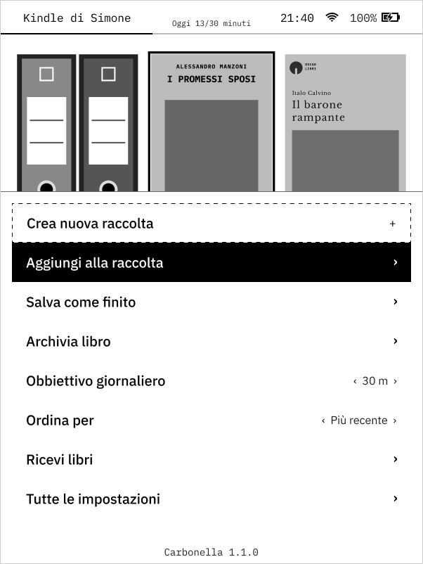

# 18 novembre 2026 · Icona Wi-Fi e voce "Ricevi libri" (Figma)

Tempo: circa 25 minuti (thread design).

## Cosa ha chiesto Simone

"ok proviamo a farlo aggiungi prima su figma poi su kindle un'icona wifi": via libera alla voce
"Ricevi libri" nel menù della Home e una nuova icona Wi-Fi nell'header, prima in Figma e poi sul Kindle.

## Cosa è cambiato in Figma

- Prima delle modifiche: istantanea in Evoluzione ("18 nov · prima di Ricevi libri e Wi-Fi") con il
  menù Home e l'header di prima. Le istanze dell'header dentro Evoluzione sono state staccate (21),
  così le istantanee storiche non cambiano.
- **Menù Home** (Pannello menu › Home): nuova riga **`Ricevi libri`** con freccia `›`, subito sopra
  `Tutte le impostazioni`. Stesso componente riga, nessun valore a destra.
- **Nuovo componente `Wi-Fi icona`** (Libreria componenti, sotto `Batteria icona`), 19×13 px come la
  batteria, colori dagli stili E-ink salvati:
  - `Stato=Connesso`: punto e tre archi in Inchiostro G0.
  - `Stato=Senza rete`: punto in Inchiostro, archi in Cenere G6 (Wi-Fi acceso ma non collegato).
  - `Stato=Spento`: archi in Cenere G6 con barra diagonale Inchiostro da 2 px.
  - Archi spessi 2 px, spazio 1,5 px: raggi (dal punto in basso al centro) 0–2,5 · 4–6 · 7,5–9,5 · 11–13,
    spicchio di 90° (da -135° a -45°).
- **Header** (Standard e Lettura): ordine a destra `Ora` · `Wi-Fi` · `Batteria`, spazio 16 px.
  "Destra" ora si adatta al contenuto (170 px); nella variante Lettura anche la colonna di sinistra è
  170 px, così il titolo centrale resta centrato.

## Passaggi agli altri thread

- Front end: disegnare l'icona sul Kindle (stessa geometria) nell'header, a sinistra della batteria, e
  aggiungere la voce `Ricevi libri` nel menù Home.
- Back end: fornire lo stato Wi-Fi (connesso / senza rete / spento) e collegare `Ricevi libri` alla
  schermata già disegnata (vedi [ricevi-libri](2026-11-18-ricevi-libri.md)).
