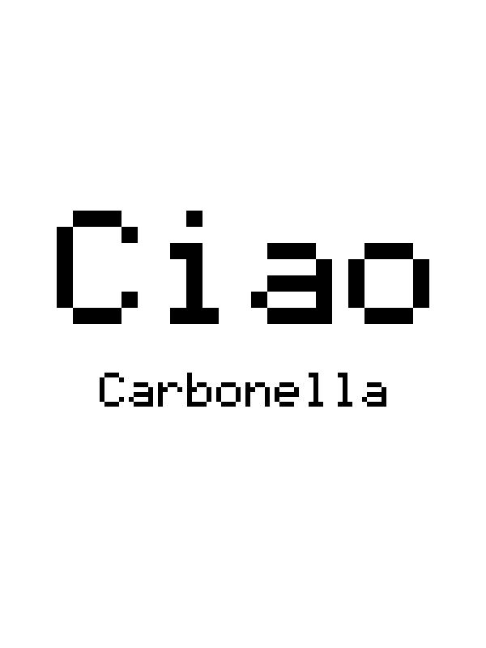

# Esperimento 01 · "Ciao" sullo schermo e-ink

Il primo programma nativo di Carbonella: scritto in C, compilato sul Mac per il processore ARM del
Kindle 4, copiato via `scp` e avviato via SSH. Disegna **"Ciao"** e, sotto, **"Carbonella"**.



*(Anteprima generata al computer con lo stesso codice di disegno, 600×800.)*

## Come funziona, in breve

1. Apre il **framebuffer** `/dev/fb0`: è la memoria in cui ogni byte (o mezzo byte) è un pixel dello schermo.
2. La "mappa" in memoria con `mmap`, la riempie di bianco e disegna le lettere con un mini font 5×7
   scritto a mano dentro `ciao.c` (si vede la forma delle lettere fatta di `#` e `.`), ingrandito.
3. Chiede al driver e-ink di aggiornare lo schermo (`ioctl FBIO_EINK_UPDATE_DISPLAY`, il driver
   "einkfb" dei Kindle 2/3/4). Se non funziona, prova `/proc/eink_fb/update_display`.

Non usa librerie esterne. Per i font veri useremo [FBInk](https://github.com/NiLuJe/FBInk) più avanti.

**Perché Zig?** È il modo più semplice per cross-compilare dal Mac: un solo programma da installare,
include già il compilatore C e la libreria `musl` per ARM. Compiliamo **statico** (tutto dentro un
unico file) così non dipendiamo dalle librerie del Kindle, che sono del 2011.

## Comandi (dal Mac)

Una volta sola, installa Zig con [Homebrew](https://brew.sh):

```sh
brew install zig
```

Poi, dalla cartella del repository:

```sh
cd esperimenti/01-ciao
make                 # crea build/ciao (circa 30 KB)
file build/ciao      # deve dire: ELF 32-bit LSB executable, ARM ... statically linked
```

Con USBNetwork attivo, copia e avvia sul Kindle (ti chiederà la password di root, anche più volte):

```sh
ssh root@192.168.15.244 "mkdir -p /mnt/us/carbonella"
scp -O build/ciao root@192.168.15.244:/mnt/us/carbonella/ciao
ssh root@192.168.15.244 "chmod +x /mnt/us/carbonella/ciao; /mnt/us/carbonella/ciao"
```

Oppure tutto insieme: `make run`.

`-O` dice a `scp` di usare il protocollo classico: i Mac recenti usano SFTP, che il server SSH del
Kindle potrebbe non avere.

`/mnt/us` è la memoria dei libri vista dal Kindle (la stessa che vedi come disco USB): non serve
`mntroot rw` e il sistema non viene toccato. Dopo un riavvio troverai il file anche nella cartella
`carbonella/` del disco `Kindle`.

### Cosa deve succedere

Sul terminale compare una riga tipo

```
framebuffer: id=... 600x800 (virtual ...) bpp=8 line_length=... grayscale=...
refresh: ioctl FBIO_EINK_UPDATE_DISPLAY ok
```

e lo schermo del Kindle lampeggia e mostra "Ciao". **Copia quella riga nel diario**: ci dice com'è
fatto il framebuffer del K4, ci servirà per Carbonella.

L'interfaccia di Amazon è ancora attiva: appena premi un tasto (o parte il salvaschermo) ridisegna
lo schermo sopra il nostro "Ciao". È normale. Per fare la foto, non toccare il Kindle.

## Se qualcosa non va

| Sintomo | Cosa fare |
|---------|-----------|
| `make: zig: No such file or directory` | Manca Zig: `brew install zig`. |
| `scp: Connection closed` o errore su `sftp` | Hai dimenticato `-O` in `scp`. |
| `Permission denied` avviando il programma | La memoria `/mnt/us` potrebbe non permettere di eseguire file. Usa `/tmp`: `scp -O build/ciao root@192.168.15.244:/tmp/ciao` e poi `ssh root@192.168.15.244 "chmod +x /tmp/ciao; /tmp/ciao"` (in `/tmp` sparisce al riavvio). |
| Il terminale dice `ok` ma lo schermo non cambia | Prova a forzare l'aggiornamento: `ssh root@192.168.15.244 "eips ''"`. Annota il risultato nel diario. |
| Lo schermo è "in negativo" (scritte bianche su nero) | Il K4 usa i colori al contrario: avvia con `/mnt/us/carbonella/ciao -i`. |
| `Illegal instruction` o `not found` | Incolla l'output nel thread: è un problema di compilazione, lo sistemiamo. |

Non c'è rischio di brick: il programma scrive solo nella memoria dello schermo.
